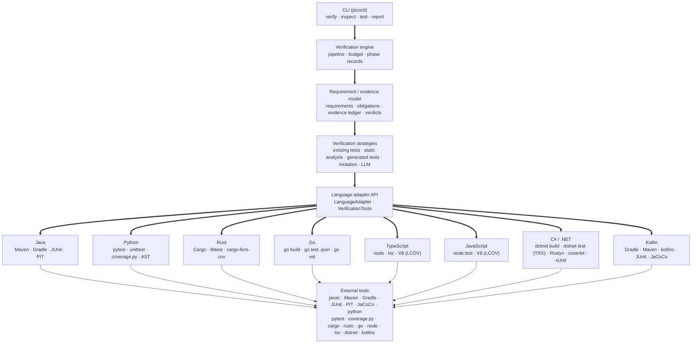

# CodeWitness architecture

This document explains how the system is put together, and — more importantly — why the verification
rules are what they are. The rules exist to stop a verification tool from becoming an oracle.

## 1. The central abstraction: an evidence chain

Everything in CodeWitness exists to make this chain machine-checkable:

```
CLAIM                    a requirement, in natural language, written by a human
   ↓
OBLIGATION               a concrete experiment that would demonstrate the claim
   ↓
EXPERIMENT               an executed tool run: a build, a test, a fuzzer, an analyzer
   ↓
OBSERVATION              what the tool actually printed or returned
   ↓
EVIDENCE                 the observation, stored with its command, inputs and confidence
   ↓
CONCLUSION               VERIFIED / PARTIALLY_VERIFIED / FAILED / UNVERIFIED / BLOCKED
```

Each arrow is a place where a verification tool usually starts lying. CodeWitness closes them:

- An obligation that no experiment can discharge stays visible as `unknownAspects` rather than being
  quietly dropped.
- An experiment that could not run produces an `INCONCLUSIVE` record with the failure reason, not a
  pass.
- An observation is stored with the exact command that produced it.
- Evidence carries a **confidence**, and only deterministic evidence can move a verdict.
- The conclusion is computed by one small class, `VerdictCalculator`, from the evidence — never by the
  thing that produced the evidence.

## 2. Layers



Enforced by module boundaries, not by convention:

| Module | May depend on | Contains |
| --- | --- | --- |
| `codewitness-core` | SnakeYAML | the whole model, the engine, the SPIs |
| `codewitness-adapter-java` | core | Java, Maven, Gradle, JUnit, PIT, JaCoCo |
| `codewitness-adapter-python` | core | Python, pytest/unittest, coverage.py, AST mutation |
| `codewitness-adapter-rust` | core | Rust, Cargo, libtest, rustc diagnostics, cargo-llvm-cov, source mutation |
| `codewitness-adapter-go` | core | Go, `go build`/`go test`, `go vet` diagnostics, coverprofile coverage, source mutation |
| `codewitness-adapter-typescript` | core | TypeScript, Node, node:test, tsc diagnostics, V8/LCOV coverage, source mutation |
| `codewitness-adapter-javascript` | core | JavaScript, Node, node:test, V8/LCOV coverage, source mutation |
| `codewitness-adapter-csharp` | core | C#, .NET SDK, `dotnet build`/`dotnet test`, Roslyn diagnostics, xUnit, coverlet |
| `codewitness-adapter-kotlin` | core, adapter-support | Kotlin, Gradle, Maven, `kotlinc` diagnostics, JUnit reports, JaCoCo coverage, source mutation |
| `codewitness-storage` | core | SQLite persistence |
| `codewitness-report` | core, Jackson | JSON and HTML rendering |
| `codewitness-cli` | all of the above | argument parsing and wiring |

The core holds no build-tool logic: it selects an adapter, asks it to inspect, build, test and
analyse, and reads the source extensions the adapter declares when it must find source or test files.
Language-specific code lives in the adapter modules. A few platform defaults do remain in core — the
`LanguageId` and `BuildSystemId` constants, `PackageCoordinate.parseMaven` for advisory lookups, and
`WorkspaceManager`'s excluded-directory and build-wrapper names — but the engine never branches on
them.

## 3. The pipeline

`VerificationEngine.verify(...)` runs these phases, each bounded and each recorded as a
`PhaseRecord`:

1. **inspect** — language, build system, modules, source and test directories, test frameworks,
   build wrapper, runtime version (the language's project detector: `JavaProjectDetector`,
   `PythonProjectDetector`, `RustProjectDetector`, `GoProjectDetector`, `TypeScriptProjectDetector`,
   `JavaScriptProjectDetector`, `CSharpProjectDetector`, `KotlinProjectDetector`).
2. **workspace** — the project is copied into the run directory, excluding build output, VCS metadata
   and previous run data, with executable bits restored on `mvnw`/`gradlew`. `bin` and `obj` are
   excluded too, because `obj/project.assets.json` holds absolute package paths belonging to the
   machine that restored it — a copy that kept it would describe the environment it was copied from.
3. **build** — `test-compile`/`testClasses` for Java, a syntax compile of every source file for
   Python, `cargo build --all-targets` for Rust, `go build ./...` for Go, `tsc --noEmit` (or a Node
   type-stripping syntax check when no compiler is installed) for TypeScript, `node --check` over
   every source and test file for JavaScript — a syntax check only, since JavaScript has no compiler
   and no type check anywhere in the pipeline — and `dotnet build` for C#, over the tree's single
   solution or over each project when there is no single solution. Restore is left enabled and
   `-p:NuGetAudit=false` is passed on every command, because CodeWitness runs its own advisory scan
   and NuGet's own audit would make each build depend on api.nuget.org. Diagnostics are parsed from
   and `testClasses`/`test-compile` for Kotlin, which is how `kotlinc` is invoked at all — Kotlin's
   compiler diagnostics are read in the four shapes it prints them. A failure ends verification here,
   as `BLOCKED`.
4. **tests** — stale reports are deleted, the suite is run, and results are parsed from the raw XML
   reports, not from console output. Rust has no XML report, so results are parsed from libtest's
   line protocol instead; the pairing of Cargo's two output streams is documented in the adapter. Go
   has a machine-readable stream, `go test -json`, which is read with `-count=1` so a cached pass is
   never mistaken for an experiment. TypeScript runs Node's own test runner, whose JUnit report is
   read in the same spirit; JavaScript does the same with `node --test --test-reporter=junit`, with
   no compile step before it. C# runs one `dotnet test --logger trx` per test project — a project is
   a test project when it references `Microsoft.NET.Test.Sdk` or `Microsoft.Testing.Platform`, or
   declares `IsTestProject` — and reads the TRX report, whose classes come from `TestDefinitions`,
   whose outcomes map so that anything that is not `Passed` or `Failed` is recorded as skipped, and
   whose failure `<Message>` is carried into the counterexample verbatim. Kotlin runs the project's
   own test task and reads the same JUnit XML a Java project produces, because Kotlin tests run on the
   JVM under the same reporting machinery.
5. **static analysis** — compiler diagnostics plus the adapter's heuristic rule table. For C# that
   is the Roslyn diagnostics the build phase already produced, plus a C# rule table; for Kotlin it is
   a Kotlin rule table read through one scanner that knows the language's literals.
6. **security** — the same rule table, filtered to security rules, reported separately.
7. **dependencies** — a resolved inventory per language, read from the lock file when there is one
   (`package-lock.json`, `poetry.lock`, `Cargo.lock`, `packages.lock.json`) or from the versions the
   manifest itself selects (`go.mod`), and from the declared names and ranges otherwise. A C# version
   that stands behind an MSBuild property is reported unresolved rather than guessed, and so is a
   Kotlin dependency whose version is a range or a dynamic version. Which
   dependencies exist is a separate question from whether any of them has an advisory, and the report
   answers the two separately.
8. **coverage** — the adapter's coverage provider (JaCoCo for Java, coverage.py for Python,
   cargo-llvm-cov for Rust, `go test -coverprofile` for Go, V8 through LCOV for TypeScript and
   JavaScript, coverlet's cobertura report for C# and JaCoCo over the JVM bytecode Kotlin shares with
   Java), with the Java agent attached automatically when no report exists. C# coverage is collected with `dotnet test --collect:"XPlat Code Coverage"`; a
   project without `coverlet.collector` comes back "not measured", naming the collector instead of
   reporting zero.
9. **mutation** — the adapter's mutation tester (PIT for Java, a bounded AST mutator for Python, a
   bounded source-operator mutator for Rust, Go, TypeScript, JavaScript, C# and Kotlin), with stale
   reports deleted first. C# re-runs each mutant with `dotnet test --no-restore`; Kotlin re-runs the
   project's own test goal, because PIT's bytecode mutants do not map back to Kotlin source lines.
10. **obligation planning** — scenarios declared by the user, properties derived from requirement
    text, or an explicit "nothing can be attempted here" obligation.
11. **strategies** — per requirement: existing tests, static analysis, generated tests, mutation,
    advisory LLM analysis. Each returns evidence, counterexamples and per-obligation outcomes.
12. **verdicts** — `VerdictCalculator` computes one status per requirement from the evidence.
13. **report** — canonical JSON, self-contained HTML, console summary, SQLite index.

Every phase runs inside a budget: wall clock, generated tests, LLM calls, mutation time. When a limit
is reached the run is marked `ABORTED` and everything not yet verified stays unverified.

### Polyglot projects

`LanguageAdapterRegistry.selectAll` returns **every** adapter that claims the project, not the first
one. A tree with a Java service and a TypeScript frontend is two verifiable projects, and selecting one
adapter for the whole tree verified one side while leaving the other absent from the report. Each
inspection produces its own `ProjectInfo`, and the build, test, static-analysis, security, dependency,
coverage and mutation phases run once per language against that language's description.

The requirement strategies still run once per requirement, but against the `ProjectInfo` of the language
the requirement's code is written in, because a test runner, a generator and a replay command are all
language specific. Verdicts are blocked per language too: a build failure in one language blocks the
requirements written in it, and not the ones written in a sibling that compiled.

The run's own status follows the same rule: it is `BLOCKED` when a build failure actually stopped a
requirement from being verified, not merely when some language somewhere failed to compile. A polyglot
run in which every requirement was evaluated is `COMPLETED` even if a language no requirement lives in
did not build, because `BLOCKED` is what makes a truncated run exit non-zero and this one was not
truncated. A run with no requirements at all is still `BLOCKED` after a failed build: then there is
nothing to show for it.

For the core's own purposes - mapping requirements to files, describing the project in the report - the
inspections are combined by `ProjectInfo.union`, which reports `polyglot` as the language rather than
naming whichever adapter was selected first.

### Languages nothing can verify

Every adapter is all-or-nothing: a language either has one and is verified, or has none and cannot be
represented at all. `LanguageDetector` is the second case - a language CodeWitness can see and cannot
verify - and it is discovered through `ServiceLoader` exactly as adapters are, so recognising a language is
a module and a provider file. The detectors for the languages nothing here implements live in
`codewitness-language-detectors`, which is what keeps the core from knowing what a `Gemfile` is.

`LanguageDetectorRegistry.detect` returns the registered languages present in the tree that no adapter
claimed, and `VerificationReport.languages` holds both kinds of entry: the languages that were verified and
the languages that were only recognised. One list, because a reader who sees the verified set without
seeing what was left out of it reads the report as covering the whole tree. A detector only ever adds an
entry and a sentence to the limitations list; it never schedules a phase, produces evidence, or touches a
verdict.

A detector also declares which adapter language already covers it: `DotNetLanguageDetector` reports
`verifiedAsAdapterLanguage() == "csharp"`, so a tree the C# adapter verified is not described a second
time as present and unverifiable. What remains on that path is F# and Visual Basic, which are still
recognised and still reported as unverifiable.

## 4. The verdict rules, and why

`VerdictCalculator` is deliberately the least clever class in the codebase. Its rules:

| Situation | Verdict | Why |
| --- | --- | --- |
| The project did not build | `BLOCKED` | A broken build says nothing about the code's behaviour. Reporting it as `FAILED` would be the single most misleading thing a verification tool could do. |
| An executed experiment reproduced a violation | `FAILED` | The counterexample is stored with its exact inputs. |
| Deterministic evidence refutes the requirement | `FAILED` | A static analyzer demonstrating the defect is as good as a failing test. |
| Every obligation discharged by executed experiments, nothing contradicted | `VERIFIED` | This is the only path to `VERIFIED`, and it requires execution. |
| Some obligations discharged | `PARTIALLY_VERIFIED` | Partial evidence is reported as partial. |
| Nothing executable, or nothing discharged | `UNVERIFIED` | Insufficient evidence never becomes a pass. |

Two properties of evidence make this work:

- **Confidence.** `DETERMINISTIC` evidence comes from executing a tool; `ADVISORY` evidence is a
  language model's opinion, or a human's. Only deterministic evidence can decide a verdict.
- **Provenance.** Evidence generated by a model counts only if it was independently executed. A
  suggestion that was never run is `SUGGESTION`, not `COUNTEREXAMPLE`.

### What deliberately does *not* change a verdict

- **Passing existing tests, on their own.** A test suite written by the same process that wrote the
  code is not independent verification. A failing *mapped* test produces a counterexample; a passing
  mapped test produces supporting evidence with `HIGH` (not deterministic) confidence, which is not
  enough for `VERIFIED`.
- **A high mutation score.** A surviving mutant means *nobody checked that behaviour*. It is not a
  violation of a requirement (the mutation may be equivalent, or the behaviour may be unclaimed), and
  letting it block verdicts would let test strength silently overrule executed evidence. Surviving
  mutants are reported as prominent evidence and as an explicit run limitation instead.
- **A clean static analysis run.** It only covers the rules the analyzers know. It is recorded as
  weak evidence and it does not make a requirement verified.
- **A language model's opinion.** Ever.

## 5. Evidence model

`Evidence` records: id (`EV-001`), run id, type, status (`SUPPORTS`/`REFUTES`/`INCONCLUSIVE`),
confidence, description, source tool, timestamp, the exact command, the inputs, the output, the
result, arbitrary metadata, artifact paths, the requirements and obligations it belongs to, whether a
language model produced it, whether it was executed independently, and a reproduction command.

Types: `PROJECT_INSPECTION`, `COMPILER`, `TEST`, `GENERATED_TEST`, `PROPERTY_TEST`, `FUZZ_TEST`,
`STATIC_ANALYSIS`, `COVERAGE`, `MUTATION_TEST`, `SECURITY_SCAN`, `DEPENDENCY_SCAN`, `COUNTEREXAMPLE`,
`REQUIREMENT_INTERPRETATION`, `LLM_ANALYSIS`, `INFRASTRUCTURE`, `ENVIRONMENT`.

Counterexamples are first class: `Counterexample` carries the ordered inputs, expected vs observed
result, the invariant that was violated, the test that observed it, the evidence id, the random seed,
the case index, and a `ReproductionRecipe` (command plus artifact path). Generated tests report
failures through a single structured line, `CODEWITNESS_COUNTEREXAMPLE|case=…|seed=…|inputs={…}|…`,
which the engine parses — that is why a counterexample contains data rather than just a stack trace.

## 6. Requirements, obligations and the mapping problem

The natural language requirement is authoritative; everything structured is an interpretation, and
reports say so. Three sources of obligations, in decreasing order of strength:

1. a scenario declared by the user — executable by construction, attributed to the user;
2. properties derived from the requirement text — used by the generators to choose boundaries;
3. obligations suggested by a language model — advisory, never executable by themselves.

When a requirement has a declared scenario, the text-derived obligations are *not* added. They would
otherwise be permanent "not executed" entries that keep an otherwise fully verified requirement out
of `VERIFIED`, which would be a lie in the other direction.

Mapping evidence to requirements is deliberately mechanical, so that a reader can check it:

- a source or test file belongs to a requirement when the requirement's id appears in it, or when the
  requirement declares `paths:`/`tests:` explicitly. The extensions that count as source come from the
  adapter (`sourceExtensions`), so the same rule works for `.java` files, Python modules, Rust files,
  Go files, TypeScript files, JavaScript files, C# files and Kotlin files; Go adds one refinement,
  because its tests
  live beside the code rather than in a separate tree, so only `*_test.go` files in a Go test tree are
  treated as tests;
- a mutation location is mapped to its source file path, whether the tool reports a Java class name,
  a Python file, a Rust file, a Go file, a TypeScript file, a JavaScript file, a C# file or a Kotlin
  file;
- a test declared in a requirement is matched by the identifier the language's own report uses, which
  is why `RequirementCodeMapper` derives a .NET test class identifier as `<namespace>.<file stem>` —
  the shape of the TRX `className` — the same way it already special-cases Go and Node;
- anything unmapped stays unmapped and the report says so. CodeWitness never silently attributes a
  passing test to a requirement it does not mention.

## 7. Extension points

**Another language.** Implement `LanguageAdapter` (`supports`, `inspect`, `build`, `runTests`,
`analyze`, `capabilities`) in a new module, add a `META-INF/services` entry, and register any tool
providers. The engine needs no change: it selects an adapter by asking each one whether it supports
the project, and never switches on a language string. `codewitness-adapter-python`,
`codewitness-adapter-rust`, `codewitness-adapter-go`, `codewitness-adapter-typescript`,
`codewitness-adapter-javascript`, `codewitness-adapter-csharp` and `codewitness-adapter-kotlin` are the
worked examples: each reuses the whole pipeline and adds only detection, tool providers and a
generator. A language that shares a build tool with another one — Kotlin with Java, over Gradle and
Maven — has to claim by *source language* as well as by build system, because two adapters claiming
one tree is a polyglot run and two providers claiming one project both run.

**Another tool.** Implement one of the interfaces in `VerificationTools` (`Compiler`, `TestRunner`,
`StaticAnalyzer`, `CoverageProvider`, `MutationTester`, `SecurityAnalyzer`, `DependencyAnalyzer`,
`TestGenerator`, `GeneratedTestExecutor`) and register it in the composition root
(`JavaAdapterBundle`, `PythonAdapterBundle`, `RustAdapterBundle`, `GoAdapterBundle`,
`TypeScriptAdapterBundle`, `JavaScriptAdapterBundle`, `CSharpAdapterBundle` and
`KotlinAdapterBundle` are the examples).
Registration is data, not code paths. A `TestRunner` or `GeneratedTestExecutor` may also implement the
optional replay-command methods, which is how a language supplies a reproducible command without the
core knowing how tests are invoked.

**Another verification strategy.** Implement `VerificationStrategy`. It receives the context, the
requirement and its obligations, and returns evidence plus per-obligation outcomes. It cannot assign
a verdict; only the engine can.

## 8. Isolation and reproducibility

All execution inside a run goes through one `ExecutionSandbox`. `LocalProcessSandbox` sanitises the
environment (credentials and proxy variables are dropped), refuses working directories outside the
run, caps output and enforces hard timeouts. `DockerSandbox` runs the same commands in a container
with no network and dropped capabilities. The isolation level actually used is recorded in every
report, and the local sandbox is explicitly documented as a resource-safety boundary rather than a
security boundary.

A run records everything needed to reproduce it: project identifier, source revision, CodeWitness
version, runtime version (Java, Python, Rust, Go, Node for TypeScript and JavaScript, the .NET SDK for
C#, or the Kotlin release for Kotlin), build tool and version, configuration fingerprint, tool versions, language model identifier,
requirements hash, isolation level, timestamps, and every command. Run data is kept
under `<project>/.codewitness/runs/<run-id>/`, with generated sources and raw reports copied into the
artifact store so a counterexample can be reviewed and replayed after the run.

## 9. Storage

SQLite (`<project>/.codewitness/codewitness.db`) holds `projects`, `verification_runs`,
`requirements`, `obligations`, `evidence`, `test_results`, `test_cases`, `findings`,
`counterexamples` and `tool_runs`, with the canonical JSON document stored verbatim on the run row so
that `./codewitness report <run-id>` reproduces exactly what was written. Generated sources and raw
reports live in the artifact store on disk, not in the database.

## 10. Testing strategy

- **Unit tests** pin the verdict rules, the parsers, the configuration, the sandbox, the workspace
  copier, the analyzers' rule tables and the generated-test rendering (including compiling a generated
  Java test to prove it is valid Java, rendering a Python scenario into a runnable module, rendering a
  Go scenario into a `_test.go` file, rendering a JavaScript scenario into a plain `node:test` module
  and rendering a C# scenario into an xUnit class in a project that compiles). The Kotlin generator's
  output is proved by the end-to-end test instead, which compiles and runs it with the real compiler
  rather than putting a second Kotlin compiler on a unit test classpath.
- **Integration tests** drive each adapter against small projects and parse synthetic tool reports,
  including the DOCTYPE-carrying JaCoCo and PIT formats, pytest's JUnit XML, coverage.py's JSON,
  Node's JUnit report and a BOM-prefixed TRX report.
- **End-to-end tests** (`-Pe2e`) run `./codewitness verify` against the fixture projects and assert the
  verdicts, the counterexample contents and the exit codes. The Java, Python, Rust, Go, TypeScript,
  JavaScript, C# and Kotlin fixtures are all covered; the Python one uses only the standard library, the Rust
  one and the Go one have no dependencies and the TypeScript and JavaScript ones have no packages, so
  each needs an interpreter, a toolchain, the `go` tool or a Node runtime and nothing else. The C# one
  needs the .NET SDK and no network: its test host packages must already be in the machine's NuGet
  cache, which they are for any machine that has run `dotnet test` before, because the fixture's sandbox
  config sets `allow_network: false`. The Kotlin fixture needs Maven and nothing else, because it is a
  Maven build with `kotlin-maven-plugin`: the compiler, the standard library and Surefire are resolved
  from a repository the way a dependency is, which is why it is not a Gradle project here.
- **Fixtures** are projects with known defects — off-by-one boundaries, null handling, concurrency,
  security, weak tests, and a requirement that cannot be verified at all — used to prove that
  CodeWitness distinguishes them, in more than one language.
