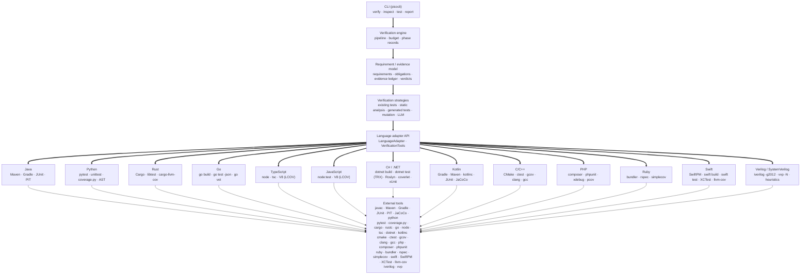

# CodeWitness architecture

This document explains how the system is put together, and — more importantly — why the verification
rules are what they are. The rules exist to stop a verification tool from becoming an oracle.

## 1. The central abstraction: an evidence chain

Everything in CodeWitness exists to make this chain machine-checkable:

```
CLAIM                    a requirement, in natural language, written by a human
   ↓
OBLIGATION               a concrete experiment that would demonstrate the claim
   ↓
EXPERIMENT               an executed tool run: a build, a test, a fuzzer, an analyzer
   ↓
OBSERVATION              what the tool actually printed or returned
   ↓
EVIDENCE                 the observation, stored with its command, inputs and confidence
   ↓
CONCLUSION               VERIFIED / PARTIALLY_VERIFIED / FAILED / UNVERIFIED / BLOCKED
```

Each arrow is a place where a verification tool usually starts lying. CodeWitness closes them:

- An obligation that no experiment can discharge stays visible as `unknownAspects` rather than being
  quietly dropped.
- An experiment that could not run produces an `INCONCLUSIVE` record with the failure reason, not a
  pass.
- An observation is stored with the exact command that produced it.
- Evidence carries a **confidence**, and only deterministic evidence can move a verdict.
- The conclusion is computed by one small class, `VerdictCalculator`, from the evidence — never by the
  thing that produced the evidence.

## 2. Layers



Enforced by module boundaries, not by convention:

| Module | May depend on | Contains |
| --- | --- | --- |
| `codewitness-core` | SnakeYAML | the whole model, the engine, the SPIs |
| `codewitness-adapter-java` | core | Java, Maven, Gradle, JUnit, PIT, JaCoCo |
| `codewitness-adapter-python` | core | Python, pytest/unittest, coverage.py, AST mutation |
| `codewitness-adapter-rust` | core | Rust, Cargo, libtest, rustc diagnostics, cargo-llvm-cov, source mutation |
| `codewitness-adapter-go` | core | Go, `go build`/`go test`, `go vet` diagnostics, coverprofile coverage, source mutation |
| `codewitness-adapter-typescript` | core | TypeScript, Node, node:test, tsc diagnostics, V8/LCOV coverage, source mutation |
| `codewitness-adapter-javascript` | core | JavaScript, Node, node:test, V8/LCOV coverage, source mutation |
| `codewitness-adapter-csharp` | core | C#, .NET SDK, `dotnet build`/`dotnet test`, Roslyn diagnostics, xUnit, coverlet |
| `codewitness-adapter-kotlin` | core, adapter-support | Kotlin, Gradle, Maven, `kotlinc` diagnostics, JUnit reports, JaCoCo coverage, source mutation |
| `codewitness-adapter-cpp` | core, adapter-support | C and C++, CMake, CTest, clang/gcc/MSVC diagnostics, gcov coverage, source mutation, Conan/vcpkg/CMake inventory |
| `codewitness-adapter-php` | core, adapter-support | PHP, the interpreter's own parse, Composer, PHPUnit, Xdebug/PCOV coverage, source mutation, Packagist inventory |
| `codewitness-adapter-ruby` | core, adapter-support | Ruby, the interpreter's own parse, Bundler, RSpec, SimpleCov coverage, source mutation, RubyGems inventory |
| `codewitness-adapter-swift` | core, adapter-support | Swift, Swift Package Manager, `swift build`/`swift test`, XCTest results read from the runner's console, LLVM coverage, source mutation, `Package.resolved` inventory |
| `codewitness-adapter-verilog` | core, adapter-support | Verilog and SystemVerilog, Icarus Verilog, `iverilog -g2012` build, `vvp -N` testbench simulation, heuristic rule table, source mutation; no coverage and no dependency inventory |
| `codewitness-storage` | core | SQLite persistence |
| `codewitness-report` | core, Jackson | JSON and HTML rendering |
| `codewitness-cli` | all of the above | argument parsing and wiring |

The core holds no build-tool logic: it selects an adapter, asks it to inspect, build, test and
analyse, and reads the source extensions the adapter declares when it must find source or test files.
Language-specific code lives in the adapter modules. A few platform defaults do remain in core — the
`LanguageId` and `BuildSystemId` constants, `PackageCoordinate.parseMaven` for advisory lookups, and
`WorkspaceManager`'s excluded-directory and build-wrapper names — but the engine never branches on
them.

## 3. The pipeline

`VerificationEngine.verify(...)` runs these phases, each bounded and each recorded as a
`PhaseRecord`:

1. **inspect** — language, build system, modules, source and test directories, test frameworks,
   build wrapper, runtime version (the language's project detector: `JavaProjectDetector`,
   `PythonProjectDetector`, `RustProjectDetector`, `GoProjectDetector`, `TypeScriptProjectDetector`,
   `JavaScriptProjectDetector`, `CSharpProjectDetector`, `KotlinProjectDetector`,
   `CppProjectDetector`, `PhpProjectDetector`, `RubyProjectDetector`, `SwiftProjectDetector`,
   `VerilogProjectDetector`, `SqlProjectDetector`).
2. **workspace** — the project is copied into the run directory, excluding build output, VCS metadata
   and previous run data, with executable bits restored on `mvnw`/`gradlew`. `bin` and `obj` are
   excluded too, because `obj/project.assets.json` holds absolute package paths belonging to the
   machine that restored it — a copy that kept it would describe the environment it was copied from.
   A CMake project's `CMakeFiles`, `_deps`, `vcpkg_installed`, `cmake-build-debug`,
   `cmake-build-release`, `cmake-build-relwithdebinfo`, `cmake-build-minsizerel` and `.cache` are
   excluded for the same reason: they are absolute-path-laden leftovers of a configure that ran
   somewhere else. A `build` directory of the project's own is already excluded by name from the
   copy, as are `third_party`, `vendor`, `extern`, `external`, `conan` and `out` from the C and C++
   adapter's own source scan, and PHP's `.phpunit.cache` and `.phpunit.result.cache`, because a previous
   run's results are not the project's sources. Ruby's `.bundle` holds a Bundler config naming absolute
   paths on the machine that wrote it, and SimpleCov's `coverage` directory is result data belonging to a
   previous run, so neither is copied either; `.yardoc` is excluded with them. SwiftPM's `.build` holds the
   whole compiled product, the checked-out dependencies and the coverage output of the run that produced
   them, and `.swiftpm` holds the package's local configuration; `DerivedData` is Xcode's equivalent, so
   all three are excluded and the adapter's `swift build` restores what it needs. Verilator's `obj_dir`
   is the same kind of leftover — the generated C++ a Verilator build compiles the design into — so it is
   excluded too, even though this adapter drives Icarus Verilog. Icarus writes its compiled simulation
   and any waveform dump as plain files and the adapter deletes each one it creates, so no other
   exclusion is needed for the toolchain it drives.
3. **build** — `test-compile`/`testClasses` for Java, a syntax compile of every source file for
   Python, `cargo build --all-targets` for Rust, `go build ./...` for Go, `tsc --noEmit` (or a Node
   type-stripping syntax check when no compiler is installed) for TypeScript, `node --check` over
   every source and test file for JavaScript — a syntax check only, since JavaScript has no compiler
   and no type check anywhere in the pipeline — and `dotnet build` for C#, over the tree's single
   solution or over each project when there is no single solution. Restore is left enabled and
   `-p:NuGetAudit=false` is passed on every command, because CodeWitness runs its own advisory scan
   and NuGet's own audit would make each build depend on api.nuget.org. Kotlin is compiled by its own
   build tool — `testClasses` for a Gradle build and `test-compile` for a Maven one, which is how
   `kotlinc` is invoked at all — and its compiler diagnostics are read in the four shapes it prints
   them. For C and C++ it is
   `cmake -S <src> -B <build> -DCMAKE_EXPORT_COMPILE_COMMANDS=ON -DCMAKE_BUILD_TYPE=Debug` followed by
   `cmake --build <build> --parallel`, in a build directory inside the run: clang and gcc diagnostics
   (`file:line:col: error: message`, and gcc's `file:line:` without a column), MSVC's
   `file(line,col): error C1234:` and a linker failure with no position are all read, so a compile
   error is `BLOCKED` here too. PHP has no compilation step of its own, so its build is a lint of every
   source file with the interpreter's own parser (`token_get_all(…, TOKEN_PARSE)`) followed, when a
   `composer.json` exists, by `composer install --no-interaction --no-progress --no-scripts
   --prefer-dist` — the command that materialises `vendor/` and therefore the only reason PHPUnit can
   exist at all. A Composer failure is a failed build with Composer's own output in the notes, and
   `--no-scripts` because running a project's arbitrary install scripts is not a verifier's job. A
   failure ends verification here,
   as `BLOCKED`. Ruby is the same shape with a different toolchain: its build is a lint of every source
   file with the interpreter's own parser (`RubyVM::InstructionSequence.compile_file`) followed, when a
   `Gemfile` exists, by `bundle install` — the command that puts RSpec in the project's bundle and
   therefore the only reason it can exist at test time. The lint runs first on purpose: a tree that does
   not parse is already a broken build, and installing a bundle into it would spend a network round trip
   to report the wrong failure. A Bundler failure is a failed build with Bundler's own output in the
   notes, never a defect in the code. Swift has a real compilation step, so its build is
   `swift build --build-tests`, which compiles the package's own targets and its test targets alike; the
   compiler's canonical `path:line:column: severity: message` line and the module-level `error: message`
   line are both read, so a compile error is `BLOCKED` here too. Compiling the tests is deliberate: a
   test that does not compile is a broken build rather than a test failure. Verilog is compiled by
   Icarus the way any other language is built: `iverilog -g2012` over every source and testbench,
   writing the compiled simulation into the run's artefact directory. Icarus prints diagnostics rather
   than a report, so its parser reads the toolchain's own line shapes — `file.v:LINE: error:` and
   `warning:`, the bare `file.v:LINE: syntax error`, the location-less `Elaboration failed` and the
   preprocessor's missing-include line — and a compile error is `BLOCKED` here too.
4. **tests** — stale reports are deleted, the suite is run, and results are parsed from the raw XML
   reports, not from console output. Rust has no XML report, so results are parsed from libtest's
   line protocol instead; the pairing of Cargo's two output streams is documented in the adapter. Go
   has a machine-readable stream, `go test -json`, which is read with `-count=1` so a cached pass is
   never mistaken for an experiment. TypeScript runs Node's own test runner, whose JUnit report is
   read in the same spirit; JavaScript does the same with `node --test --test-reporter=junit`, with
   no compile step before it. C# runs one `dotnet test --logger trx` per test project — a project is
   a test project when it references `Microsoft.NET.Test.Sdk` or `Microsoft.Testing.Platform`, or
   declares `IsTestProject` — and reads the TRX report, whose classes come from `TestDefinitions`,
   whose outcomes map so that anything that is not `Passed` or `Failed` is recorded as skipped, and
   whose failure `<Message>` is carried into the counterexample verbatim. Kotlin runs the project's
   own test task and reads the same JUnit XML a Java project produces, because Kotlin tests run on the
   JVM under the same reporting machinery. C and C++ run
   `ctest --test-dir <build> --output-junit <file> --output-on-failure` and read the JUnit report CTest
   writes, which names each test the way it was registered with `add_test`. PHP runs PHPUnit, resolved at
   test time rather than at inspection because it is a Composer dependency this run's own build has just
   installed, with `--log-junit` and `--do-not-cache-result`, and reads the JUnit XML it writes. PHPUnit
   carries a test class's name twice, in PHP's own backslash spelling and in JUnit's dotted one; the
   parser reads the dotted `classname` and normalises any backslash to a dot, which is the identifier
   `RequirementCodeMapper` derives for the same file from its `namespace` declaration. When no PHPUnit
   exists at all the phase reports the tests as not executed and names it, because PHP has no
   standard-library test framework to fall back on. Ruby has the same structural position with RSpec:
   the runner is resolved at test time, because the project's own `bin/rspec` binstub only exists after
   the build's `bundle install`, and the phase asks for RSpec's own JSON report
   (`--format json --out <artifacts>/ruby/rspec.json`) rather than scraping progress output. Each example
   names its file as `file_path`, and the parser turns that into the dotted suite
   (`spec/ledger_spec.rb` becomes `spec.ledger_spec`), which is the identifier `RequirementCodeMapper`
   derives for the same file, so a result is attributed rather than guessed at. Swift has no structured
   report to read: XCTest gives a command-line caller only its console, so the parser reads the fixed
   `Test Case '-[Module.Class method]'` open and close lines and takes a failure's message from the
   compiler-style error line between them, which is where a generated test's counterexample line lands.
   A suite written with Swift Testing rather than XCTest is reported as carrying no readable case rather
   than as a pass. Verilog has no test framework at all, so like Swift it is read from the toolchain's
   own output: each testbench is compiled with `iverilog -g2012 -s <testbench>` and simulated with
   `vvp -N`, and the unit is the testbench rather than a case inside it, because the language gives a
   caller no way to ask for one case of several. That is why one test case per testbench is reported,
   under the testbench file's own name. A simulation is a failure when it exits non-zero, prints a
   generated test's counterexample line, or prints a line opening with `FAIL`, `FAILED`, `ERROR` or
   `ASSERTION FAILED`; one that runs to completion is a pass, and one that does not compile is an error
   rather than a failing test.
5. **static analysis** — compiler diagnostics plus the adapter's heuristic rule table. For C# that
   is the Roslyn diagnostics the build phase already produced, plus a C# rule table; for Kotlin it is
   a Kotlin rule table read through one scanner that knows the language's literals; for C and C++ it
   is one rule table read through one `CppSourceScan` that offers each rule a code view, a
   literal-masked view and a directive view, so a rule sees the literals it is about and the
   statements a literal would otherwise hide; for PHP it is a rule table read through one
   literal-aware `PhpSourceScan` that knows single and double quotes, heredoc and nowdoc strings,
   `//`, `#` and `/* */` comments and backslash escapes; for Ruby it is a rule table read through one
   `RubySourceScan` that knows `#` and `=begin`/`=end` comments, interpolating strings, percent literals,
   heredocs, regular expressions and the `__END__` data section, and offers each rule a code view and a
   literal-masked view of the same length so a match maps back to the line that produced it; for Swift it
   is a rule table read through one `SwiftSourceScan` that knows `//` and nestable `/* */` comments,
   ordinary strings with escapes and `\(…)` interpolation, `"""…"""` multi-line strings and `#"…"#` raw
   strings with matching hash counts, and offers the same offset-aligned code and literal views. For
   Verilog it is a rule table read through one literal-aware `VerilogSourceScan` that knows `//` and
   `/* */` comments, string literals and the based-literal apostrophe (`4'b1010`, `8'hFF`), and offers
   the same offset-aligned code and literal views. A testbench file is not analysed as design logic,
   because a testbench is not the design.
6. **security** — the same rule table, filtered to security rules, reported separately.
7. **dependencies** — a resolved inventory per language, read from the lock file when there is one
   (`package-lock.json`, `poetry.lock`, `Cargo.lock`, `packages.lock.json`) or from the versions the
   manifest itself selects (`go.mod`), and from the declared names and ranges otherwise. A C# version
   that stands behind an MSBuild property is reported unresolved rather than guessed, and so is a
   Kotlin dependency whose version is a range or a dynamic version. For C and C++ the sources are
   `conan.lock`, whose resolved graph is queried as the `ConanCenter` ecosystem, `vcpkg.json`, whose
   versions are declared floors and so are reported without a version, and the `FetchContent_Declare`
   and `find_package` calls in the CMake files, where a git tag is not a released version and a system
   package's version is a property of the machine. For PHP the sources are `composer.json` and, when it
   exists, `composer.lock`, every entry queried as the `Packagist` ecosystem, with a version that is a
   range, a wildcard or a branch alias reported unresolved rather than guessed and the `platform`,
   `php` and `ext-*` entries skipped because they are not packages. For Ruby the source is
   `Gemfile.lock`, whose `GEM`, `PATH` and `GIT` sections are read as the resolved graph and whose
   entries are queried as the `RubyGems` ecosystem; an entry with no version parenthesis, or a gem that
   `DEPENDENCIES` names and no `specs` block resolved, is reported unresolved rather than guessed, and a
   project with a `Gemfile` but no lock file has no resolved graph to inventory, which the phase says
   rather than reporting an empty one. For Swift the source is `Package.resolved`, in either of the two
   schemas SwiftPM writes, whose pins are queried as the `SwiftURL` ecosystem under the package's own
   location rather than a registry name; a package with only `Package.swift` resolves nothing, which is an
   inventory of zero, and a pin with neither a version nor a revision is reported unresolved. Verilog is
   the one language here with no inventory at all: there is no package manager and no advisory ecosystem
   for HDL, so the adapter declares no dependency capability and the phase reports that dependencies were
   not analysed rather than an empty inventory. Which dependencies exist is a separate question from
   whether any of them has an advisory, and the report answers the two separately.
8. **coverage** — the adapter's coverage provider (JaCoCo for Java, coverage.py for Python,
   cargo-llvm-cov for Rust, `go test -coverprofile` for Go, V8 through LCOV for TypeScript and
   JavaScript, coverlet's cobertura report for C# and JaCoCo over the JVM bytecode Kotlin shares with
   Java), with the Java agent attached automatically when no report exists. C# coverage is collected with `dotnet test --collect:"XPlat Code Coverage"`; a
   project without `coverlet.collector` comes back "not measured", naming the collector instead of
   reporting zero. C and C++ coverage is `gcov`, measured over a second configure that adds
   `--coverage` to `CMAKE_C_FLAGS` and `CMAKE_CXX_FLAGS` and the project's own CTest suite run over
   it; the figures cover the project's own sources only, with the reports for headers nobody in the
   project wrote excluded and the note saying how many were. PHP coverage is PHPUnit's Clover report,
   and PHP has no instrumentation of its own: when the probe found no Xdebug and no PCOV loaded the
   phase reports the figure as not measured and names the missing driver, never as zero. Ruby coverage is
   SimpleCov's own result set (`coverage/.resultset.json`), read after the suite is re-run with the
   conventional `COVERAGE` and `SIMPLECOV` opt-ins set: SimpleCov is a gem rather than an interpreter
   extension, so there is nothing to probe for and the presence of the gem is not the measurement - the
   provider decides from the report the run produces. A stale
   result set is deleted before the run, and when none appears the figure is not measured with the
   reason, never zero. Swift coverage is SwiftPM's own LLVM export: the suite is re-run with
   `swift test --enable-code-coverage`, `swift test --show-codecov-path` names the `codecov` JSON (with a
   scan of `.build` as a fallback), stale reports are cleared first, and the totals are summed over the
   project's own Swift files only, so a checked-out dependency, the generated test runner SwiftPM
   instruments for itself, or XCTest itself is not counted. Verilog is the exception: Icarus Verilog
   exports no coverage data, so the adapter claims no coverage capability and the phase reports coverage
   as not measured rather than as zero. Verilator can export coverage, but this adapter does not drive
   Verilator.
9. **mutation** — the adapter's mutation tester (PIT for Java, a bounded AST mutator for Python, a
   bounded source-operator mutator for Rust, Go, TypeScript, JavaScript, C#, Kotlin, C and C++, PHP,
   Ruby and Verilog), with stale reports deleted first. C# re-runs each mutant with `dotnet test --no-restore`;
   Kotlin re-runs the project's own test goal, because PIT's bytecode mutants do not map back to Kotlin
   source lines; C and C++ re-run each mutant through the platform shell, because CMake has no single
   invocation that builds and tests in one command, and decide viability by whether CTest reached its
   own `Total Test time` summary rather than by matching failure words. PHP re-runs each mutant through
   PHPUnit and decides viability with the same lint program the build uses, so a mutant that does not
   parse is discarded rather than counted as killed, and every file is restored in a `finally`. Ruby
   re-runs each mutant through RSpec with the shared `TextMutator` and a `RubyLexis`, and decides
   viability from the runner's own words, so a mutant the interpreter cannot parse, a Bundler that cannot
   load the project and a run that discovered no example are all excluded from the score rather than
   counted as killed. Swift re-runs each mutant through `swift test`, which is also what compiles it, and
   decides viability from whether the output shows a build failure with no XCTest case line at all, so a
   mutant the compiler rejects is excluded rather than credited as a kill. Verilog re-runs each mutant
   through a shell pipeline that compiles every testbench and simulates it with `vvp -N`, stopping at
   the first failure, and decides viability from whether Icarus printed an `error:`, a `syntax error` or
   an `Elaboration failed`, so a mutant that does not compile is excluded rather than counted as a kill.
10. **obligation planning** — scenarios declared by the user, properties derived from requirement
    text, or an explicit "nothing can be attempted here" obligation.
11. **strategies** — per requirement: existing tests, static analysis, generated tests, mutation,
    advisory LLM analysis. Each returns evidence, counterexamples and per-obligation outcomes.
12. **verdicts** — `VerdictCalculator` computes one status per requirement from the evidence.
13. **report** — canonical JSON, self-contained HTML, console summary, SQLite index.

Every phase runs inside a budget: wall clock, generated tests, LLM calls, mutation time. When a limit
is reached the run is marked `ABORTED` and everything not yet verified stays unverified.

### Polyglot projects

`LanguageAdapterRegistry.selectAll` returns **every** adapter that claims the project, not the first
one. A tree with a Java service and a TypeScript frontend is two verifiable projects, and selecting one
adapter for the whole tree verified one side while leaving the other absent from the report. Each
inspection produces its own `ProjectInfo`, and the build, test, static-analysis, security, dependency,
coverage and mutation phases run once per language against that language's description.

The requirement strategies still run once per requirement, but against the `ProjectInfo` of the language
the requirement's code is written in, because a test runner, a generator and a replay command are all
language specific. Verdicts are blocked per language too: a build failure in one language blocks the
requirements written in it, and not the ones written in a sibling that compiled.

The run's own status follows the same rule: it is `BLOCKED` when a build failure actually stopped a
requirement from being verified, not merely when some language somewhere failed to compile. A polyglot
run in which every requirement was evaluated is `COMPLETED` even if a language no requirement lives in
did not build, because `BLOCKED` is what makes a truncated run exit non-zero and this one was not
truncated. A run with no requirements at all is still `BLOCKED` after a failed build: then there is
nothing to show for it.

For the core's own purposes - mapping requirements to files, describing the project in the report - the
inspections are combined by `ProjectInfo.union`, which reports `polyglot` as the language rather than
naming whichever adapter was selected first.

### Languages nothing can verify

Every adapter is all-or-nothing: a language either has one and is verified, or has none and cannot be
represented at all. `LanguageDetector` is the second case - a language CodeWitness can see and cannot
verify - and it is discovered through `ServiceLoader` exactly as adapters are, so recognising a language is
a module and a provider file. The detectors for the languages nothing here implements live in
`codewitness-language-detectors`, which is what keeps the core from knowing what a `Gemfile` is.

`LanguageDetectorRegistry.detect` returns the registered languages present in the tree that no adapter
claimed, and `VerificationReport.languages` holds both kinds of entry: the languages that were verified and
the languages that were only recognised. One list, because a reader who sees the verified set without
seeing what was left out of it reads the report as covering the whole tree. A detector only ever adds an
entry and a sentence to the limitations list; it never schedules a phase, produces evidence, or touches a
verdict.

A detector also declares which adapter language already covers it: `DotNetLanguageDetector` reports
`verifiedAsAdapterLanguage() == "csharp"`, so a tree the C# adapter verified is not described a second
time as present and unverifiable. What remains on that path is F# and Visual Basic, which are still
recognised and still reported as unverifiable. `CppLanguageDetector` declares the same for `cpp`, so a
CMake tree the C and C++ adapter verified is not described twice, and what remains for it is a C or
C++ tree built by a hand-written `Makefile` or by Meson, which is recognised and reported as
unverifiable rather than passed over. `PhpLanguageDetector` declares the same for `php`: it used to
stand in for a language CodeWitness had no adapter for, and now it names PHP only for a tree the
adapter does not claim, so a PHP project that was verified is not described a second time as
unverifiable and one that was not is still reported rather than passed over. `RubyLanguageDetector`
declares the same for `ruby`: it used to be the whole of what CodeWitness could say about a Ruby tree,
and it now names Ruby only for a tree the adapter does not claim, so a verified Ruby project is not
described twice while one left unverified is still reported rather than dropped from the report.
`SwiftLanguageDetector` declares the same for `swift`, so a Swift package the adapter verified is not
described twice, and a tree with `.swift` files but no `Package.swift` — a CocoaPods project, say — is
still recognised and reported as present and not verified. `VerilogLanguageDetector` declares the same
for `verilog`, so a tree the adapter claimed is not described a second time as present and
unverifiable; it still speaks for a classpath without the adapter, which is where recognition is the
only thing CodeWitness can say about the tree.

The scan depth is the detector's own to choose. Most languages announce themselves near the root, so the
shared default stops three levels down; `SqlLanguageDetector` asks for six, because SQL has no
conventional root file and its migration trees sit under a build's resource directory -
`src/main/resources/db/migration` for Flyway, for instance - which is one level past the default. The
ignored-directory list is applied at every level either way, so a deeper scan is bounded by the project's
own tree rather than by whatever is vendored inside it.

## 4. The verdict rules, and why

`VerdictCalculator` is deliberately the least clever class in the codebase. Its rules:

| Situation | Verdict | Why |
| --- | --- | --- |
| The project did not build | `BLOCKED` | A broken build says nothing about the code's behaviour. Reporting it as `FAILED` would be the single most misleading thing a verification tool could do. |
| An executed experiment reproduced a violation | `FAILED` | The counterexample is stored with its exact inputs. |
| Deterministic evidence refutes the requirement | `FAILED` | A static analyzer demonstrating the defect is as good as a failing test. |
| Every obligation discharged by executed experiments, nothing contradicted | `VERIFIED` | This is the only path to `VERIFIED`, and it requires execution. |
| Some obligations discharged | `PARTIALLY_VERIFIED` | Partial evidence is reported as partial. |
| Nothing executable, or nothing discharged | `UNVERIFIED` | Insufficient evidence never becomes a pass. |

Two properties of evidence make this work:

- **Confidence.** `DETERMINISTIC` evidence comes from executing a tool; `ADVISORY` evidence is a
  language model's opinion, or a human's. Only deterministic evidence can decide a verdict.
- **Provenance.** Evidence generated by a model counts only if it was independently executed. A
  suggestion that was never run is `SUGGESTION`, not `COUNTEREXAMPLE`.

### What deliberately does *not* change a verdict

- **Passing existing tests, on their own.** A test suite written by the same process that wrote the
  code is not independent verification. A failing *mapped* test produces a counterexample; a passing
  mapped test produces supporting evidence with `HIGH` (not deterministic) confidence, which is not
  enough for `VERIFIED`.
- **A high mutation score.** A surviving mutant means *nobody checked that behaviour*. It is not a
  violation of a requirement (the mutation may be equivalent, or the behaviour may be unclaimed), and
  letting it block verdicts would let test strength silently overrule executed evidence. Surviving
  mutants are reported as prominent evidence and as an explicit run limitation instead.
- **A clean static analysis run.** It only covers the rules the analyzers know. It is recorded as
  weak evidence and it does not make a requirement verified.
- **A language model's opinion.** Ever.

## 5. Evidence model

`Evidence` records: id (`EV-001`), run id, type, status (`SUPPORTS`/`REFUTES`/`INCONCLUSIVE`),
confidence, description, source tool, timestamp, the exact command, the inputs, the output, the
result, arbitrary metadata, artifact paths, the requirements and obligations it belongs to, whether a
language model produced it, whether it was executed independently, and a reproduction command.

Types: `PROJECT_INSPECTION`, `COMPILER`, `TEST`, `GENERATED_TEST`, `PROPERTY_TEST`, `FUZZ_TEST`,
`STATIC_ANALYSIS`, `COVERAGE`, `MUTATION_TEST`, `SECURITY_SCAN`, `DEPENDENCY_SCAN`, `COUNTEREXAMPLE`,
`REQUIREMENT_INTERPRETATION`, `LLM_ANALYSIS`, `INFRASTRUCTURE`, `ENVIRONMENT`.

Counterexamples are first class: `Counterexample` carries the ordered inputs, expected vs observed
result, the invariant that was violated, the test that observed it, the evidence id, the random seed,
the case index, and a `ReproductionRecipe` (command plus artifact path). Generated tests report
failures through a single structured line, `CODEWITNESS_COUNTEREXAMPLE|case=…|seed=…|inputs={…}|…`,
which the engine parses — that is why a counterexample contains data rather than just a stack trace.
A C and C++ generated test is one self-contained program that prints that line to standard output and
exits non-zero; CTest records `Failed` as the failure message with the program's output beside it in
`system-out`, which is why the CTest report parser joins the two. A PHP generated test is a PHPUnit
`TestCase` method whose failure message carries the same line, which is where the JUnit report parser
reads it from. A Ruby generated test is an RSpec example that fails with an
`RSpec::Expectations::ExpectationNotMetError` carrying the line, which is where RSpec's JSON report has
it, in the failing example's `exception.message` — the protocol is one line in every language, and only
the place it is read from differs.

## 6. Requirements, obligations and the mapping problem

The natural language requirement is authoritative; everything structured is an interpretation, and
reports say so. Three sources of obligations, in decreasing order of strength:

1. a scenario declared by the user — executable by construction, attributed to the user;
2. properties derived from the requirement text — used by the generators to choose boundaries;
3. obligations suggested by a language model — advisory, never executable by themselves.

When a requirement has a declared scenario, the text-derived obligations are *not* added. They would
otherwise be permanent "not executed" entries that keep an otherwise fully verified requirement out
of `VERIFIED`, which would be a lie in the other direction.

Mapping evidence to requirements is deliberately mechanical, so that a reader can check it:

- a source or test file belongs to a requirement when the requirement's id appears in it, or when the
  requirement declares `paths:`/`tests:` explicitly. The extensions that count as source come from the
  adapter (`sourceExtensions`), so the same rule works for `.java` files, Python modules, Rust files,
  Go files, TypeScript files, JavaScript files, C# files, Kotlin files, C and C++ files, PHP files,
  Ruby files, Swift files and Verilog files (`.v`, `.sv`, `.vh` and `.svh`);
  Go adds one refinement, because its tests
  live beside the code rather than in a separate tree, so only `*_test.go` files in a Go test tree are
  treated as tests;
- a mutation location is mapped to its source file path, whether the tool reports a Java class name,
  a Python file, a Rust file, a Go file, a TypeScript file, a JavaScript file, a C# file, a Kotlin
  file, a C or C++ file, a PHP file, a Ruby file, a Swift file or a Verilog file;
- a test declared in a requirement is matched by the identifier the language's own report uses, which
  is why `RequirementCodeMapper` derives a .NET test class identifier as `<namespace>.<file stem>` —
  the shape of the TRX `className` — the same way it already special-cases Go and Node. PHP is the same
  problem in a different spelling: PHPUnit's JUnit report gives a test class twice, as `class` in PHP's
  own backslash form and as `classname` in JUnit's dotted form, and the adapter's parser records the
  dotted one. The mapper therefore derives `Namespace.Class` from the file's own `namespace`
  declaration and writes the separators as dots, so the identifier the report carries and the
  identifier derived from the file agree rather than merely resemble each other. Ruby is the same
  problem again: RSpec reports an example's file as `file_path`, and the parser records the suite as that
  path relative to the project root with the separators turned into dots (`spec/ledger_spec.rb` becomes
  `spec.ledger_spec`). The mapper derives the same identifier from a `.rb`, `.rake` or `.gemspec` file
  under the project root rather than relativising against the test root — which would match only through
  the simple-name fallback and could not tell two same-named suites apart. Swift is a third: XCTest
  reports a case under `Module.Class`, the test target's module followed by the class, so the mapper
  derives the class from the file's own name and lets the simple-name fallback match the module prefix,
  which is also what lets a generated class whose module is recorded at run time be attributed;
  Verilog is the simplest case of the same idea: the adapter reports a testbench under its file's own
  name, so the mapper returns the testbench file's stem directly rather than relativising it against
  the test root, which would produce an identifier the report never carries;
- anything unmapped stays unmapped and the report says so. CodeWitness never silently attributes a
  passing test to a requirement it does not mention.

## 7. Extension points

**Another language.** Implement `LanguageAdapter` (`supports`, `inspect`, `build`, `runTests`,
`analyze`, `capabilities`) in a new module, add a `META-INF/services` entry, and register any tool
providers. The engine needs no change: it selects an adapter by asking each one whether it supports
the project, and never switches on a language string. `codewitness-adapter-python`,
`codewitness-adapter-rust`, `codewitness-adapter-go`, `codewitness-adapter-typescript`,
`codewitness-adapter-javascript`, `codewitness-adapter-csharp`, `codewitness-adapter-kotlin`,
`codewitness-adapter-cpp`, `codewitness-adapter-php`, `codewitness-adapter-ruby`,
`codewitness-adapter-swift` and `codewitness-adapter-verilog` are the worked
examples: each reuses the whole pipeline and adds only
detection, tool providers and a generator. A language that shares a build tool with another one — Kotlin with Java, over Gradle and
Maven — has to claim by *source language* as well as by build system, because two adapters claiming
one tree is a polyglot run and two providers claiming one project both run. The C and C++ adapter is
the mirror image of that case: one build system covers two languages, so one adapter claims both and
one `LanguageId` (`cpp`) carries them, with the report counting the `.c` files and the C++
implementation files separately rather than reporting a number that pretends they are one language.
A header names neither, because a header belongs to whichever language includes it.

**Another tool.** Implement one of the interfaces in `VerificationTools` (`Compiler`, `TestRunner`,
`StaticAnalyzer`, `CoverageProvider`, `MutationTester`, `SecurityAnalyzer`, `DependencyAnalyzer`,
`TestGenerator`, `GeneratedTestExecutor`) and register it in the composition root
(`JavaAdapterBundle`, `PythonAdapterBundle`, `RustAdapterBundle`, `GoAdapterBundle`,
`TypeScriptAdapterBundle`, `JavaScriptAdapterBundle`, `CSharpAdapterBundle`, `KotlinAdapterBundle`,
`CppAdapterBundle`, `PhpAdapterBundle`, `RubyAdapterBundle`, `SwiftAdapterBundle` and
`VerilogAdapterBundle` are the examples).
Registration is data, not code paths. A `TestRunner` or `GeneratedTestExecutor` may also implement the
optional replay-command methods, which is how a language supplies a reproducible command without the
core knowing how tests are invoked. PHP is also where a test runner turns out to be a project
dependency rather than a tool of the machine: PHPUnit does not exist until the build has installed it,
so the adapter's runner resolves it after the build instead of trusting what inspection could see, and
a `TestRunner` that has nothing to run says so rather than reporting a suite of zero tests. Ruby is the
same case with a different package manager: RSpec does not exist until `bundle install` has put it in
the project's bundle, so its runner is resolved after the build too. Swift is the opposite case: XCTest
ships with the toolchain, so its runner resolves nothing beyond the `swift` driver the build already
drove, and the only thing it has to read is the runner's own console, because XCTest gives a
command-line caller no structured report. Verilog is the case where a test is two processes: the test
runner compiles a testbench with `iverilog` and then simulates it with `vvp`, so it carries the
two-step replay recipe itself, because the core has no single command to ask for. Its generated-test
executor does the same for a generated testbench, and its mutation tester wraps the pair in one shell
command per mutant, which is the shape the shared mutator's one-command-per-mutant loop accepts.

**Another verification strategy.** Implement `VerificationStrategy` and register it on the
`VerificationProviderRegistry`, exactly like a tool. It receives the context, the requirement and its
obligations, and returns evidence plus per-obligation outcomes. It cannot assign a verdict; only the
engine can. The requirement-to-code mapping is not a constructor argument - it is created after
inspection and read from `VerificationContext.codeMap()`, which is what lets a strategy be registered
before the run rather than built by the engine during it.

## 8. Isolation and reproducibility

All execution inside a run goes through one `ExecutionSandbox`. `LocalProcessSandbox` sanitises the
environment (credentials and proxy variables are dropped), refuses working directories outside the
run, caps output and enforces hard timeouts. `DockerSandbox` runs the same commands in a container
with no network and dropped capabilities. The isolation level actually used is recorded in every
report, and the local sandbox is explicitly documented as a resource-safety boundary rather than a
security boundary.

A run records everything needed to reproduce it: project identifier, source revision, CodeWitness
version, runtime version (Java, Python, Rust, Go, Node for TypeScript and JavaScript, the .NET SDK for
C#, the Kotlin release for Kotlin, the CMake release for C and C++, the PHP release for PHP, the Ruby
release for Ruby, the Swift release for Swift, or the Icarus Verilog release for Verilog), build tool
and version, configuration fingerprint,
tool versions, language model
identifier,
requirements hash, isolation level, timestamps, and every command. Run data is kept
under `<project>/.codewitness/runs/<run-id>/`, with generated sources and raw reports copied into the
artifact store so a counterexample can be reviewed and replayed after the run.

## 9. Storage

SQLite (`<project>/.codewitness/codewitness.db`) holds `projects`, `verification_runs`,
`requirements`, `obligations`, `evidence`, `test_results`, `test_cases`, `findings`,
`counterexamples` and `tool_runs`, with the canonical JSON document stored verbatim on the run row so
that `./codewitness report <run-id>` reproduces exactly what was written. Generated sources and raw
reports live in the artifact store on disk, not in the database.

## 10. Testing strategy

- **Unit tests** pin the verdict rules, the parsers, the configuration, the sandbox, the workspace
  copier, the analyzers' rule tables and the generated-test rendering (including compiling a generated
  Java test to prove it is valid Java, rendering a Python scenario into a runnable module, rendering a
  Go scenario into a `_test.go` file, rendering a JavaScript scenario into a plain `node:test` module,
  rendering a C# scenario into an xUnit class in a project that compiles and rendering a C++ scenario
  into a self-contained program with its compile and link commands, a PHP scenario into a PHPUnit
  `TestCase` class, a Ruby scenario into an RSpec spec file, a Swift scenario into an XCTest class
  whose generated methods carry the `test` prefix XCTest discovers by, and a Verilog scenario into a
  testbench module that instantiates the design under test). The Kotlin generator's
  output is proved by the end-to-end test instead, which compiles and runs it with the real compiler
  rather than putting a second Kotlin compiler on a unit test classpath; the C++ generator's output is
  proved the same way, by compiling it with the compiler the fixture's own build records.
- **Integration tests** drive each adapter against small projects and parse synthetic tool reports,
  including the DOCTYPE-carrying JaCoCo and PIT formats, pytest's JUnit XML, coverage.py's JSON,
  Node's JUnit report, a BOM-prefixed TRX report, a CTest JUnit report with a failed test whose
  `system-out` carries the counterexample line, a PHPUnit JUnit report that names a test class twice,
  in PHP's backslash spelling in `class` and in JUnit's dotted spelling in `classname`, and an RSpec JSON
  report whose failing example carries the counterexample line in its `exception.message`.
- **End-to-end tests** (`-Pe2e`) run `./codewitness verify` against the fixture projects and assert the
  verdicts, the counterexample contents and the exit codes. The Java, Python, Rust, Go, TypeScript,
  JavaScript, C#, Kotlin, C/C++, PHP, Ruby, Swift and Verilog fixtures are all covered; the Python one uses only the
  standard library, the Rust
  one and the Go one have no dependencies and the TypeScript and JavaScript ones have no packages, so
  each needs an interpreter, a toolchain, the `go` tool or a Node runtime and nothing else. The C# one
  needs the .NET SDK and no network: its test host packages must already be in the machine's NuGet
  cache, which they are for any machine that has run `dotnet test` before, because the fixture's sandbox
  config sets `allow_network: false`. The Kotlin fixture needs Maven and nothing else, because it is a
  Maven build with `kotlin-maven-plugin`: the compiler, the standard library and Surefire are resolved
  from a repository the way a dependency is, which is why it is not a Gradle project here. The C and
  C++ fixture needs CMake and CTest and nothing else: it fetches no package, so it configures, builds,
  tests, covers and mutates with the toolchain the machine's compiler ships, and needs no network. The
  PHP fixture needs an interpreter and Composer and nothing else installed, but it needs network access
  the first time: PHPUnit is a Composer dependency rather than part of the toolchain, so the build must
  resolve it from Packagist before any test can run, which is why the fixture's sandbox config allows
  network and why the continuous-integration job warms the toolchain before the run. The Ruby fixture is
  the same story with a different package manager: RSpec is a bundle dependency rather than part of the
  toolchain, so the build must resolve it from RubyGems before any test can run, which is why that
  fixture's sandbox config allows network and why the continuous-integration job warms its bundle first.
  The Swift fixture is the one that needs neither a package manager nor the network: XCTest ships with
  the Swift toolchain and the package declares no dependencies, so the build, tests, coverage and
  mutation all run offline against the toolchain the machine already has. The Verilog fixture is the
  same case on the toolchain side: `iverilog` and `vvp` ship together as one simulator and the tree
  declares no dependencies, so the build, testbenches and mutation run offline against the toolchain
  the machine already has, with no coverage figure to collect because Icarus exports none.
- **Fixtures** are projects with known defects — off-by-one boundaries, null handling, concurrency,
  security, weak tests, and a requirement that cannot be verified at all — used to prove that
  CodeWitness distinguishes them, in more than one language.
