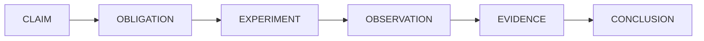

# CodeWitness

**Independent verification engine for AI-generated software.**

CodeWitness does not generate code. It answers one question:

> *"What evidence do we have that this code satisfies its requirements and behaves correctly?"*

It answers it by compiling the project, running its tests, analysing it, generating additional
adversarial tests, executing them, searching for counterexamples, and then reporting what was
observed — with the evidence attached. A language model's opinion is recorded as a suggestion and
never counted as proof.



---

## Quick start

```bash
# 1. Build (needs Java 25+ and Maven)
./build.sh

# 2. See what CodeWitness finds in a project that contains deliberate defects
./demo.sh
```

The demo verifies `fixtures/withdrawal-ledger`, a small Java project with four introduced defects
behind five requirements. At the time of writing it produces:

```text
Requirements
  ✗ R-001    Rolling withdrawal limit     FAILED
  ✗ R-002    Fees are applied to the rec… FAILED
  ✗ R-003    Negative amounts are reject… FAILED
  ✗ R-004    Multiple concurrent withdra… FAILED
  ? R-005    Rounding of computed totals  UNVERIFIED

Counterexamples
  CE-001  R-001  inputs: {t1=85800000, a1=700, t2=90000000, a2=700}  actual: 1400
```

R-001 fails because the ledger applies the limit per calendar day: two withdrawals of 700 an hour
apart, across midnight, total 1,400 in a rolling 24-hour window. R-005 has no way to be executed, so
it is `UNVERIFIED` — which is the honest answer, not a failure.

The launcher is `./codewitness` in the repository root. `./build.sh` builds the jar it needs but does
not install a `codewitness` command on `PATH`, so run it from the checkout (or set `CODEWITNESS_JAR`
and call it by path).

Verify a Java project:

```bash
./codewitness verify ./my-java-project --requirements requirements.md
```

or a Python project:

```bash
./codewitness verify ./my-python-project --requirements requirements.md
```

or a Rust project:

```bash
./codewitness verify ./my-rust-crate --requirements requirements.md
```

or a Go module:

```bash
./codewitness verify ./my-go-module --requirements requirements.md
```

or a TypeScript project:

```bash
./codewitness verify ./my-typescript-project --requirements requirements.md
```

or a JavaScript project:

```bash
./codewitness verify ./my-javascript-project --requirements requirements.md
```

or a C#/.NET project:

```bash
./codewitness verify ./my-dotnet-project --requirements requirements.md
```

or a Kotlin project:

```bash
./codewitness verify ./my-kotlin-project --requirements requirements.md
```

or a CMake C++ project:

```bash
./codewitness verify ./my-cmake-project --requirements requirements.md
```

or a PHP project:

```bash
./codewitness verify ./my-php-project --requirements requirements.md
```

or a Ruby project:

```bash
./codewitness verify ./my-ruby-project --requirements requirements.md
```

or a Swift package:

```bash
./codewitness verify ./my-swift-package --requirements requirements.md
```

or a Verilog project:

```bash
./codewitness verify ./my-verilog-project --requirements requirements.md
```

or a VHDL design:

```bash
./codewitness verify ./my-vhdl-design --requirements requirements.md
```

or a SQL project:

```bash
./codewitness verify ./my-sql-project --requirements requirements.md
```

or a Pascal project:

```bash
./codewitness verify ./my-pascal-project --requirements requirements.md
```

The language is detected, and a project may be written in several. `LanguageAdapterRegistry.selectAll`
runs **every** adapter that claims part of the tree — a Java service with a TypeScript frontend is two
verifiable projects, and one of them being read is not a reason for the other to disappear. Phases that
belong to a language run once per language against that language's own description; a language whose build
fails blocks only the requirements written in it, and the run is `BLOCKED` only when that failure actually
stopped one from being verified.

JavaScript and TypeScript coexist in one tree. They own disjoint extensions — `js`/`mjs`/`cjs` against
`ts`/`tsx`/`mts`/`cts` — so the split is at the file level, and a TypeScript frontend next to plain
JavaScript tooling is verified in both rather than losing one.

The report says `polyglot` and lists every language it accounted for under `languages`, each entry marked
`verified` or not, so the verdicts cannot be read as if the whole tree were one language. A language the
tree contains that **no** adapter understands is an entry in that same list, marked not verified and naming
the file that gave it away — a language that appears nowhere in the report is indistinguishable from one
that is not there. Recognition comes from `LanguageDetector` implementations discovered like adapters are,
so naming a language CodeWitness cannot verify is a module and a provider file, not an edit to the engine.

An adapter declares the phases it supports (`Capability`) and registers the providers that implement them. The
two are recorded in different places, so the engine checks them against each other at the start of every run: an
adapter that registers a coverage provider while not declaring `COVERAGE` would have that phase skipped with the
provider sitting unused, and that is now a stated limitation and a self-issue rather than a quietly narrower
verification.

`language.adapter: java`, `python`, `rust`, `go`, `typescript`, `javascript`, `csharp`, `kotlin`,
`cpp`, `php`, `ruby`, `swift`, `verilog`, `vhdl`, `sql` or `pascal`
*narrows* the run
to that one adapter instead of being merged with the automatic choice. It is not forced: the named adapter
is used when it exists and actually claims the project, and otherwise the run falls back to
auto-detection — an unknown id is silently ignored rather than reported.

Python support needs only an interpreter: it uses `pytest` when the project has it and the standard library `unittest` runner
otherwise, so a project with no third-party packages can still be verified. Rust support needs only
`cargo`: a dependency-free crate is built, tested, analysed and mutated by the toolchain it already
has, and generated scenarios become ordinary Cargo integration tests. Go support needs only the `go`
tool: a dependency-free module is built,
tested, analysed and mutated by the toolchain it already has, coverage comes from
`go test -coverprofile`, and generated scenarios become ordinary `_test.go` files in the package
under test. TypeScript support needs only Node 22.6 or later: a project with no `node_modules` is
syntax-checked, tested, analysed and mutated by the runtime it already has, and generated scenarios
become ordinary `node:test` modules. JavaScript support needs only Node 18.17 or later: there is no
compiler and no type check anywhere in the pipeline — the build is a syntax check with the runtime's
own parser — and a project with no `node_modules` is checked, tested, analysed and mutated by the
runtime it already has, with generated scenarios becoming ordinary `node:test` modules. C# support
needs only the .NET SDK: a solution is built with `dotnet build` and tested with `dotnet test`,
restore is left enabled but `-p:NuGetAudit=false` is passed on every command, because CodeWitness runs
its own advisory scan and NuGet's own audit would make each build depend on api.nuget.org, and
generated scenarios become xUnit cases in the tree's own test project. Kotlin support needs only the
project's own build tool: a Maven build with `kotlin-maven-plugin` or a Gradle build with the Kotlin
plugin is compiled by `kotlinc` through that build, its Kotlin compiler diagnostics are read from the
format the compiler itself prints, coverage comes from JaCoCo over the same JVM bytecode a Java
project produces, and generated scenarios become ordinary Kotlin JUnit 5 classes in the tree's own
test sources. C and C++ support needs only CMake and CTest: a tree whose `CMakeLists.txt` declares a
`project()` and at least one C or C++ source is configured and built with `cmake`, its own CTest
suite is run and read from the JUnit report CTest writes, static analysis reads a C and C++ rule
table, coverage comes from `gcov` over a second configure that adds `--coverage` to the flags, the
package inventory is read from `conan.lock`, `vcpkg.json` and the CMake files, and generated
scenarios become one self-contained C++ translation unit each, compiled with the arguments the
project's own build recorded and linked against the archives it produced. A tree built by a
hand-written `Makefile` or by Meson is recognised and reported as present and not verified, because
this adapter drives CMake and does not guess at a build it does not understand. PHP support needs only
an interpreter and Composer: a tree with a `composer.json` is linted with the interpreter's own parser,
its dependencies are resolved with `composer install`, its PHPUnit suite is run and read from the JUnit
report PHPUnit writes, and generated scenarios become ordinary PHPUnit `TestCase` classes in the tree's
own test root. PHPUnit is the one test tool here that is not part of the toolchain — it is a Composer
dependency, so it exists only after the build has resolved it, and a project that has none is reported
as having no test runner rather than quietly passing. Ruby support needs only an interpreter and
Bundler: a tree with a `Gemfile` is linted with the interpreter's own parser, its gems are resolved with
`bundle install`, its RSpec suite is run and read from the JSON report RSpec writes, and generated
scenarios become ordinary RSpec spec files in the tree's own `spec/` root. RSpec is the second test tool
here that is not part of the toolchain — it is a bundle dependency, so it exists only after the build has
resolved it, and a project that has none is reported as having no test runner rather than quietly
passing. Swift support needs only the Swift toolchain: a package with a `Package.swift` is compiled with
`swift build --build-tests`, its XCTest suite is run with `swift test` and read from the runner's own
console, coverage comes from SwiftPM's exported LLVM coverage report, the package inventory is read from
`Package.resolved`, and generated scenarios become ordinary XCTest classes in the tree's own test
target. XCTest ships with the toolchain, so unlike PHP and Ruby there is no test tool to resolve, and a
package with no external dependencies needs no network to build, test or verify. A tree with `.swift`
files but no `Package.swift` — a CocoaPods project, say — is recognised and reported as present and not
verified, because this adapter drives Swift Package Manager and does not guess at a build it does not
understand. Verilog support needs only Icarus Verilog: a tree holding `.v`, `.sv`, `.vh` or `.svh`
files is claimed, the design under test is the first module with ports that is not a testbench, and
the tree is compiled with `iverilog -g2012` over every source and testbench while each testbench is
simulated with `vvp -N`. There is no case-level test protocol in the language, so one test case per
testbench is reported under the testbench file's own name, and a testbench that does not compile is
an error rather than a failing test. Icarus Verilog writes its diagnostics to the console rather than
to a machine-readable report, so a compile error is read from Icarus's own line shapes and is a
failed build. Static analysis reads a Verilog rule table, and generated scenarios become ordinary
testbench modules that instantiate the design under test as `dut`. Icarus Verilog exports no coverage
data and Verilog has no package manager or advisory ecosystem for HDL, so coverage and the dependency
inventory are reported as not measured rather than as zero. VHDL support needs only GHDL: a tree holding
`.vhd` or `.vhdl` files is claimed, each design unit is analysed with
`ghdl -a --std=08 --workdir=<lib>` into a work library inside the run's artefact directory, the first
entity with a port clause that is not a testbench is elaborated with `ghdl -e --std=08 --workdir=<lib>`,
and each testbench is simulated with `ghdl -r --std=08 --workdir=<lib> <testbench> --assert-level=error`.
GHDL is one executable with three roles, so the whole toolchain is the `ghdl` the machine already has.
Analysis is order-sensitive, so the sources are analysed one at a time and retried until no pass makes
progress, which discovers the dependency order rather than requiring it; `--assert-level=error` is
essential rather than tidy, because without it GHDL prints an assertion error and still exits zero, so a
failing design would be reported as passing. The revision is VHDL-2008, whose `std.env.finish` the adapter
uses. There is no case-level test protocol and no test framework, so one test case per testbench is
reported under the testbench file's own name, and a tree that does not analyse is a failed build rather
than a failing test. GHDL writes its diagnostics to the console rather than to a machine-readable report,
so a build error is read from GHDL's own line shapes. Static analysis reads a VHDL rule table, and
generated scenarios become ordinary testbench entities that declare a signal named after each of the
design's ports and connect it, because a component instance's ports cannot be selected by name. GHDL's
coverage export is not a form this adapter reads and VHDL has no package manager or advisory ecosystem,
so coverage and the dependency inventory are reported as not measured rather than as zero.
Pascal support needs only Free Pascal: a
tree holding `.pas`, `.pp`, `.lpr`, `.dpr` or `.p` files is claimed, the programs it declares are
compiled with `fpc`, and a tree of units with no program is compiled unit by unit as the language's
first-failure check. Unit and executable output go below the run's artefact directory, so a verification
leaves no `.ppu`, `.o` or binary in the tree. Tests are the project's own fpcunit suites: a program that
links them is compiled and run through the console runner, and a tree that keeps test units but no runner
is given a synthesized one, because fpcunit registers its suites when they are linked. A test program that
is not an fpcunit runner is judged by its exit status, and the console runner's JUnit-shaped XML report is
read per test; a test program that does not compile is an error rather than a failing test. Static
analysis reads a Pascal rule table, generated scenarios become ordinary programs named `cw_sc_…` that link
the unit under test and print a counterexample line, and mutation testing flips Pascal's own operators
(`=`, `<>`, `<=`, `>=`, `and`, `or`, `div`, `mod`, `shl`, `shr`) while leaving `{ }` and `(* *)` comments
and string literals whole. Free Pascal's base distribution exports no coverage data and has no package
manager or advisory ecosystem, so coverage and the dependency inventory are reported as not measured
rather than as zero.

---

## What CodeWitness is not

- It is not a code generator.
- It is not an oracle: it never says "this code is correct". It says what was observed and what
  remains unknown.
- It never converts "the tests pass" into "the requirement holds" unless the tests it *executed*
  actually exercised that requirement.
- It never treats a language model's opinion as evidence.
- It does not modify source code. A failing requirement produces evidence and a reproduction
  command, not a patch.

---

## The five verdicts

Every requirement ends up in exactly one state:

| Status | Meaning |
| --- | --- |
| `VERIFIED` | Every planned obligation was discharged by an executed experiment, and nothing contradicted the requirement. |
| `PARTIALLY_VERIFIED` | Some obligations were discharged; significant cases remain unverified. |
| `FAILED` | An executed experiment (or a deterministic analyzer) reproduced a violation. The evidence contains the exact input. |
| `UNVERIFIED` | CodeWitness could not establish sufficient evidence either way. This is a legitimate and common result. |
| `BLOCKED` | Verification could not proceed because of an infrastructure or project problem: a failed build or a missing build tool. **A failed build is reported as `BLOCKED`, never as `FAILED`.** |

An overall run status is derived from the individual verdicts, and it is deliberately conservative: a
single counterexample makes the whole run `FAILED`; blocked verification never becomes a pass. If the
budget runs out before every requirement is discharged, the run as a whole is reported `BLOCKED` and
exits non-zero: the requirements it did reach keep their own verdicts, the ones it never reached stay
`UNVERIFIED`, and a truncated run never reports zero failures as success. A budget that stops the work
says so: `budget.exhausted` is set and `budget.exhaustedReason` names the limit that was reached
(`max_duration`, `max_generated_tests` or `max_llm_calls`), so a run that ran out of room cannot be read
as one that had nothing left to do.

A `BLOCKED` verdict outranks a counterexample, because a project that does not build cannot be verified
as a whole. That precedence does not discard what was observed: when an executed experiment did record a
counterexample for a requirement whose build failed, the verdict's reason names the counterexample and it
stays in the report.

---

## Command line

```bash
./codewitness verify <project>      # the full pipeline, producing report.html and report.json
./codewitness inspect <project>     # detection only: language, build system, modules, sources, tests
./codewitness test <project>        # compile and run the existing test suite only
./codewitness report <run-id>       # print a stored run, or list recent runs
./codewitness reproduce <run-id>    # print (or with --run, execute) the command that replays a counterexample
./codewitness clean <project>       # delete stored run data
./codewitness init <project>        # write starter codewitness.yaml and requirements.md
./codewitness issues [--project .]  # list, or mark resolved, faults CodeWitness recorded in itself
./codewitness mcp                  # serve the tools over the Model Context Protocol on stdio
./codewitness version
```

Useful `verify` flags: `--requirements <file>`, `--config <file>`, `--output <dir>`,
`--max-duration 10m`, `--max-generated-tests 100`, `--in-place`, `--fail-on-unverified`,
`--no-tests`, `--no-mutation`, `--no-generated-tests`, `--no-static-analysis`, `--no-security`,
`--llm`, `--json`, `--quiet`, `--sarif <file>`, `--baseline <report.json>`.

Exit codes are part of the interface:

| Code | Meaning |
| --- | --- |
| `0` | The run completed and no requirement is `FAILED` or `BLOCKED`. By default an `UNVERIFIED` requirement does not change this: exit `0` means "nothing failed", not "everything passed". |
| `1` | At least one requirement is `FAILED`, or `--fail-on-unverified` was given and some requirement is not `VERIFIED`. |
| `2` | Verification was `BLOCKED` (failed build, missing build tool, exhausted budget). `inspect` and `test` also use `2` when no adapter or build tool can be found, and `report`/`reproduce` when a stored run is unknown. `issues` uses `2` when `--resolve` names an id that was never recorded. |
| `3` | The command could not be used, or could not finish its job: a command-line or configuration error, an unhandled internal failure, a `--requirements` file that does not exist, a `clean` that could not delete, or a `reproduce --run` that could not start its command. Also used when a run completed but its result could not be stored — a verification whose evidence cannot be read back is not evidence, so this is a failure rather than a warning. The `./codewitness` launcher also exits `3` when no built jar is found. |

---

## Self-issue log

CodeWitness records faults it finds in **itself** — an unexpected exception, a phase or adapter that
crashed, a report artefact it could not write, a language it detected but cannot verify — in a durable
journal next to the project's run data:

```text
<project>/.codewitness/self-issues/
  SELF-ISSUES.md   # grouped digest: stable id, source frame, command, run and stack trace
  issues.jsonl     # one row per occurrence, machine-readable and append-only
  resolved.jsonl   # resolutions, with timestamps
```

This is not a list of findings about the project. A failing test, a surviving mutant, a compiler
error or a dependency advisory is the product working, and it is reported in the run, never here. A
self-issue never changes a requirement verdict or the exit code. Only the CLI's unhandled-exception
path and the engine's own catch blocks write to the journal.

Review it, or tell a future agent to fix an entry:

```bash
./codewitness issues --project .                       # open issues
./codewitness issues --project . --json                # the same for scripts
./codewitness issues --project . --all                 # include resolved issues
./codewitness issues --project . \
    --resolve CWI-1A2B3C4D --note "fixed by ..."       # keep the history, close the issue
```

The id is stable across runs: it is derived from the category, exception type and source frame. A
message is used only when there is no source frame to identify the fault, because messages often carry
a run directory or a temporary path that changes every run. Repeating a fault updates one entry instead
of creating a new one. A fault that recurs after its resolution is open again automatically. `verify`
prints a one-line pointer when a run records something new, and `SELF-ISSUES.md` contains a
ready-to-use request for a future agent.

The location defaults to the project being verified. It stays with the project even when `--output`
moves the run data, so a temporary output directory cannot take the journal with it. Set
`CODEWITNESS_SELF_ISSUES_DIR` to keep one central journal, or `CODEWITNESS_SELF_ISSUES=off` to disable
recording. The equivalent system properties are `codewitness.selfIssues.dir` and
`codewitness.selfIssues.enabled`.

---

## MCP server

`./codewitness mcp` serves the same engine over the Model Context Protocol on standard input and
standard output. It is a normal stdio MCP server: one JSON-RPC message per line, standard output
reserved for protocol frames, and progress/errors on standard error.

```bash
./codewitness mcp
```

Tools:

| Tool | What it does |
| --- | --- |
| `version` | Version, Java runtime and MCP protocol revision. |
| `inspect` | Detection only: language, build system, modules, sources, tests, capabilities. |
| `test` | Compile and run the existing test suite only. |
| `verify` | Full verification. Returns verdicts, counterexamples, report paths and an exit code. |
| `report` | Read a stored run, or list recent runs. |
| `issues` | List the self-issue journal, or mark entries resolved. |
| `reproduce` | Show the command(s) that replay a recorded counterexample. |

Verification exit codes stay verification results, not MCP errors: `0` = nothing failed, `1` = a
requirement failed, `2` = the run was blocked, `3` = the tool could not run. A full `verify` can take
minutes, so a client should allow a correspondingly long tool-call timeout.

For DSH, one entry in the MCP client configuration is enough; the server is the normal launcher with
the `mcp` argument:

```yaml
- insert:
    - id: codewitness-mcp
      name: "@deepseek-ai/dsh-mcp-client"
      config:
        serverName: codewitness
        transport: stdio
        command: /path/to/CodeWitness/codewitness/codewitness
        args: [mcp]
        cwd: /path/to/CodeWitness
        env:
          JAVA_HOME: /path/to/CodeWitness/.tools/jdk-25
          PATH: "/path/to/CodeWitness/.tools/jdk-25/bin:/path/to/CodeWitness/.tools/maven/bin:/usr/local/bin:/usr/bin:/bin:/usr/sbin:/sbin"
          HOME: /path/to/CodeWitness/.tools/selfcheck-home
          JAVA_TOOL_OPTIONS: "-Dmaven.repo.local=/path/to/CodeWitness/.m2/repository"
        toolCallTimeoutMs: 1800000
```

The stdio client scrubs ambient credentials, so `JAVA_HOME`, `PATH` (including Maven), `HOME` and the
Maven repository property must be declared explicitly. Its tools appear to the model as
`mcp__codewitness__verify`, `mcp__codewitness__issues`, and so on. The server itself is a local process
running with your permissions; it is not a security sandbox for untrusted projects.

---

## Requirements

Requirements are plain text with stable identifiers. Markdown:

```markdown
# R-001 Rolling withdrawal limit

A customer may withdraw at most 1,000 during any rolling 24-hour period.
A withdrawal that would exceed the limit must be rejected.
The system must behave correctly when multiple withdrawal requests occur concurrently.
```

or YAML, which additionally lets you declare structured properties, source paths and test classes:

```yaml
requirements:
  - id: R-001
    title: Rolling withdrawal limit
    description: A customer may withdraw at most 1,000 during any rolling 24-hour period.
    properties:
      - type: upper_bound
        value: 1000
      - type: concurrency
    paths:
      - src/main/java/com/example/account/WithdrawalLedger.java
    tests:
      - com.example.account.WithdrawalLedgerTest
```

The natural language text is authoritative. Anything structured that CodeWitness derives from it —
by heuristic or by language model — is labelled as an *interpretation* in every report.

Two declaration mistakes are reported rather than assumed away, because either one silently removes
evidence: a requirements document that names the same id twice (the repeated heading is verified twice,
but a report keyed by id can only show one verdict per id, so the ids are named on the console and in the
limitations), and a scenario whose `requirement` names an id the requirements document does not declare
(the planner matches scenarios by walking the requirements, so an orphan scenario was simply never
visited — a typo silently disabled the only executable evidence for that requirement).

---

## Scenarios: how a requirement gets executed

CodeWitness cannot invent your API, so you declare how a requirement can be executed. CodeWitness
then supplies the mechanical part: boundary enumeration, seeded random search, execution, and
counterexamples you can replay.

```yaml
scenarios:
  - id: SC-ROLLING
    requirement: R-001
    description: Two withdrawals across midnight, one hour apart
    mode: sequence            # single | sequence | concurrent
    setup: "com.example.account.WithdrawalLedger ledger = new com.example.account.WithdrawalLedger();"
    steps:
      - call: "ledger.withdraw(java.time.Instant.ofEpochMilli(${t1}), ${a1})"
        inputs:
          - name: t1
            type: long
            domain: long
            values: ["85800000"]                 # deterministic boundary case (23:50)
            range: {min: 0, max: 172800000}      # seeded random search
          - name: a1
            type: java.math.BigDecimal
            domain: decimal
            values: ["700"]
            range: {min: 100, max: 900, scale: 2}
      - call: "ledger.withdraw(java.time.Instant.ofEpochMilli(${t2}), ${a2})"
        inputs:
          - name: t2
            type: long
            domain: long
            values: ["90000000"]                 # 01:00 the next day
          - name: a2
            type: java.math.BigDecimal
            domain: decimal
            values: ["700"]
    observation: "ledger.totalWithinLast24Hours(java.time.Instant.ofEpochMilli(${t2}))"
    invariant: "observation.compareTo(new java.math.BigDecimal(\"1000\")) <= 0"
    cases: 300
    seed: 42
```

`${name}` is substituted with a generated variable of the declared `type`, so write `${a1}` and
not `new java.math.BigDecimal(${a1})`. The fragments are written in the project's own language: for a
Python project they are Python statements and expressions, and `${name}` becomes a Python variable:

```yaml
language:
  adapter: python

scenarios:
  - id: SC-ROLLING
    requirement: R-001
    mode: sequence
    setup: |
      from ledger import WithdrawalLedger
      ledger = WithdrawalLedger()
    steps:
      - call: "ledger.withdraw(${t1}, ${a1})"
        inputs:
          - {name: t1, type: int, domain: integer, values: ["85800000"]}
          - {name: a1, type: decimal.Decimal, domain: decimal, values: ["700"], range: {min: 100, max: 900, scale: 2}}
    observation: "ledger.total_within_last_24_hours(${t1})"
    invariant: "observation <= decimal.Decimal(\"1000\")"
```

Boundary cases are enumerated in three passes: a baseline with every input at its first declared value, then
variation across the inputs in rounds so that every input moves as early as the budget allows, and finally pairs
once the budget is spare. A scenario with four inputs and six values each therefore varies all four, where an
enumeration that gave one input all of its values first would spend the cap before the later inputs moved at all.

The invariant is checked after every step. `mode: concurrent` releases eight threads simultaneously
against one shared subject and then checks the invariant. Every failing case reports its exact inputs
plus the seed and case index, which is what makes a counterexample reproducible. Python generated
tests are standard-library `unittest` cases, so they run with or without pytest.

For a Rust project the fragments are Rust statements, the generated test is a Cargo integration test
under `tests/`, and `${name}` becomes a Rust variable:

```yaml
language:
  adapter: rust

scenarios:
  - id: SC-ROLLING
    requirement: R-001
    mode: sequence
    setup: |
      let mut ledger = withdrawal_ledger::WithdrawalLedger::new();
    steps:
      - call: "ledger.withdraw(${t1}, ${a1});"
        inputs:
          - {name: t1, type: i64, domain: integer, values: ["85800000"]}
          - {name: a1, type: i64, domain: integer, values: ["70000"], range: {min: 10000, max: 90000}}
    observation: "ledger.total_within_last_24_hours(${t1})"
    invariant: "observation <= 100000"
```

Rust generated tests use only the standard library, so they compile on any stable toolchain; a value
recorded in a counterexample must implement `Debug`.

For a Go module the fragments are Go statements, the generated test is a `_test.go` file written into
the package under test (so it uses only the standard library and needs no import), and `${name}`
becomes a Go variable. Go rejects unused local variables, so every generated input is blanked with
`_ = name`; the standard packages a fragment might use (`fmt`, `math`, `os`, `regexp`, `sort`,
`strconv`, `strings`, `sync`, `time`, `errors`) are imported and blank-referenced so an unused one
never breaks the build:

```yaml
language:
  adapter: go

scenarios:
  - id: SC-ROLLING
    requirement: R-001
    mode: sequence
    setup: |
      l := New()
    steps:
      - call: "l.Withdraw(${t1}, ${a1})"
        inputs:
          - {name: t1, type: int64, domain: integer, values: ["85800000"]}
          - {name: a1, type: int64, domain: integer, values: ["70000"], range: {min: 10000, max: 90000}}
    observation: "l.TotalWithinLast24Hours(${t1})"
    invariant: "observation <= 100000"
```

Go generated tests use only the standard library and call the package's exported API from within the
same package; a scenario fragment is responsible for using whatever it declares.

For a TypeScript project the fragments are TypeScript statements, the generated test is a `node:test`
module written beside the project's own tests, and inputs are referenced as `#{name}` rather than
`${name}`: `${...}` is template-literal interpolation in TypeScript, so `#{...}` is used instead and
cannot collide with it. An `import` line in `setup` is hoisted to the top of the module, because an
import cannot appear inside a function:

```yaml
language:
  adapter: typescript

scenarios:
  - id: SC-ROLLING
    requirement: R-001
    mode: sequence
    setup: |
      import { WithdrawalLedger } from "../src/ledger.ts";
      const ledger = new WithdrawalLedger();
    steps:
      - call: "ledger.withdraw(#{t1}, #{a1});"
        inputs:
          - {name: t1, type: bigint, domain: integer, values: ["85800000"]}
          - {name: a1, type: bigint, domain: integer, values: ["70000"], range: {min: 10000, max: 90000}}
    observation: "ledger.totalWithinLast24Hours(#{t1})"
    invariant: "observation <= 100000n"
```

TypeScript generated tests use only Node's standard library, so they run on Node 22.6 or later
without a build step; `#{name}` becomes a TypeScript variable of the declared `type`.

For a JavaScript project the fragments are plain JavaScript, the generated test is a `node:test`
module written beside the project's own tests, and inputs are referenced as `#{name}` for the same
reason: `${...}` is template-literal interpolation in JavaScript, so `#{...}` is used instead and
cannot collide with it. The generated file uses the `.test.mjs` extension, so it is unambiguously an
ES module whatever the project's `package.json` declares, and it carries no type annotations:

```yaml
language:
  adapter: javascript

scenarios:
  - id: SC-ROLLING
    requirement: R-001
    mode: sequence
    setup: |
      import { WithdrawalLedger } from "../src/ledger.js";
      const ledger = new WithdrawalLedger();
    steps:
      - call: "ledger.withdraw(#{t1}, #{a1});"
        inputs:
          - {name: t1, type: bigint, domain: integer, values: ["85800000"]}
          - {name: a1, type: bigint, domain: integer, values: ["70000"], range: {min: 10000, max: 90000}}
    observation: "ledger.totalWithinLast24Hours(#{t1})"
    invariant: "observation <= 100000n"
```

JavaScript generated tests use only Node's standard library, so they run on Node 18.17 or later
without a build step; `#{name}` becomes a JavaScript variable, and `type` only selects `bigint`
wrapping.

For a C# project the fragments are C# statements, `${name}` becomes a C# variable, and the generated
test is an xUnit class written into the tree's own test project — a C# test must live in a project
that compiles against the code under test, so there is nowhere else for it to go. The class is
declared in the namespace that project's own tests already use and the production namespaces are
imported, so a scenario writes `new WithdrawalLedger()` without spelling out where the type lives:

```yaml
language:
  adapter: csharp

scenarios:
  - id: SC-ROLLING
    requirement: R-001
    mode: sequence
    setup: |
      var l = new WithdrawalLedger();
    steps:
      - call: "l.Withdraw(${t1}, ${a1})"
        inputs:
          - {name: t1, type: long, domain: integer, values: ["85800000"]}
          - {name: a1, type: long, domain: integer, values: ["70000"], range: {min: 10000, max: 90000}}
      - call: "l.Withdraw(${t2}, ${a2})"
        inputs:
          - {name: t2, type: long, domain: integer, values: ["90000000"]}
          - {name: a2, type: long, domain: integer, values: ["70000"]}
    observation: "l.TotalWithinLast24Hours(${t2})"
    invariant: "observation <= 100000"
```

The generated class is run with `dotnet test --filter FullyQualifiedName~<class>` and removed
afterwards unless `report.keep_generated_tests` is set, with a copy always kept in the run's artefact
store; a failing case reaches the engine as a `CODEWITNESS_COUNTEREXAMPLE|…` line carried in the TRX
failure message, so the counterexample carries data rather than a stack trace.

```bash
mvn -Dtest=Cw_SC_ROLLING_OB_001_Test -Dcodewitness.seed=42 -Dcodewitness.case=37 test
```

For a Verilog project the fragments are Verilog statements, `${name}` becomes the signal `name`, and
the generated test is an ordinary testbench module named `cw_sc_<scenario>_<obligation>` that
instantiates the design under test as `dut` and connects the scenario's inputs to it, declaring each
one at the design's own port width (or `reg [63:0]` when the name is not a port). The generator
enumerates the declared boundary values and adds a seeded `$urandom_range` search when a scenario
declares a range, advances time with `#1` before sampling the observation — a combinational design
settles in a delta cycle — and checks the invariant once per case:

```yaml
language:
  adapter: verilog

scenarios:
  - id: SC-DEBIT
    requirement: R-001
    mode: single
    setup: ""
    steps:
      - call: ";"
        inputs:
          - {name: balance, type: integer, domain: integer, values: ["100000"]}
          - {name: amount, type: integer, domain: integer, values: ["1", "99999"], range: {min: 1, max: 99999}}
    observation: "dut.new_balance"
    invariant: "dut.accepted == 1 && observation == balance - amount"
    cases: 1
    seed: 1
```

A violated invariant prints the shared `CODEWITNESS_COUNTEREXAMPLE|…` line and the simulation calls
`$fatal` once at the end, so it exits non-zero; because a Verilog test is a compile and then a
simulation rather than one command, the replay is the two-step `iverilog` then `vvp` recipe.

For a VHDL design the fragments are VHDL statements, `${name}` becomes the signal `name`, and the
generated test is an ordinary testbench entity named `cw_sc_<scenario>_<obligation>` that declares a
signal named after each of the design's ports and connects it to an instance of the design. Two VHDL
facts shape the file. A component instance's ports cannot be selected by name — there is no `dut.balance`
— so a fragment references the port signals directly (`balance`, `accepted`, `new_balance`). And the
language is strongly typed, so an integer boundary value is converted into the port's own subtype with
`to_unsigned`, `to_signed` or a std_logic conditional before it is assigned, and the observation is
assigned to an `integer` variable named `observation`. The generator enumerates the declared boundary
values and adds a seeded search when a scenario declares a non-negative range, waits `1 ns` before
sampling the observation — a combinational design settles in a delta cycle — and checks the invariant
once per case:

```yaml
language:
  adapter: vhdl

scenarios:
  - id: SC-DEBIT
    requirement: R-001
    mode: single
    setup: ""
    steps:
      - call: "null;"
        inputs:
          - {name: balance, type: integer, domain: integer, values: ["100000"]}
          - {name: amount, type: integer, domain: integer, values: ["1", "99999"], range: {min: 1, max: 99999}}
    observation: "to_integer(new_balance)"
    invariant: "accepted = '1' and observation = to_integer(balance) - to_integer(amount)"
    cases: 1
    seed: 1
```

A violated invariant prints the shared `CODEWITNESS_COUNTEREXAMPLE|…` line and sets a flag; a single
`assert … severity failure` runs at the end, so every case runs and the simulation still exits non-zero;
because a VHDL test is an analyse and then a simulation rather than one command, the replay is the
analyse-then-simulate recipe.

For a Pascal project the fragments are Pascal statements, `${name}` becomes the declared input `name`,
and the generated test is an ordinary `program` named `cw_sc_<scenario>_<obligation>` that links the
project's units by name. The generator declares each input at the Pascal type derived from its declared
type, declares `observation` at the widest type any input implies, enumerates the declared boundary
values, and for a `sequence` scenario adds a seeded `Random` search when every input declares an integer
range. A step's `call` is a statement, so it may assign to `observation` directly, and the invariant is
the boolean expression checked once per case:

```yaml
language:
  adapter: pascal

scenarios:
  - id: SC-REJECT
    requirement: R-002
    mode: single
    setup: ""
    steps:
      - call: "observation := ledger.Withdraw(balance, amount);"
        inputs:
          - {name: balance, type: integer, domain: integer, values: ["100000"]}
          - {name: amount, type: integer, domain: integer, values: ["100001", "200000"]}
    observation: "observation"
    invariant: "ledger.Accepted(balance, amount) or (observation = balance)"
    cases: 1
    seed: 1
```

A violated invariant prints the shared `CODEWITNESS_COUNTEREXAMPLE|…` line and calls `Halt(1)`, so the
program exits non-zero; because a Pascal test is a compile and then a run rather than one command, the
replay is the two-step `fpc` then executable recipe. The generator declares only the scenario's inputs
and `observation` — it has no scratch variables — so a scenario assigns to `observation` or calls
project code directly.

### Process scenarios: asserting on a program's own interface

Every mode above calls code from *inside* the project's test framework. None of them can observe what a caller of
the built program sees — its exit code, its diagnostics — because those are properties of a process. `mode: process`
closes that gap: it runs a command and asserts on what it returned.

```yaml
scenarios:
  - id: SC-EXIT
    requirement: R-007
    mode: process
    command:                      # argv, not a shell string
      - java
      - -jar
      - ${project_root}/codewitness-cli/target/codewitness.jar
      - verify
      - .
      - --requirements
      - does-not-exist.md
    expect:
      exit_code: 3
      stderr_contains: ["codewitness: requirements file not found"]
    timeout_seconds: 120
```

- **`command`** is a list of arguments. There is no shell, so there are no quoting rules to get wrong and no place
  for a value to become a second command. `${project_root}` is substituted with the original project tree — needed
  because the isolated copy excludes build output, so an artefact the run just built is not in the copy; using it is
  recorded in the run's limitations.
- **`expect`** is declarative rather than an expression language: `exit_code`, `stdout_contains`, `stderr_contains`.
  A free-form expression evaluated inside CodeWitness would be a second scenario language with different semantics;
  the other modes avoid that by evaluating their invariant in the project's own environment.
- The command runs through the same sandbox as every other process — allow-listed environment, hard timeout, capped
  output — and with the isolated copy as its working directory.
- A violated expectation produces a counterexample carrying the argv, the observed exit code and the tails of both
  streams. A process that never started is `UNVERIFIED`, never a failure: a missing binary is not a defect in the
  code under verification.

This mode exists because CodeWitness's own exit-code contract was the one ground rule its self-check could not
demonstrate. It is demonstrated now: `selfcheck/codewitness.yaml` runs the built jar and asserts exit `3` on a usage
error, and every requirement in `selfcheck/requirements.yaml` is `VERIFIED` by execution.

See [`docs/writing-scenarios.md`](docs/writing-scenarios.md) for the full reference.

---

## Configuration

`codewitness.yaml` at the project root; every value has a conservative default.

```yaml
project:
  name: payment-service

language:
  adapter: auto          # auto | java | python | rust | go | typescript | javascript | csharp | kotlin | cpp | php | ruby | swift | verilog | vhdl | sql | pascal

verification:
  timeout: 15m           # per build or test command
  max_duration: 15m      # whole run
  max_test_generation_iterations: 5
  max_generated_tests: 500
  max_mutation_time: 10m

mutation:      { enabled: true, tool: pitest }
property_testing: { enabled: true, max_scenarios: 50, concurrent: true }
static_analysis:  { enabled: true, analyzers: [javac, heuristics] }
security:
  enabled: true
  vulnerabilities:       # dependency advisories; off by default, and needs network access
    enabled: false
    source: osv          # osv
    endpoint: https://api.osv.dev
    timeout: 30s
    max_dependencies: 500
    fail_on: high        # critical | high | medium | low | none
tests:         { enabled: true }

llm:
  enabled: false         # advisory only, off by default
  provider: none         # none | openai-compatible
  api_key_env: CODEWITNESS_LLM_API_KEY
  max_calls: 0

report:  { html: true, json: true, sarif: false, keep_runs: 0 }   # keep_runs prunes old runs after a verify
findings:
  baseline: null         # a previous report.json; findings it already contains are not reported again
  suppress: []           # [{rule: CW-CONC-001, path: null, reason: "..."}]
sandbox:
  mode: local-process    # local-process | docker
  allow_network: false

database:                # an ephemeral database for tests and scenarios; off by default
  enabled: false
  engine: sqlite         # sqlite
  schema: db/schema.sql  # one .sql file, or a directory of them applied in file-name order
  seed: db/seed.sql      # optional, applied after the schema
  url: null              # or a connection URL the project manages itself; then nothing is created
  timeout: 30s
```

A database that is prepared is exported to every process the run starts as `CODEWITNESS_DATABASE_URL`,
so a test or a generated scenario reaches it in whatever language it is written, and the database
itself is kept in the run directory so a counterexample that names a table can be replayed against the
schema that was actually loaded. A requested database that cannot be prepared is a reported limitation
and leaves the requirements that needed one `UNVERIFIED`; it never turns into a pass.

The language model is optional, disabled by default, and never decides anything. When it is enabled,
its output is stored as `LLM_ANALYSIS` evidence with `ADVISORY` confidence,
`generatedByLlm = true` and `executedIndependently = false`, and it is reported as an unexecuted
suggestion. Source code and project files are treated as untrusted data and fenced accordingly, so
an "ignore all previous instructions" comment inside a source file stays data.

---

## Findings in CI

Findings are advisory: a heuristic match never fails a requirement, so the report has to carry them to
where a reviewer is. Three things make that work.

**SARIF.** `--sarif <file>` (or `report.sarif: true`, which writes `report.sarif` beside the other
reports) emits SARIF 2.1.0: one rule per rule id, one result per finding and per counterexample, the
finding fingerprint as a partial fingerprint, and a single invocation whose `executionSuccessful`
reflects the run status, so a truncated scan cannot be uploaded as a clean one. A counterexample is
always `error`, because it is proof rather than advice, and each result keeps its original severity in
`properties.codeWitnessSeverity` because SARIF's three levels cannot express six.

**Baseline.** `--baseline <report.json>` (or `findings.baseline`) takes a previous run's canonical report
and reports only the findings it did not contain — the question a pull request actually asks. Nothing is
deleted and nothing is remembered between runs: the file the caller names is the only memory, it is
matched on the finding's fingerprint, and the number of findings it accounted for is stated in the run's
limitations. A baseline that cannot be read makes the run report everything and says why, because silently
falling back to "no baseline" would present known findings as new.

**Suppression.** A rule that fires on correct code cannot be argued with in a pull request. Suppression
is the narrowing answer:

```yaml
findings:
  baseline: .codewitness/runs/CW-2026-10-25-0QYX6/report.json   # optional
  suppress:                                                     # optional
    - rule: CW-CONC-001
      reason: immutable model classes built through a builder
    - rule: CW-SEC-004
      path: src/main/java/dev/example/Sandbox.java              # this file only
      reason: the sandbox is the component that executes commands, by design
```

A suppression entry needs a rule id — an entry without one would cover every finding — and the run states
how many findings were suppressed, by which rules and for what reason. The rules stay installed:
suppression is a claim about these findings in this project, not a finding that the rule is wrong.

---

## Reports

Every run produces both:

- `report.json` — the canonical machine-readable representation, with run id, environment, status,
  per-requirement verdicts, obligations, evidence, counterexamples, test/mutation/coverage/
  static-analysis summaries, phases, budget usage and limitations. `status` is the verdict aggregate and
  `runStatus` the pipeline's own outcome, and they are separate keys because a run can be `BLOCKED` while
  every requirement it reached is `VERIFIED`. `build` records what the build phase attempted, ran and
  observed: the command, the exit status and the compiler's error and warning counts;
- every report is written through a text guard that replaces an unpaired surrogate with U+FFFD, because a
  hostile test report can carry one and `Files.writeString` throws on it before writing anything — which used to
  lose both report files and the durable record with them. The HTML report additionally carries a
  `Content-Security-Policy` that allows nothing but its own inline stylesheet, and its tables are bounded at 500
  rows with the truncation stated in the report, so a project's own warning count cannot make the report
  unopenable;
- `report.html` — a self-contained human report that starts with an executive summary and then shows
  the evidence, including an appendix listing every evidence record with the command that produced it.
  Both the overall status and the run status appear in the header, a run that did not complete says so in
  a banner, and the build phase has its own section — a report that showed only the verdicts rendered a
  blocked run as a green page. When two verdicts are recorded for one requirement id (a repeated heading
  in the requirements document), the most severe is shown and the collision is stated.

Run data lives in `<project>/.codewitness/runs/<run-id>/`: the report files, the raw artifacts
(generated test sources, test and coverage reports) and an isolated copy of the project. Metadata is
also indexed in `<project>/.codewitness/codewitness.db` (SQLite).

Each run keeps a copy of the project, so a history grows with the tree: `report.keep_runs: N` prunes all
but the N most recent runs after a successful `verify` (deleting their index rows with their directories),
and `clean` does the same on demand. Retention is off by default, because deleting a history nobody asked
to delete is not a safe default.

Two runs against the same project contend for one SQLite writer. The loser waits 15 s for the lock and, if it
still cannot get it, retries the write with a doubling backoff before reporting the failure — and the failure
names the contention, so it cannot arrive as a generic storage error. A read-only directory or a corrupt file
is never retried, because waiting cannot fix either.

Reading a history is a separate operation from writing one. `report`, `reproduce` and `listRuns` open the
database read-only and never create it, and any storage restriction that makes the *index* unreadable — a
read-only mount, a directory the process may not write, a database another run holds — is reported as a
statement about the history with exit `3`, not as an internal failure of the tool. A corrupt database is
the opposite case: that is a defect in CodeWitness, and it is journalled. Where the index cannot be read,
`report <run-id>` still works, because it reads the stored report files directly.

---

## Reproducibility

A report is only useful if it can be reproduced, so every run records: the project identifier, the
source revision, the CodeWitness version, the runtime version (the Java version for a Java project,
the .NET SDK version for a C# one, the Kotlin release for a Kotlin one, the CMake version for a C and
C++ one, the PHP version for a PHP one, the Ruby version for a Ruby one, the Swift version for a Swift
one, the Icarus Verilog version for a Verilog one, the GHDL release for a VHDL one), the build tool and its version,
the verification configuration fingerprint, every tool version, the language model identifier if any,
the requirements hash, the isolation level, timestamps and every command that was executed. Evidence
records carry their command and inputs, and counterexamples carry a replayable command.

---

## Security

CodeWitness executes project code, so it treats the project as hostile:

- all execution goes through one sandbox abstraction. The child does not inherit the host
  environment: only an allow-list is forwarded (`PATH`, `JAVA_HOME`, `LANG`, `LC_ALL`, `TZ`, `TMPDIR`,
  `HOME`, `GRADLE_USER_HOME`, `JAVA_TOOL_OPTIONS`, `SDKMAN_DIR`), so credentials and tokens are
  dropped. `MAVEN_OPTS` is explicitly removed, but `JAVA_TOOL_OPTIONS` is forwarded and routinely
  carries proxy settings such as `-Dhttps.proxyHost`, so a proxy variable can still reach the build.
  There is also an isolated working directory, capped output and hard timeouts;
- every XML file a project produces — test reports, coverage reports, build files — is parsed through one
  hardened loader (`XmlDocuments` in `codewitness-adapter-support`): DOCTYPE declarations are removed and
  refused, external general and parameter entities are off, XInclude is off and external DTD/schema access is
  emptied. It was nine copies across seven adapters before this, which is nine places to miss a hardening fix;
- the project is copied into the run workspace by default, so generated tests and build output never
  touch your working tree. Symbolic links are neither followed nor copied: following one would copy data
  from outside the project into a run directory that is kept on disk and travels with a bug report, so a
  repository containing `.env -> ~/.aws/credentials` would have had the user's credentials copied into
  `.codewitness/runs/<id>/workspace/`. Every link that is skipped is listed in the run's limitations, so a
  project that needs one fails visibly instead of being verified against a different tree;
- `sandbox.mode: docker` runs everything in a container with no network and dropped capabilities;
- the local-process sandbox is a **resource-safety** boundary, not a security boundary, and every
  report says so instead of overstating it.

One security rule is deliberately cross-language, because the defect is: **a database query assembled
from a value** rather than sent with parameters. Every adapter whose language builds queries carries
its own version of it — `CW-SEC-002` (Java), `CW-KT-SEC-004` (Kotlin), `CW-PY-SEC-008` (Python),
`CW-GO-SEC-006` (Go), `CW-RS-SEC-007` (Rust), `CW-JS-SEC-004` (JavaScript), `CW-TS-SEC-004`
(TypeScript), `CW-CS-SEC-003` (C#), `CW-CPP-SEC-012` (C and C++), `CW-PHP-SEC-009` (PHP),
`CW-RB-SEC-004` (Ruby) and `CW-SWIFT-SEC-007` (Swift) — and the SQL adapter contributes the SQL-side
rule, `sql-dynamic-sql-concatenation`, for a statement assembled inside the database itself. Each rule
reads a literal-aware view of the source, so it sees the concatenation or interpolation in a string and
not the same words in a comment. Every one of them is advisory: a regular expression recognises the
shape of a query built from a value, not an exploitable one, so a match is recorded as a hint and a
requirement is never failed on the rule's word alone. Neither Verilog nor VHDL has such a rule because an
HDL design does not build queries.

See [`docs/security.md`](docs/security.md).

---

## Project layout

```
codewitness/
├── codewitness-core/          language-independent verification core
│   ├── model/                 project, build, test, coverage, mutation, finding models
│   ├── evidence/              the evidence model and ledger
│   ├── requirements/          requirement parsing, properties, obligations
│   ├── result/                verdicts, counterexamples, report, budget, run record
│   ├── spi/                   LanguageAdapter, VerificationTools, registries, context
│   ├── engine/                the pipeline, verdict calculator, strategies, the finding baseline
│   ├── exec/                  sandbox and process execution
│   ├── io/                    isolated workspace and artifact store
│   ├── config/                codewitness.yaml
│   └── llm/                   advisory provider abstraction and prompt fencing
├── codewitness-adapter-support/ helpers shared by more than one adapter: the adapter base class, the
│                              hardened XML loader, the boundary-case enumeration every scenario generator
│                              uses, the security-phase forwarding, source mutation, the mutation loop, and
│                              the Node toolchain
├── codewitness-adapter-java/  Java 17+ projects (module targets 25), Maven and Gradle, JUnit 5, PIT, JaCoCo
├── codewitness-adapter-python/ Python 3 projects: syntax build, pytest/unittest, heuristics, security,
│                              coverage.py, AST mutation, dependency inventory; no third-party package required
├── codewitness-adapter-rust/   Rust projects: Cargo build and libtest, rustc diagnostics, heuristics,
│                               security, cargo-llvm-cov, built-in source mutation, dependency inventory;
│                               no third-party crate required
├── codewitness-adapter-go/     Go modules: go build and go test -json, go vet diagnostics, heuristics,
│                               security, go test -coverprofile coverage, built-in source mutation,
│                               module inventory; no third-party module required
├── codewitness-adapter-typescript/ TypeScript projects: Node syntax check and tsc, node:test with JUnit
│                               parsing, heuristics, security, V8 coverage from LCOV, built-in source
│                               mutation, dependency inventory; no third-party package required
├── codewitness-adapter-javascript/ JavaScript projects: Node syntax check only (no compiler, no type
│                               check), node:test with JUnit parsing, heuristics, security, V8
│                               coverage from LCOV, built-in source mutation, dependency inventory;
│                               no third-party package required
├── codewitness-adapter-csharp/  C#/.NET projects: dotnet build over the tree's solution, dotnet test
│                               with TRX parsing, Roslyn diagnostics, heuristics, security, coverlet
│                               cobertura coverage, bounded source mutation, NuGet inventory
├── codewitness-adapter-kotlin/  Kotlin projects: Gradle or Maven with the Kotlin plugin, kotlinc
│                               diagnostics, JUnit XML reports, heuristics, security, JaCoCo
│                               coverage, bounded source mutation, Maven and Gradle inventories
├── codewitness-adapter-cpp/     C and C++ projects: CMake configure and build, clang/gcc/MSVC
│                               diagnostics, CTest with JUnit parsing, heuristics, security, gcov
│                               coverage, bounded source mutation, Conan/vcpkg/CMake inventory
├── codewitness-adapter-php/     PHP projects: the interpreter's own parse and composer install,
│                               PHPUnit with JUnit parsing, heuristics, security, Xdebug/PCOV
│                               coverage, bounded source mutation, Composer/Packagist inventory
├── codewitness-adapter-ruby/    Ruby projects: the interpreter's own parse and bundle install,
│                               RSpec with JSON parsing, heuristics, security, SimpleCov coverage,
│                               bounded source mutation, Bundler/RubyGems inventory
├── codewitness-adapter-swift/   Swift packages: swift build and swift test with XCTest results read
│                               from the runner's console, heuristics, security, LLVM coverage,
│                               bounded source mutation, Package.resolved inventory
├── codewitness-adapter-verilog/ Verilog and SystemVerilog projects: iverilog -g2012 build and vvp -N
│                               testbench simulation, heuristics, security, bounded source mutation;
│                               no coverage export and no dependency inventory
├── codewitness-adapter-vhdl/    VHDL designs: ghdl -a analysis into a work library, ghdl -e elaboration
│                               and ghdl -r testbench simulation, heuristics, security, bounded source
│                               mutation; no coverage export and no dependency inventory
├── codewitness-adapter-sql/    SQL projects: schema and migration loading into an ephemeral SQLite
│                               database as the language's first failure, declared SQL test scripts
│                               whose assertion queries must return no rows, generated constraint probes,
│                               schema mutation, heuristics and security; no coverage and no dependency
│                               inventory
├── codewitness-adapter-pascal/ Pascal projects: fpc compilation with diagnostics and the project's own
│                               fpcunit suites compiled and run with per-test XML results, heuristics,
│                               security and bounded source mutation, generated scenario programs;
│                               no coverage export and no dependency inventory
├── codewitness-storage/       SQLite persistence
├── codewitness-report/        canonical JSON and human HTML reports
├── codewitness-cli/           command line interface
└── fixtures/                  deliberately defective projects used to test all of this
```

Language support lives entirely in the adapters: adding a language means adding a module that
implements `dev.codewitness.core.spi.LanguageAdapter` and registering its providers — not editing the
engine. Recognising a language CodeWitness has no adapter for is the same shape: a module implementing
`dev.codewitness.core.spi.LanguageDetector`, discovered the same way, and the detectors for the languages
nothing here implements live in `codewitness-language-detectors`. A few platform defaults do remain in core
— the `LanguageId` and `BuildSystemId` constants (`JAVA`, `PYTHON`, `RUST`, `GO`, `JAVASCRIPT`,
`TYPESCRIPT`, `CSHARP`, `KOTLIN`, `CPP`, `PHP`, `RUBY`, `SWIFT`, `VERILOG`, `VHDL`, `SQL`, `PASCAL`, `CMAKE`,
`COMPOSER`, `BUNDLER`, `SWIFTPM`, `ICARUS`, `GHDL`, `FPC`, `POLYGLOT` and the rest), the typed
`PackageCoordinate` an advisory
lookup needs (`PACKAGIST` for PHP, `RUBYGEMS` for Ruby and `SWIFT_URL` for Swift among them — Verilog and
VHDL add none, because HDL has no advisory ecosystem, and so does Pascal, because Free Pascal's base
distribution has no package manager), and the excluded-directory and build-wrapper names
in `WorkspaceManager` — but they are
vocabulary and platform defaults, not language logic, and the engine never switches on a language.
Nothing in core names a language it cannot already verify.

---

## Versioning and what 1.0 means

A major version is a promise about what will not break. CodeWitness 1.0 makes it about these, and only these:

- **the command line**: the commands, their flags, and the exit codes in the table above;
- **the report documents**: `report.json` keys, the SARIF profile, and the `Status`/`Run status` vocabulary;
- **the configuration**: every key `codewitness.yaml` understands;
- **the adapter SPI**: `LanguageAdapter`, `VerificationTools.*` and `Capability`, which is what a new language
  is written against.

Adding to any of those is a minor release. Renaming or removing is a major one. Everything else — internal
structure, artefact layout under `.codewitness/runs/`, the wording of a limitation — may change in a minor
release, because those are implementation, and calling them an interface would freeze mistakes.

**What 1.0 is not.** It is not a claim that verification is complete. The tool's own self-check still reports one
requirement `UNVERIFIED` — the exit-code contract, because a scenario cannot yet assert anything about a
*process* — and that is the honest answer rather than a failure. Findings from heuristic rules are advisory and
never fail a requirement. The `local-process` sandbox is a resource boundary, not a security boundary, and every
report says so. The open work is in [`docs/backlog.md`](docs/backlog.md), with the reasoning.

---

## Backlog

What is known to be wrong or worth doing next lives in [`docs/backlog.md`](docs/backlog.md), together with the
release that closed each completed item. It is in the repository rather than in somebody's head because a backlog
that lives in a conversation expires with the conversation.

---

## Releasing

Release notes live in the repository: [`docs/release-notes/<version>.md`](docs/release-notes), backfilled to
0.1.5. A release's notes are the file whose name is its version, so the repository's account of its own history
travels with the code instead of living beside somebody's checkout.

A release is a tag whose version agrees in three places — the tag itself, the root `pom.xml` version every module
inherits, and the version the tool reports — with the shaded jar attached. Automation for that is landing as its
own change (`.github/workflows/release.yml`); until it does, a release is cut with those three checks by hand,
which is what every release so far has done.

---

## Building and testing

```bash
./build.sh                      # package everything
mvn test                        # unit and integration tests
mvn -Pe2e test                  # plus the end-to-end tests that verify the fixture projects
mvn -pl codewitness-core test   # one module
```

`mvn -Pe2e test` requires a Maven executable on `PATH` (`MAVEN_HOME` and `M2_HOME` are honoured),
plus Python 3, Cargo, Go, Node, the .NET SDK, CMake with CTest, PHP with Composer, Ruby with Bundler,
a Swift toolchain, Icarus Verilog with `vvp`, GHDL and Free Pascal
for the Python, Rust, Go, TypeScript, JavaScript, C#, C/C++, PHP, Ruby, Swift, Verilog, VHDL and Pascal
fixtures, and network access the
first time, because it builds real projects. The Kotlin fixture
needs no toolchain of its own beyond Maven: it is a Maven build with `kotlin-maven-plugin`, so the
compiler, the standard library and Surefire are resolved from a repository the way a dependency is. The C# fixture
needs no toolchain of its own beyond the SDK: its sandbox config sets `allow_network: false`, and it works because the
SDK's test host packages are already in the machine's NuGet cache on any machine that has run
`dotnet test` before. The C and C++ fixture needs CMake and CTest and nothing else — it fetches no
package — so it builds and tests without reaching for anything. The PHP fixture needs an interpreter
and Composer and nothing else installed: PHPUnit is a Composer dependency rather than a part of the
toolchain, so the first run resolves it from Packagist and the fixture allows network access for that
reason, exactly as a real project's `composer install` needs it. The Ruby fixture is the same story with
a different package manager: RSpec arrives from RubyGems as a bundle dependency, so the first run needs
network access for `bundle install` and nothing else is installed by hand. The Swift fixture is the
opposite case: XCTest ships with the toolchain and the package declares no dependencies, so the sandbox
config sets `allow_network: false` and the run compiles and tests offline with nothing installed by
hand. The Verilog fixture is the same case as the Swift one: `iverilog` and `vvp` ship together and the
tree declares no dependencies, so its sandbox config sets `allow_network: false` and the run compiles,
simulates, analyses and mutates offline with nothing installed by hand. The VHDL fixture is the same case
again on the toolchain side: GHDL is one executable that analyses, elaborates and simulates, and the tree
declares no dependencies, so its sandbox config sets `allow_network: false` and the run analyses,
elaborates, simulates, analyses and mutates offline with nothing installed by hand. The Pascal fixture is the same
case again: Free Pascal is a compiler and fpcunit ships inside the same distribution, so its sandbox
config sets `allow_network: false` and the run compiles, tests, analyses and mutates offline with
nothing installed by hand. An end-to-end test is skipped
rather than failed when its toolchain is absent.

---

## Honest status of this MVP

Implemented and exercised end to end:

- detection of Java 17+ projects, including Java 25, using Maven or Gradle, with multi-module layouts;
- compilation and existing-test execution through the project's own build tool, with results parsed
  from raw Surefire/Failsafe/Gradle XML reports;
- static analysis: compiler diagnostics (`-Xlint:all`) plus an auditable table of deterministic
  heuristics, and a separate security rule set;
- coverage through JaCoCo (agent attached automatically when no report exists);
- mutation testing through PIT, including surviving-mutant reporting;
- requirement parsing (Markdown and YAML), stable ids, heuristic property extraction, obligation
  planning;
- generated adversarial tests from declared scenarios: boundary enumeration, seeded random search
  and concurrent execution;
- counterexample extraction from structured failure messages, with replayable reproduction commands;
- requirement → evidence mapping, conservative verdict computation;
- SQLite persistence, canonical JSON and self-contained HTML reports, console reporting;
- a CLI with `verify`, `inspect`, `test`, `report`, `reproduce`, `clean`, `init`, `version`.

The Python adapter is implemented and exercised end to end as well (`fixtures/python-withdrawal-ledger`):

- detection of Python 3 projects (`pyproject.toml`, `setup.py`, `setup.cfg`, `requirements.txt`,
  `Pipfile`, `tox.ini`, `pytest.ini`), flat and `src/` layouts, and a project virtual environment when
  one exists;
- a syntax build (`compile()` over every source file) whose failures are `BLOCKED`, never a defect;
- existing tests through pytest when the interpreter can import it, and through a standard-library
  `unittest` runner that writes the same JUnit XML when it cannot - so no third-party package is
  required;
- heuristic correctness rules and a separate security rule set for Python;
- coverage through `coverage.py`, reported as not measured when it is absent;
- mutation testing through the standard library `ast` module, with a bounded operator set, a mutant
  cap and a wall-clock budget;
- a dependency inventory from the project's manifests, resolved from `poetry.lock` or from requirements
  pinned with `==` when either exists, and from the declared names and version *ranges* otherwise; when
  nothing pins a version the report says the advisory scan cannot query these distributions rather than
  implying they are clean;
- generated adversarial tests from declared scenarios: the fragments are Python, the generated tests
  are `unittest` cases, and a counterexample carries the exact inputs plus a replayable command.

Python support is new, and the honest limits are:

- mutation uses a small, documented operator set (arithmetic, comparison boundaries, boolean
  operators and boolean constants) rather than a dedicated framework such as mutmut or cosmic-ray;
- coverage and pytest are used when present and reported as unavailable when not: CodeWitness never
  installs anything;
- the heuristic rule table is intentionally small and has a known false-positive profile, exactly
  like the Java one.

The Rust adapter is implemented and exercised end to end as well (`fixtures/rust-withdrawal-ledger`):

- detection of Cargo projects (`Cargo.toml`, `Cargo.lock`, `rust-toolchain.toml`) and the
  conventional `src/` and `tests/` layout, with a hyphenated package name normalised to the crate
  identifier Rust code uses;
- a build through `cargo build --all-targets` — the library, binaries, examples and tests — whose
  rustc diagnostics are parsed from rustc's own output, so a compile error is `BLOCKED` and never a
  code defect;
- existing tests through `cargo test`, parsed from libtest's line protocol because Cargo has no JUnit
  XML report, with the raw output stored as an artefact so the observation can be checked;
- heuristic correctness rules and a separate security rule set for Rust;
- coverage through `cargo-llvm-cov` when it is installed, and an honest "not measured" when it is not;
- mutation testing through a bounded, built-in source mutator (arithmetic, comparison boundaries,
  boolean operators and boolean constants) that flips one operator at a time and re-runs the suite;
- a dependency inventory from `Cargo.lock` when it exists — every crate the lock file resolves, including
  transitive ones, and so queryable — and from the declared crate names and version ranges otherwise; only
  a lock file carries the resolved version an advisory is a statement about, and the report says which of
  the two it read;
- generated adversarial tests from declared scenarios: the fragments are Rust, the generated tests
  are standard-library Cargo integration tests, and a counterexample carries the exact inputs plus a
  replayable `cargo test` command.

The honest limits of Rust support are:

- Cargo has no machine-readable test report, so tests are read from libtest's line protocol rather
  than from a report file; the protocol is stable, but it is a protocol rather than a document;
- mutation uses a deliberately small operator set rather than `cargo-mutants`, and only operators
  surrounded by whitespace are considered, so an unformatted expression may be skipped;
- coverage needs `cargo-llvm-cov` to be installed, and only its aggregate JSON totals are read;
  per-file coverage is not reported;
- a generated test calls the crate by name (`my_crate::Thing`) and any value recorded in a
  counterexample must implement `Debug`; the scenario documentation states both;
- the heuristic rule table is intentionally small and has a known false-positive profile.

The Go adapter is implemented and exercised end to end as well (`fixtures/go-withdrawal-ledger`):

- detection of Go modules (`go.mod`, `go.sum`, `go.work`), the module path and declared language
  version, and the package tree (Go has no separate test root: tests sit beside the code as
  `*_test.go`, and only those files are treated as tests);
- a build through `go build ./...` whose diagnostics are parsed from the toolchain's own
  `file:line:column: message` output, so a compile error is `BLOCKED` and never a code defect;
- existing tests through `go test -json`, read from Go's machine-readable event stream rather than
  from console output, with `-count=1` so a remembered cache hit is never mistaken for an experiment;
- static analysis runs `go vet ./...` and reads its diagnostics alongside the adapter's heuristic
  correctness rule table, and a separate security rule set for Go;
- coverage through the built-in `go test -coverprofile`, so statement coverage is available without
  installing anything; branch coverage is not part of the profile and is reported as an empty
  `0/0` rather than guessed;
- mutation testing through a bounded, built-in source mutator (arithmetic, comparison boundaries,
  boolean operators and boolean constants) that flips one operator at a time and re-runs the suite;
- a dependency inventory from `go.mod`, carrying the version each `require` directive selects, which is
  what makes the Go dependencies queryable at all; `go.sum` is deliberately not used, because it keeps
  every version ever downloaded rather than the one the build selects, and asking about those would report
  advisories against versions the build no longer uses;
- generated adversarial tests from declared scenarios: the fragments are Go, the generated
  `_test.go` files are placed in the package under test, and a counterexample carries the exact
  inputs plus a replayable `go test` command.

The honest limits of Go support are:

- `go build ./...` does not compile test files; a package whose tests do not compile is reported by
  the test phase as tests that did not execute, not by the build phase;
- mutation uses a deliberately small operator set rather than a dedicated framework, and only
  operators surrounded by whitespace are considered, so an unformatted expression may be skipped;
- the coverage profile carries statements only: branch coverage is reported as an empty `0/0`, not
  as a measured percentage;
- a generated test is written into the package under test and may call both exported and unexported
  identifiers, but it uses only the fixed standard-library import set listed above, and a fragment
  that declares a local variable must use it (Go rejects an unused variable);
- the heuristic rule table is intentionally small and has a known false-positive profile.

The TypeScript adapter is implemented and exercised end to end as well
(`fixtures/typescript-withdrawal-ledger`):

- detection of Node/TypeScript projects (`package.json`, `tsconfig.json` and their lock files) and the
  conventional `src/` plus `tests/` layout, with the pinned package manager (npm, pnpm, yarn or bun)
  recorded rather than assumed;
- a build with the project's own `tsc --noEmit` when a compiler is installed and a `tsconfig.json`
  exists, and otherwise a syntax check using the runtime's own type stripper — the same parser that will
  execute the files — with the difference stated in the report because the syntax check does not check
  types;
- existing tests through Node's built-in runner (`node --test`), read from the JUnit report the runner
  writes rather than from console output, with the raw report stored as an artefact;
- heuristic correctness rules and a separate security rule set for TypeScript (`CW-TS-SEC-001..007`,
  `CW-TS-REL-001..004`, `CW-TS-TYPE-001..002`, `CW-TS-BUG-001..002`, `CW-TS-NUM-001..002`,
  `CW-TS-DATE-001` and `CW-TS-TEST-001`);
- coverage through V8 (`node --test --experimental-test-coverage`), read from its LCOV export;
- mutation testing through a bounded, built-in source mutator (arithmetic, comparison boundaries,
  equality, boolean operators and boolean constants) that flips one operator at a time and re-runs the
  suite, excluding mutants the runtime cannot parse;
- a dependency inventory from `package-lock.json` when it exists — every package the install would ship,
  including transitive ones — and from the declared names and version ranges otherwise;
- generated adversarial tests from declared scenarios: the fragments are TypeScript, the generated tests
  are `node:test` modules, and a counterexample carries the exact inputs plus a replayable `node --test`
  command.

The honest limits of TypeScript support are:

- TypeScript is executed by Node's type stripper, so only erasable syntax is supported: `enum`,
  `namespace` with a runtime value and parameter properties cannot be run (and `.tsx` cannot be checked
  or executed) without a compiler; the adapter reports that rather than pretending otherwise;
- tests run through Node's built-in runner, so a project whose tests are written for Jest or Vitest is
  detected and reported, but those runners are not installed or invoked;
- mutation uses a deliberately small operator set rather than Stryker, and only operators surrounded by
  whitespace are considered, so an unformatted expression may be skipped;
- coverage is V8 coverage, so only the files the tests actually loaded appear in the report: a source
  file no test imports is not counted as 0%, it is absent, and the report says so;
- scenarios reference inputs as `#{name}` rather than `${name}` because `${...}` is template-literal
  interpolation in TypeScript;
- a generated test is written beside the project's own tests and its `setup` import is relative to that
  directory, which is why the convention is stated in the documentation;
- the heuristic rule table is intentionally small and has a known false-positive profile.

The JavaScript adapter is implemented and exercised end to end as well
(`fixtures/javascript-withdrawal-ledger`):

- detection of Node/JavaScript projects (adapter id `javascript`, language id `javascript`, build
  system `node`): a `package.json` beside JavaScript sources, or an unambiguous Node test file such as
  `*.test.js` or `*.spec.mjs`, with the conventional `src/` plus `tests/` layout. It deliberately
  refuses a project that has a `tsconfig.json` or `tsconfig.base.json` or any
  `.ts`/`.tsx`/`.mts`/`.cts` source, leaving it to the TypeScript adapter. `.jsx` is not a source or
  test extension here either, because Node cannot execute JSX without a transform, so a project whose
  sources or tests are all JSX is left unclaimed rather than run without its transform;
- a build that is a syntax check only: `node --check` over every source and test file through a
  generated helper script. JavaScript has no compiler and no type check anywhere in the pipeline, and
  the build message says so;
- existing tests through Node's built-in runner (`node --test --test-reporter=junit`), read from the
  JUnit report the runner writes rather than from console output, with the raw report stored as an
  artefact; Node 18.17 or later is required for that reporter;
- heuristic correctness rules and a separate security rule set for JavaScript (`CW-JS-SEC-001..007`,
  `CW-JS-REL-001..004`, `CW-JS-BUG-001..002`, `CW-JS-NUM-001..002`, `CW-JS-DATE-001` and
  `CW-JS-TEST-001`). The TypeScript-only escape-hatch rules — `CW-TS-TYPE-001` for `any`,
  `CW-TS-TYPE-002` for a non-null assertion, and `CW-TS-REL-002` for `@ts-ignore`, `@ts-nocheck` and
  `@ts-expect-error` — have no JavaScript equivalent and are deliberately absent;
- coverage through V8 (`node --test --experimental-test-coverage --test-reporter=lcov`), read from
  its LCOV export;
- mutation testing through a bounded, built-in source mutator (provider id `javascript-text-mutation`,
  tool id `javascript-text`; arithmetic, comparison boundaries, equality, boolean operators and
  boolean constants) that flips one operator at a time and re-runs the suite, excluding mutants the
  runtime cannot parse;
- a dependency inventory from `package-lock.json` when it exists — every package the install would ship,
  including transitive ones — and from the declared names and version ranges otherwise;
- generated adversarial tests from declared scenarios: the fragments are plain JavaScript, the
  generated tests are ordinary `node:test` modules written with the `.test.mjs` extension, a failing
  case throws the same `CODEWITNESS_COUNTEREXAMPLE|…` protocol line, and a counterexample carries the
  exact inputs plus a replayable `node --test` command.

The honest limits of JavaScript support are:

- JavaScript has no compiler and no type check, here or anywhere else in the pipeline: the build
  verifies syntax with the runtime's own parser and nothing more. CodeWitness never claims a type
  check happened;
- generated scenario tests are always written as `.test.mjs`, so they are always ES modules whatever
  the project's `package.json` `"type"` says. In a CommonJS project a scenario fragment's `import`
  must therefore use the form Node's ESM/CJS interop supports: a named import works when the CommonJS
  module exposes its exports statically (`exports.Foo = …` or `module.exports = { Foo }`), and
  otherwise the default-import form is needed. The build check and the project's own tests still
  follow the project's module type — `node --check` and `node --test` both honour `package.json`
  `"type"`;
- tests run through Node's built-in runner, so a project whose tests are written for Jest or Vitest is
  detected and reported, but those runners are not installed or invoked;
- `.jsx` needs a transform the runtime does not perform, so it is not a source or test extension for
  this adapter: a `.jsx` test is never collected as if it had run, and a project whose sources or
  tests are all JSX is left unclaimed rather than reported as passing;
- mutation uses a deliberately small operator set rather than Stryker, and only operators surrounded
  by whitespace are considered, so an unformatted expression may be skipped;
- coverage is V8 coverage, so only the files the tests actually loaded appear in the report: a source
  file no test imports is not counted as 0%, it is absent, and the report says so;
- scenarios reference inputs as `#{name}` rather than `${name}` because `${...}` is template-literal
  interpolation in JavaScript, and generated fragments carry no type annotations: `type` only selects
  `bigint` wrapping;
- a generated test is written beside the project's own tests and its `setup` import is relative to
  that directory, which is why the convention is stated in the documentation;
- the heuristic rule table is intentionally small and has a known false-positive profile.

The C#/.NET adapter is implemented and exercised end to end as well
(`fixtures/csharp-withdrawal-ledger`):

- detection of .NET trees in the three ways one announces itself — a solution file, one or more
  project files, or C# sources with no project file at all — with the conventional `src/` and `tests/`
  split; a test project is identified by what it references (`Microsoft.NET.Test.Sdk` or
  `Microsoft.Testing.Platform`) or by an `IsTestProject` declaration, rather than by its name;
- a build through `dotnet build` over the tree's single solution, or over each project when there is
  no single solution, whose Roslyn/MSBuild diagnostics are parsed from the canonical
  `file(line,col): error CS####: message [project]` line shape, so a compile error is `BLOCKED` and
  never a code defect. Restore is left enabled, but `-p:NuGetAudit=false` is passed on every command,
  because CodeWitness runs its own advisory scan and NuGet's own audit would make each build depend
  on api.nuget.org;
- existing tests through one `dotnet test` per test project with `--logger trx`, read from the TRX
  report rather than from console output — a report that starts with a UTF-8 BOM — with classes taken
  from `TestDefinitions`, anything that is not `Passed` or `Failed` recorded as skipped, and a
  failure's `<Message>` carried into the counterexample verbatim;
- static analysis runs over a C# rule table (`csharp-heuristics`, ids `CW-CS-SEC-*`,
  `CW-CS-CORRECT-*`, `CW-CS-REL-*` and `CW-CS-TEST-001`) alongside the Roslyn diagnostics the build
  phase already produced, with one shared `CSharpSourceScan` handling comments, verbatim strings
  (`@"..."`), raw strings (`"""..."""`) and interpolated strings, so the mutation lexis and the
  analyzer can never disagree about where a literal ends. A separate security rule set is filtered
  out of the same table;
- coverage from coverlet's cobertura report, collected with
  `dotnet test --collect:"XPlat Code Coverage"`; a project without `coverlet.collector` comes back
  "not measured", naming the collector instead of reporting zero;
- mutation testing through the shared `CommandMutationTester` and a C# `CSharpLexis`, with a bounded
  operator set (arithmetic, comparison boundaries, boolean operators and boolean constants) that
  flips one operator at a time and re-runs each mutant with `dotnet test --no-restore`;
- a dependency inventory read from `packages.lock.json` when it is present — the resolved graph,
  transitives included — and otherwise from `PackageReference` versions and central `PackageVersion`
  entries, in the `NuGet` ecosystem; a version behind an MSBuild property is reported unresolved
  rather than guessed;
- generated adversarial tests from declared scenarios: the fragments are C#, the generated test is an
  xUnit class written into the tree's own test project — its namespace taken from that project's own
  tests, the production namespaces imported — it is run with
  `dotnet test --filter FullyQualifiedName~<class>`, and it is removed afterwards unless
  `report.keep_generated_tests` is set. A failing case reaches the engine as a
  `CODEWITNESS_COUNTEREXAMPLE|…` line carried in the TRX failure message, so a counterexample carries
  the exact inputs plus a replayable `dotnet test` command.

The honest limits of C#/.NET support are:

- coverage needs `coverlet.collector` in the test project: without it the phase reports the project
  as not measured and names the collector rather than reporting zero;
- restore is left enabled, so a tree whose packages this machine has never restored needs network
  access or a populated NuGet cache before it can build;
- a version that stands behind an MSBuild property is reported unresolved rather than guessed, so the
  advisory scan cannot query it; and a project that references neither test host and declares no
  `IsTestProject` is not treated as a test project, so its tests are not run;
- mutation uses a deliberately small operator set rather than a dedicated framework, and only
  operators surrounded by whitespace are considered, so an unformatted expression may be skipped;
- a tree that holds `.cs` sources but no project file at all is claimed with a warning: the sources can
  be analysed, but there is no project for the SDK to build, so nothing can be compiled, tested or
  mutated.

The Kotlin adapter is implemented and exercised end to end as well
(`fixtures/kotlin-withdrawal-ledger`):

- detection of Kotlin trees in the two ways one announces itself — a Gradle build applying the Kotlin
  plugin, or a Maven POM with `kotlin-maven-plugin` — with the conventional `src/main/kotlin` and
  `src/test/kotlin` split and multi-module layouts on both. What claims a tree is Kotlin source or a
  Kotlin plugin, never the build descriptor alone: Kotlin shares Gradle and Maven with Java, so a
  `build.gradle.kts` on its own is evidence of neither language. A tree that holds both is polyglot,
  and each adapter verifies the sources written in its own language;
- a build through the project's own build tool — `testClasses` for Gradle, `test-compile` for Maven —
  so `kotlinc` compiles against exactly the classpath the project uses. The Kotlin compiler's own
  diagnostics are read in all four shapes it prints them (`[ERROR] file:///path/File.kt:4:23 message`
  from `kotlin-maven-plugin` 2.x, the older bracketed position, `e: file:///path/File.kt:4:23 message`
  from Gradle and the command line compiler, and `path/File.kt:4:23: error: message` from `kotlinc`),
  so a compile error is `BLOCKED` and never a code defect. The Maven goals ask for the compiler's
  in-process execution strategy, because the default starts a daemon that outlives the run by hours
  and holds file handles inside the workspace CodeWitness is about to delete;
- existing tests through the project's own test task, read from the JUnit XML report Surefire and
  Gradle both write: a Kotlin class appears under its fully qualified name and a Kotlin function under
  its own name, and the failure text is carried verbatim;
- static analysis over a Kotlin rule table (`kotlin-heuristics`, ids `CW-KT-SEC-*`, `CW-KT-NUM-*`,
  `CW-KT-DATE-001`, `CW-KT-REL-*`, `CW-KT-CONC-*` and `CW-KT-TEST-001`), read through one
  `KotlinSourceScan` that knows Kotlin's literals: a raw string spans lines, a template's `${…}` hole
  is consumed with its nested braces and strings, a backtick name is a name, and block comments nest.
  The mutation lexis reads source through that same scanner, so the two can never disagree about
  where a literal ends. A separate security rule set is filtered out of the same table;
- coverage from JaCoCo over the same JVM bytecode a Java project produces. For Maven the agent is
  attached to the project's own test run when no report exists; for Gradle the `jacoco` plugin has to
  be in the build already, which is stated rather than worked around. A Kotlin file's top-level
  functions are reported under the synthetic `<File>Kt` class the compiler gives them;
- mutation testing through the shared `CommandMutationTester` and a `KotlinLexis` that knows what a
  text mutator gets wrong in Kotlin: `===` and `!==` are not `==`, `..` and `..<` must not expose their
  `<`, `?:`, `?.`, `!!` and `::` are single operators, and `1..5` is not a malformed number. Each
  mutant is re-run with a command that *fails* on a failing test, unlike the test phase, because the
  exit status is the only signal a mutation run has;
- a dependency inventory from two sources, and the difference is stated in the note rather than
  hidden: Maven is asked for the graph it resolves with `dependency:list` (transitives, dependency
  management and imported BOMs included), while a Gradle project's manifests are read directly —
  `gradle/libs.versions.toml` for the versions a project centralises, `gradle.lockfile` for the
  versions it locked, and the build scripts for the declarations — so the inventory still works on a
  machine with no Gradle installed. A version that is dynamic, a range or an unresolvable catalog
  alias is reported unresolved rather than guessed;
- generated adversarial tests from declared scenarios: the fragments are Kotlin, the generated test is
  a Kotlin JUnit 5 class written into the tree's own test sources, it is run with
  `mvn -Dtest=<class>` or `gradle test --tests <class>`, and it is removed afterwards unless
  `report.keep_generated_tests` is set. A failing case reaches the engine as a
  `CODEWITNESS_COUNTEREXAMPLE|…` line carried in the JUnit failure text, so a counterexample carries
  the exact inputs plus a replayable command.

The honest limits of Kotlin support are:

- a Gradle Kotlin project needs a Gradle distribution: the adapter drives `./gradlew` when the tree
  has one and `gradle` on `PATH` otherwise. With neither, the build cannot be attempted at all, so the
  run is `BLOCKED` and the limitation says which tool was missing; that is why the fixture in this
  repository is a Maven build;
- the compiler's in-process execution strategy is requested for Maven only. A Gradle build keeps
  Gradle's own daemon behaviour, which the adapter does not override;
- a Gradle dependency inventory reports the *declared* versions read from the manifests, not the
  resolved graph, unless the project has a `gradle.lockfile`; the report says which of the two it is;
- coverage for a Gradle project needs the `jacoco` plugin to be applied by the project itself, which
  CodeWitness does not add;
- mutation uses a deliberately small operator set rather than PIT, whose bytecode mutants do not map
  back to Kotlin source lines; only operators surrounded by whitespace are considered, and the shared
  tokenizer does not nest block comments, so a nested comment is read as if the outer one had ended at
  the first `*/` — at worst one extra mutant, which is excluded as non-viable if it does not compile;
- a tree that holds `.kt` sources but no build descriptor at all is claimed with a warning: the
  sources can be analysed, but there is nothing there that could compile them.

The C and C++ adapter is implemented and exercised end to end as well
(`fixtures/cpp-withdrawal-ledger`):

- detection of C and C++ trees by CMake: a `CMakeLists.txt` that declares a `project()` and at least one
  C or C++ source is claimed, and one `LanguageId` (`cpp`) covers both languages because one build
  system does — the report carries a count of `.c` files and of C++ implementation files, and a header
  names neither, because a header belongs to whichever language includes it. A tree built by a
  hand-written `Makefile` or by Meson is recognised by `CppLanguageDetector` and reported as present and
  not verified, exactly as a language nothing implements is: the detector declares
  `verifiedAsAdapterLanguage()` as `cpp`, the way the C# and Kotlin detectors do, so a tree the adapter
  did verify is not described a second time as unverifiable, and its suffix list gained `.c` so a pure C
  tree is recognised at all;
- a build through `cmake -S <src> -B <build> -DCMAKE_EXPORT_COMPILE_COMMANDS=ON
  -DCMAKE_BUILD_TYPE=Debug` followed by `cmake --build <build> --parallel`, in a build directory the
  adapter creates inside the run's artefact store and never inside the project tree. The
  `compile_commands.json` that configure always exports is the build's own record of how each
  translation unit was compiled, which is what lets a generated test be compiled the way the project
  compiles itself. Diagnostics are read in the shapes a C or C++ compiler prints them — clang and gcc
  `file:line:col: error: message`, gcc's `file:line:` without a column, MSVC's `file(line,col): error
  C1234:` — plus a linker failure, which has no position at all — so a compile error is `BLOCKED` and
  never a code defect: a project that does not compile leaves the run `BLOCKED` and exits `2`, not
  `1`;
- existing tests through `ctest --test-dir <build> --output-junit <file> --output-on-failure`, read from
  the JUnit report CTest writes rather than from console output, with the raw report stored as an
  artefact. CTest reports a test under the name it was registered with, and the requirement mapper
  derives a test file's identifier from its own name, so a project that registers a test under the name
  of the file that implements it — as the fixture does, and as the convention a CMake project that
  wants its tests attributed follows — has the two agree without either side guessing. A project that
  registers one under another name maps nothing, and the report says the test was not attributed rather
  than attributing it to a requirement it may not exercise;
- static analysis over one C and C++ rule table (`cpp-heuristics`, ids `CW-CPP-SEC-*` for the twelve
  security rules, `CW-CPP-MEM-*`, `CW-CPP-BOUND-*`, `CW-CPP-NUM-*`, `CW-CPP-CORRECT-*`, `CW-CPP-REL-*`,
  `CW-CPP-CONC-*` and `CW-CPP-TEST-001`), read through one `CppSourceScan` that produces three views of
  the source — code, masked literals and directives — so a rule can look for a literal, for a statement
  with the literals removed, or at a preprocessor directive, and the mutation lexis reads source through
  the same scanner and can never disagree with the analyzers about where a C or C++ literal ends. The
  literals it knows are `"..."`, `'...'`, a backslash continuation and a raw string
  `R"delim(...)delim"` with an optional `u8`/`u`/`U`/`L` prefix, which is exactly where a naive scanner
  sees a string ending at the first quote. A separate security rule set (`cpp-security`) is filtered out
  of the same table by the security phase, so a rule is defined once and reported under one id.
- coverage through `gcov` (provider id `gcov-coverage`), which every compiler implementing the GNU
  coverage format ships. A second build directory is configured with `--coverage` in `CMAKE_C_FLAGS`
  and `CMAKE_CXX_FLAGS`, the project's own CTest suite is run over it, and `gcov -b -c` is asked for a
  report per instrumented object. Nothing about the project's own build is changed, and the figures
  cover the project's own sources only: `--coverage` instruments the standard library headers the
  compiler read too, and a line in a header nobody in this project wrote is not a line this project can
  cover, so the reports for those files are excluded and the note says how many were;
- mutation testing through the shared `CommandMutationTester` and a `CppLexis` (provider id
  `cpp-text-mutation`, report tool `cpp-text`) with a bounded operator set that flips one operator at a
  time and re-runs each mutant. Mutation needs a build and a test in one command, and CMake offers no
  single invocation for both — `ctest --build-and-test` reconfigures from scratch for every mutant,
  which would multiply the phase's cost by the size of the build — so the profile composes the project's
  own two commands with the platform's shell (`/bin/sh -c "cmake --build <dir> --parallel && ctest
  --test-dir <dir> --output-on-failure"`, `cmd.exe /c` on Windows). Viability is decided by whether CTest
  reached its own `Total Test time` summary rather than by matching failure words: CTest's "The
  following tests FAILED:" contains ninja's "FAILED:" verbatim, and a rule that matched the words would
  call every killed mutant a mutant that did not compile;
- a dependency inventory from three sources, and the difference is stated in the note rather than
  hidden: `conan.lock`, which is Conan's own resolution record and gives the resolved graph with the
  versions the install selected, queried as the `ConanCenter` ecosystem; `vcpkg.json`, which declares a
  floor rather than the installed version, so no version is reported for it; and the
  `FetchContent_Declare` and `find_package` calls in the CMake files, where a git tag is not a released
  version and a system package's version is a property of the machine rather than of the project. An
  inventory with nothing resolvable reports that no source could be consulted rather than reporting zero
  vulnerabilities;
- generated adversarial tests from declared scenarios: the fragments are C++, and a generated test is one
  self-contained C++ translation unit with a `main`, not a class in a test framework. It is written into
  the run's artefact store, compiled by the compiler the project's own build used with the exact
  arguments that build recorded in `compile_commands.json`, and linked against the archives that build
  produced. The Java and C# adapters write a generated test into the tree's own test sources; this
  adapter never edits the tree it is verifying. The generated file includes every header the project has,
  because a scenario fragment may name any of the project's types and the generator cannot read a C++
  declaration to know which; a project whose headers cannot all be included together therefore gets a
  generated test that does not compile, which is reported as such rather than as a defect in the code.
  The compiled executable is kept in the artefact store, which is what makes the replay command — `env
  CODEWITNESS_SEED=… CODEWITNESS_CASE=… <exe>` — work after the run. A failing case prints the
  `CODEWITNESS_COUNTEREXAMPLE|…` line to standard output and exits non-zero, and a generated test that
  does not compile leaves its requirement `UNVERIFIED`, never `BLOCKED`, because nothing was
  demonstrated either way.

The honest limits of C and C++ support are:

- only CMake is driven. A tree built by a hand-written `Makefile` or by Meson is
  recognised and reported as present and not verified rather than built by a guess at its commands;
- a generated test needs the `compile_commands.json` the adapter's own configure always exports, and a
  compiler and linker the project's build already used. A project whose build the adapter could not
  configure has nothing to compile a generated test with, and the requirement stays `UNVERIFIED`;
- a generated test includes every header the project has, so a project whose headers cannot all be
  included in one translation unit gets a generated test that does not compile. That is reported as a
  generated test that did not compile rather than as a defect, and it is a stated limit rather than a
  hidden one;
- mutation needs a build and a test in one command, and CMake has no single invocation for both, so the
  mutant command goes through the platform shell. A project whose build and test cannot be chained with
  `&&` in one shell command cannot be mutated;
- coverage needs `gcov` on `PATH` and a test registered with `add_test`; without either, coverage is
  reported as not measured with the reason, never as zero. The instrumented build is a full second
  compile, which is why the phase costs what it does;
- the inventory is an inventory. A `vcpkg.json` floor, a `FetchContent` git tag and a `find_package`
  package all lack the resolved version an advisory is a statement about, so the report says how many
  packages could not be asked about rather than implying they are clean;
- one `LanguageId` (`cpp`) covers both languages, because one build system does. The report carries a
  count of `.c` files and of C++ implementation files, but a header names neither: a header belongs to
  whichever language includes it, and the adapter refuses to guess;
- the heuristic rule table is intentionally small and has a known false-positive profile, exactly like
  every other adapter's.

The PHP adapter is implemented and exercised end to end as well
(`fixtures/php-withdrawal-ledger`):

- detection of PHP trees by what a PHP project announces itself with — a `composer.json`, a
  `phpunit.xml` or `phpunit.xml.dist`, a `Pest.php`, or a Laravel `artisan` file — with the conventional
  `src/`, `app/` or `lib/` source layout and the project root as the last resort, a `tests/`, `test/` or
  `spec/` tree when it holds `.php` files, the PHP version the project declares in `composer.json`'s
  `require.php` alongside the interpreter's own version from the probe, and the test framework named
  from what the project declares (`phpunit` or `pest`). `vendor/` is excluded from the source walk, as
  is `.phpunit.cache`, because a copy of somebody else's sources and a previous run's results are not
  the project's own code. A `composer.json` that cannot be parsed is recorded as a detection warning
  rather than silently treated as absent;
- a build in two parts, because PHP has no separate compilation step. The interpreter's own parser runs
  over every source file through `token_get_all($source, TOKEN_PARSE)` and every syntax error is read
  from the single line per diagnostic the lint program prints, so a project that does not parse is
  `BLOCKED` and never a code defect. When `composer.json` exists the build then runs
  `composer install --no-interaction --no-progress --no-scripts --prefer-dist`, which is what
  materialises `vendor/` and therefore what makes PHPUnit exist at all; `--no-scripts` because running a
  project's arbitrary install scripts is not something a verifier does. A Composer failure is a failed
  **build**, with Composer's own output in the notes, never a defect in the code;
- existing tests through PHPUnit, with the report at `<artifacts>/php/tests/junit.xml`, deleted before
  the run. PHPUnit is resolved at test time rather than from the inspection probe, and that is the one
  place PHP differs structurally from every other adapter: PHPUnit is a Composer dependency, so
  `vendor/bin/phpunit` only exists *after* the build phase has run `composer install`. The adapter looks
  for it in that order — `<project>/vendor/bin/phpunit` first, because that is the binary this run's own
  build produced — then the project-local or `PATH` binary the probe recorded, then `phpunit.phar`
  beside the interpreter, invoking any `.phar` through the interpreter. With none of the three the
  phase returns "not executed" naming PHPUnit, because PHP has no standard-library test framework and
  "PHPUnit or nothing" is the honest answer;
- results parsed from PHPUnit's JUnit XML, which carries a test class's name twice: `class` in PHP's own
  spelling (`App\Tests\LedgerTest`, backslashes) and `classname` in JUnit's (`App.Tests.LedgerTest`,
  dots). The parser reads the dotted one and normalises any backslash to a dot, which is exactly the
  identifier `RequirementCodeMapper` derives from the file's `namespace` declaration, so a test is
  attributed to the requirement that names it without either side guessing. Anything that is not a pass
  or a failure is recorded as skipped, because a case that did not run is not evidence, and a malformed
  report becomes an error case rather than a silent skip. A timeout is checked before the report is
  looked for at all, so a run that was killed can never be read as a run that found nothing;
- static analysis over a PHP rule table (`php-heuristics`, ids `CW-PHP-SEC-*`, `CW-PHP-CORRECT-*`,
  `CW-PHP-REL-*` and `CW-PHP-TEST-001`) read through one literal-aware `PhpSourceScan` that knows single
  and double quotes, heredoc and nowdoc strings, `//`, `#` and `/* */` comments and backslash escapes,
  so a rule sees the code and not a literal that happens to look like code. A separate security rule set
  (`php-security`) is filtered out of the same table, so a rule is defined once and reported under one
  id, and each finding carries its file, its line and its rule id;
- coverage through PHPUnit's Clover report (provider id `php-coverage`, `--coverage-clover`), asked for
  **only** when the probe found a driver loaded — Xdebug or PCOV — and counted over the project's own
  files only. PHP has no coverage
  instrumentation of its own, so without one of those two extensions the figure is unknowable, and the
  report says "not measured" and names the missing driver rather than reporting zero, which would read
  as "nothing is covered". That distinction is the whole point of the phase: a zero is a measurement and
  a missing driver is not;
- a dependency inventory (`php-dependencies`) read from `composer.json` (`require` and `require-dev`)
  and, when it exists, from `composer.lock` (`packages` and `packages-dev`), every entry carrying
  `PackageCoordinate.packagist(name, version)` and so queryable as the Packagist ecosystem. Only a lock
  file carries the version a resolution actually selected; a `require` entry that is a range, a wildcard
  or a branch alias (`^11.5`, `*`, `dev-main`) is reported **unresolved** rather than guessed, and the
  `platform`, `php` and `ext-*` entries are not packages and are skipped. Manifests are read directly
  rather than through a tool, and the note says which of the two sources was read;
- mutation testing through the shared `TextMutator` and a `PhpLexis` (provider id `php-text-mutation`,
  report tool `php-text`) that knows what a text mutator gets wrong in PHP: `.` is string concatenation
  and not a number separator, `===` and `!==` are not `==` and `!=`, and a single- or double-quoted
  string, a heredoc, a nowdoc or a backtick shell string is not code. The run is bounded — at most
  sixteen mutants over at most twenty files, within the configured mutation budget — each mutant is
  checked with the **same** lint script
  the build uses so one that does not parse is discarded rather than counted as killed, every file is
  restored in a `finally`, and surviving mutants are reported loudly without ever changing a verdict;
- generated adversarial tests from declared scenarios: the fragments are PHP, `${name}` becomes the PHP
  variable `$name`, and the generated test is a PHPUnit `TestCase` class named `CwSc<ScenarioId>Test`
  (every character of the id that is not a letter or a digit becomes an underscore, so `SC-ROLLING`
  generates `CwScSC_ROLLINGTest`) written into the project's own test root, because a PHP project's
  autoloader and PHPUnit
  configuration are what make a class runnable and there is nowhere else PHPUnit would find it. A
  failing case carries the single `CODEWITNESS_COUNTEREXAMPLE|…` line the engine parses into the JUnit
  failure text, `CODEWITNESS_SEED` and `CODEWITNESS_CASE` pin one case for replay, and the reproduction
  command is a real `php vendor/bin/phpunit --filter 'CwSc…Test'` invocation carrying them.

The honest limits of PHP support are:

- PHPUnit is a Composer dependency and not part of the toolchain. It exists only after the build has run
  `composer install`, so a project that declares no PHPUnit and has none on the machine is reported as
  having no test runner, and its requirements stay `UNVERIFIED` — there is no standard-library runner to
  fall back on, the way Python has `unittest` and Rust has libtest;
- that build step resolves packages from Packagist, so the first run of a project needs network access
  unless its `vendor/` directory is already populated. CodeWitness installs nothing on its own; it runs
  the install the project's own manifest asks for;
- Pest is recognised from `Pest.php` or a `pest` entry in `composer.json` and named in the report, but the
  test phase drives PHPUnit. A project whose suite is Pest's is detected and reported as such, and its
  tests are not run by this adapter;
- coverage is reported as not measured unless Xdebug or PCOV is loaded for the interpreter that runs the
  tests, and it is never reported as zero: a missing driver means the figure is unknown, not empty. The
  instrumented run also costs what an instrumented run costs, which is why the phase is bounded by the
  same per-command timeout as everything else;
- a dependency version that is a Composer range, a wildcard or a branch alias is reported unresolved,
  because it is not a version an advisory can be a statement about, and the report says the scan could
  not query it rather than implying the package is clean;
- mutation uses a deliberately small operator set rather than a dedicated framework such as Infection,
  and only operators surrounded by whitespace are considered, so an unformatted expression may be
  skipped. A surviving mutant means nobody checked that behaviour; it never changes a verdict;
- a scenario declared `mode: concurrent` is executed sequentially, and the generated file says so in a
  `LIMIT:` comment: PHP's standard build has no threads, so there is no barrier to release and no race
  to run. Such a scenario is evidence about the sequence of its steps and nothing about interleaving;
- a tree that holds `.php` sources but no `composer.json` is still claimed and linted, but there is no
  manifest for Composer to install from, so `vendor/` cannot be produced and there is no test runner
  unless one is already on the machine;
- the heuristic rule table is intentionally small and has a known false-positive profile.

The Ruby adapter is implemented and exercised end to end as well
(`fixtures/ruby-withdrawal-ledger`):

- detection of Ruby trees by what a Ruby project announces itself with — a `Gemfile`, a `Gemfile.lock`,
  a `*.gemspec`, a `.ruby-version`, a `Rakefile` or a `config.ru` — with the conventional `lib/`, `app/`
  or `src/` source layout and the project root as the last resort, and a `spec/` or `test/` tree when it
  holds Ruby source. The Ruby version the project asks for is read, in decreasing order of how much the
  build is bound by it, from the `Gemfile`'s `ruby` line, a `.ruby-version` file or a gemspec's
  `required_ruby_version`, and the interpreter's own probed version replaces it in the report. A
  descriptor is read as text and never evaluated, because a `Gemfile` and a `*.gemspec` are Ruby source
  and running either to learn a name would execute the project before the run has decided to. A
  descriptor that exists and cannot be read is a detection warning, not an absent file. `vendor/`,
  `.bundle`, `coverage`, `tmp`, `log`, `.rspec_status` and `.yardoc` are excluded from the source walk,
  because a bundle tree, a Bundler config and a previous run's coverage data are not the project's code;
- a build in two parts, because Ruby has no separate compilation step. The interpreter's own parser runs
  over every source file through `RubyVM::InstructionSequence.compile_file`, so a project that does not
  parse is `BLOCKED` and never a code defect. The check runs *before* the install deliberately: a tree
  that does not parse is already a broken build, and installing a bundle into it would spend a network
  round trip and a minute of the run's budget to report whatever the install failed at instead of the
  syntax error the project actually has. When a `Gemfile` exists the build then runs `bundle install`,
  which is what puts RSpec in the project's bundle; the command is never `bundle update`, because
  verification must measure the dependency set the project committed to in its lock file, not the one
  that happens to be newest today. A Bundler failure is a failed **build**, with Bundler's own output in
  the notes, never a defect in the code;
- existing tests through RSpec, with the report at `<artifacts>/ruby/rspec.json`, deleted before the run.
  RSpec is resolved at test time rather than from the inspection probe, and that is the one place Ruby
  differs structurally from the adapters whose test tool is part of the toolchain: RSpec is a bundle
  dependency, so the project's own `bin/rspec` binstub only exists *after* the build phase has run
  `bundle install`. The adapter looks for that binstub first, then `bundle exec rspec` — which a
  `Gemfile` always makes available through the interpreter's own Bundler — then an RSpec below
  `vendor/bundle` or on `PATH`. With none of those the phase returns "not executed" naming RSpec, because
  a project's suite is written against one runner and running a second, weaker one against files it was
  not written for produces results that describe nothing;
- results parsed from RSpec's own JSON report, which is the runner's account rather than our reading of
  its console output. Each example names its file as `file_path`, and the parser turns that into the
  suite name the engine maps against requirements: the leading `./` is dropped, the separators become
  dots and the `.rb` extension is removed, so `spec/ledger_spec.rb` becomes `spec.ledger_spec`. That is
  exactly the identifier `RequirementCodeMapper` derives from the same file, so a result is attributed to
  the requirement that names it without either side guessing. An example's status maps one to one, and
  anything else is recorded as an error rather than as a pass; a malformed report becomes an error case
  naming the parse failure rather than a silent skip; and a timeout is checked before the report is
  looked for at all, so a run that was killed can never be read as a run that found nothing;
- static analysis over a Ruby rule table (`ruby-heuristics`, ids `CW-RB-SEC-*`, `CW-RB-CORRECT-*`,
  `CW-RB-BUG-*`, `CW-RB-REL-*`, `CW-RB-STYLE-001`, `CW-RB-MAIN-*` and `CW-RB-TEST-001`) read through one
  literal-aware `RubySourceScan` that knows `#` and `=begin`/`=end` comments, single- and double-quoted
  strings and their `#{...}` interpolation, percent literals, heredocs, regular expressions and the
  `__END__` data section, so a rule sees the code and not a literal that happens to look like code. The
  scan produces two offset-aligned views — comments blanked with literal text kept, and literal contents
  masked with their delimiters kept — so a rule that is *about* a literal and a rule that is about a
  statement shape each read the reading they mean. A separate security analyzer (`ruby-security`) filters
  the same table to the `CW-RB-SEC-*` rules, so a rule is defined once and reported under one id, and each
  finding carries its file, its line and its rule id;
- coverage through SimpleCov's own result set (`coverage/.resultset.json`), asked for by setting the
  conventional opt-in variables `COVERAGE` and `SIMPLECOV` on the suite's environment, and counted over
  the project's own files only. SimpleCov is a gem rather than an interpreter extension, so unlike PHP
  there is nothing for the inspection probe to load: presence is not the same as use, and the provider
  decides from the report the run produces rather than from the probe. A stale
  result set is deleted before the run, so a suite that wrote nothing can never be credited with a
  previous run's numbers, and when no report appears the figure is reported as not measured with the
  reason, never as zero;
- a dependency inventory (`bundler`) read from `Gemfile.lock`'s `GEM`, `PATH` and `GIT` sections, every
  entry carrying `PackageCoordinate.rubygem(name, version)` and so queryable as the RubyGems ecosystem.
  The lock file is read directly rather than through a command, because `bundle lock` would rewrite the
  file this analysis is a report about and `bundle list` needs the gems installed. A lock file that
  exists and cannot be read is "not analysed" rather than an empty inventory, and an entry with no
  version parenthesis, or a gem named in `DEPENDENCIES` that no `specs` block resolved, is reported with an
  empty version rather than a guessed one, so the note says how many packages no advisory service can be
  asked about;
- mutation testing through the shared `TextMutator` and a `RubyLexis` (provider id `ruby-mutation`,
  report tool `ruby-text`) that knows what a text mutator gets wrong in Ruby: `#` and `=begin`/`=end`
  are comments, `__END__` ends the program, `/`, `<<`, `%` and `?` open a literal or an operator
  depending on what precedes them, and `x.nil?` is one method name rather than the keyword `nil`
  followed by a stray question mark. The run is bounded — at most sixteen mutants over at most twenty
  files, within the configured mutation budget — and every file is restored in a `finally`. A mutant the
  interpreter cannot parse, a Bundler that cannot load the project and a run that discovered no example
  are told apart from a real failure and excluded from the score rather than counted as killed, and
  surviving mutants are reported loudly without ever changing a verdict;
- generated adversarial tests from declared scenarios: the fragments are Ruby, `${name}` becomes the bare
  Ruby local `name`, and the generated file is an ordinary RSpec spec named `cw_sc_<ScenarioId>_spec.rb` —
  every character of the id that is not a letter or a digit becomes an underscore, so `SC-ROLLING`
  generates `cw_sc_SC_ROLLING_spec.rb` — written into the project's own first test root under
  `generated/`, because RSpec discovers a spec by its file name and the `require 'spec_helper'` it opens
  with is what loads the project's own configuration, and there is nowhere else RSpec would find it. A
  failing case raises the single `CODEWITNESS_COUNTEREXAMPLE|…` line from an
  `RSpec::Expectations::ExpectationNotMetError`, which is where the JSON report's `exception.message`
  carries it; `CODEWITNESS_SEED` and `CODEWITNESS_CASE` travel in the environment because RSpec has no
  per-case seed flag, and the reproduction command is a real
  `env CODEWITNESS_SEED=… CODEWITNESS_CASE=… bundle exec rspec <generated spec>` invocation.

The honest limits of Ruby support are:

- RSpec is a bundle dependency and not part of the toolchain. It exists only after the build has run
  `bundle install`, so a project that declares no RSpec and has none on the machine is reported as
  having no test runner, and its requirements stay `UNVERIFIED`;
- that build step resolves gems from RubyGems, so the first run of a project needs network access unless
  its bundle is already installed or its `vendor/bundle` is already populated. CodeWitness installs
  nothing on its own; it runs the install the project's own `Gemfile` asks for;
- minitest is recognised from a `test/` tree, a `Rakefile` or a `Gemfile` mention and named in the report,
  but the test phase drives RSpec. A project whose suite is minitest's is detected and reported as such,
  and its tests are not run by this adapter;
- the syntax check uses MRI's own `RubyVM::InstructionSequence`. On an interpreter that does not provide
  it the check reports a warning per file and exits zero, because "this interpreter cannot parse-check"
  is a fact about the checker and reporting it as a parse error would be a code defect the project does
  not have — which also means no syntax error is caught there;
- coverage is reported as not measured until the project itself loads SimpleCov and writes
  `coverage/.resultset.json`. The `COVERAGE` and `SIMPLECOV` variables the run sets are conventional
  names, not SimpleCov's own, so a project that gates SimpleCov on something else measures nothing and
  the report says so rather than reporting zero. SimpleCov's default JSON carries line data only, so
  branch coverage is not measured;
- a gem that `Gemfile.lock` lists without a version, or a `DEPENDENCIES` entry that no `specs` block
  resolved, is reported unresolved, because it is not a version an advisory can be a statement about,
  and the report says the scan could not query it rather than implying the gem is clean;
- mutation uses a deliberately small operator set rather than a dedicated Ruby framework the project
  would have to add to its `Gemfile`, and only operators surrounded by whitespace are considered, so an
  unformatted expression may be skipped. A surviving mutant means nobody checked that behaviour; it
  never changes a verdict;
- a scenario declared `mode: concurrent` is executed sequentially, and the generated file says so in a
  `LIMIT:` comment: a scenario's fragments are arbitrary user code the generator cannot assume is
  thread-safe, so the case executes the declared steps in order and demonstrates nothing about
  interleaving;
- a tree that holds `.rb` sources but no `Gemfile` is still claimed and linted, but there is no manifest
  for Bundler to install from, so there is no test runner unless an RSpec is already on the machine or
  below `vendor/bundle`;
- the heuristic rule table is intentionally small and has a known false-positive profile.

The Swift adapter is implemented and exercised end to end as well (`fixtures/swift-withdrawal-ledger`):

- detection of Swift packages by their `Package.swift`, which is the one file every SwiftPM package must
  have, with the conventional `Sources/<Target>` and `Tests/<Target>` layout and the package root as the
  last resort. `Package.swift` is Swift source, so it is read as text with a few line patterns and never
  evaluated: evaluating it would run project code before the run has decided to. The declared test
  target's name is recorded as the module XCTest reports cases under, which is what lets a generated
  test name its result the same way the runner will. `.build`, `.swiftpm`, `DerivedData` and `Pods` are
  excluded from the source walk, because a checked-out dependency, a compiled product and an Xcode index
  are not the project's code. A tree with `.swift` files but no `Package.swift` is recognised by
  `SwiftLanguageDetector` and reported as present and not verified, because this adapter drives SwiftPM
  and does not guess at a build it does not understand;
- a build through `swift build --build-tests`, whose swiftc diagnostics are parsed from two shapes: the
  canonical `path:line:column: severity: message` line, and the module-level `error: message` line a
  manifest or linker failure produces. Compiling the test targets is deliberate, so a test that does not
  compile is a failed **build** — which the engine reports as `BLOCKED` — and never a code defect or a
  test failure;
- existing tests through `swift test`, with results read from XCTest's own console. XCTest gives a
  command-line caller no structured report: SwiftPM's `--xunit-output` writes only Swift Testing results
  on the toolchains this adapter drives, and a pass over an XCTest suite produces no file at all. The
  console protocol is fixed, though — every case opens with `Test Case '-[Module.Class method]' started.`
  and closes with the same line ending in `passed`, `failed` or `skipped` and a duration, and a failure's
  message is the compiler-style error line XCTest prints before the close, which is where a generated
  test's `CODEWITNESS_COUNTEREXAMPLE|…` line lands. A summary that counts more cases than the console
  named records the missing one as an error rather than shrinking the suite, a run that produced no case
  is "not executed" rather than a pass, a Swift Testing suite is reported as unreadable rather than
  passing, and a timeout is checked before the output is parsed at all;
- static analysis over a Swift rule table (`swift-heuristics`, ids `CW-SWIFT-SEC-*`, `CW-SWIFT-CORRECT-*`,
  `CW-SWIFT-BUG-*`, `CW-SWIFT-REL-*`, `CW-SWIFT-STYLE-001`, `CW-SWIFT-MAIN-*` and `CW-SWIFT-TEST-001`)
  read through one literal-aware `SwiftSourceScan` that knows `//` line comments, `/* … */` block
  comments (which nest in Swift), `"…"` strings with backslash escapes and `\(…)` interpolation,
  `"""…"""` multi-line strings and `#"…"#` raw strings with matching hash counts, so a rule sees the code
  and not a literal that happens to look like it. A separate security analyzer (`swift-security`) filters
  the same table to the `CW-SWIFT-SEC-*` rules, so a rule is defined once and reported under one id, and
  each finding carries its file, its line and its rule id;
- coverage from SwiftPM's exported LLVM coverage report. The suite is re-run with
  `swift test --enable-code-coverage`, `swift test --show-codecov-path` names the exported `codecov`
  JSON (with a scan of `.build` as a fallback), and the line and branch totals are summed over the
  project's own files only, so a line in a dependency checkout or in the generated test runner is not
  counted. A missing report is reported as not measured with the reason, never as zero, and branch
  coverage is reported only when the report carries it;
- a dependency inventory (`swiftpm`) read from `Package.resolved`, in either of the two schemas SwiftPM
  writes, with every pin carrying `PackageCoordinate.swiftPackage(location, version)` and so queryable in
  the SwiftURL ecosystem — a Swift package is identified by its location, because it has no
  registry-assigned name. The lock file is read directly rather than through a command. A package with no
  `Package.resolved` is an inventory of zero, which is a measurement; a pin with neither a version nor a
  revision is reported unresolved rather than guessed at;
- mutation testing through the shared `TextMutator` and a `SwiftLexis` (provider id `swift-mutation`,
  report tool `swift-text`) that knows what a text mutator gets wrong in Swift: `//` and nestable
  `/* */` comments, `"…"` strings with escapes and interpolation, `"""…"""` multi-line strings, `#"…"#`
  raw strings with matching hash counts, and the identity operators `===`/`!==` beside `==`/`!=`. Each
  mutant is compiled and run by `swift test`, because running the tests is also what compiles the mutant;
  a mutant whose build fails is excluded from the score rather than counted as a kill the suite never
  made. The run is bounded — at most sixteen mutants over at most twenty files, within the configured
  mutation budget — and every file is restored in a `finally`;
- generated adversarial tests from declared scenarios: the fragments are Swift, `${name}` becomes the
  local `name`, and the generated test is an ordinary XCTest class named `CwSc<ScenarioId>Tests` — every
  character of the id that is not a letter or a digit becomes an underscore, so `SC-ROLLING` generates
  `CwScSC_ROLLINGTests` — written into the project's own test target under `Generated/`, because SwiftPM
  compiles only the Swift files that live inside a declared target's directory. A failing case calls
  `XCTFail` with the single `CODEWITNESS_COUNTEREXAMPLE|…` line, which is where XCTest's console error
  line carries it; `CODEWITNESS_SEED` and `CODEWITNESS_CASE` travel in the environment, and the
  reproduction command is a real `swift test --filter <Module.Class>/<method>` invocation.

The honest limits of Swift support are:

- the adapter drives Swift Package Manager and nothing else: a tree with `.swift` files but no
  `Package.swift` — a CocoaPods project, say — is recognised and reported as present and not verified
  rather than built by a guess at its commands;
- XCTest gives no machine-readable report on the SwiftPM command line, so results are read from the
  runner's console. A package whose suite is written with Swift Testing rather than XCTest is reported as
  having no readable case, and its requirements stay `UNVERIFIED` rather than quietly passing;
- `--disable-sandbox` is passed to every SwiftPM command, because SwiftPM's nested macOS sandbox is not
  permitted inside CodeWitness's own process boundary and a manifest that cannot be evaluated would fail
  before a line of the package was read. The declared boundary is CodeWitness's own sandbox, and
  `mode: docker` is the one that is a security boundary;
- SwiftPM has no switch that forbids the network the way Cargo's `CARGO_NET_OFFLINE` does, so
  `allow_network: false` is not enforced for dependency resolution. The fixture declares no dependencies,
  so it resolves nothing and builds and tests offline;
- coverage is a measurement only when SwiftPM exports the LLVM report; a missing report is an unknown
  figure rather than a zero, and branch coverage is absent when the report carries no branch data;
- mutation uses a deliberately small operator set rather than a dedicated Swift mutation framework the
  project would have to add to its manifest, and only binary operators surrounded by whitespace are
  considered, so an unformatted expression may be skipped. A surviving mutant never changes a verdict;
- the heuristic rule table is intentionally small and has a known false-positive profile.

The Verilog adapter is implemented and exercised end to end as well (`fixtures/verilog-withdrawal-ledger`):

- detection of Verilog and SystemVerilog trees by extension — `.v`, `.sv`, `.vh` and `.svh` are one
  language to `iverilog -g2012`, so one adapter claims them and the extensions it found are reported.
  The design under test is the first module with ports that is not a testbench, and its name is what the
  root `iverilog -s` selects for the build. A testbench is a module with no ports whose body calls a
  simulation control task (`$finish`, `$fatal`, `$dumpfile`, `$dumpvars`, `$stop`), or a module or file
  that follows the naming conventions `*_tb`, `tb_*`, `*_test` or `*_testbench`, or a file under `tb/`,
  `testbench/`, `test/`, `tests/` or `sim/`. A `.f` file list is recognised and reported as a detected
  descriptor but is not required. Both ANSI and non-ANSI module headers are read; a non-ANSI header's
  ports have direction `unknown`. A tree with sources but no testbench is still built and analysed, and
  its requirements stay `UNVERIFIED` with the reason that nothing was executed;
- a build through `iverilog -g2012 -o <run-artefacts>/verilog/build.vvp` over every source and
  testbench. Icarus writes no machine-readable report, so its diagnostics are read in the shapes it
  prints: `file.v:LINE: error: message`, `file.v:LINE: warning: message`, the bare
  `file.v:LINE: syntax error`, the location-less `Elaboration failed` and the preprocessor's
  `file.v:LINE: Include file X not found`. A compile error is a failed build, which the engine reports
  as `BLOCKED` and never as a code defect;
- existing tests through the simulator, one testbench at a time: each is compiled with
  `iverilog -g2012 -s <testbench>` and simulated with `vvp -N` (`-N` makes `$stop` fatal instead of an
  interactive prompt, so a run cannot hang). Verilog has no case-level test protocol, so one test case
  per testbench is reported, under the testbench file's own name. A simulation is a failure when it
  exits non-zero, prints a `CODEWITNESS_COUNTEREXAMPLE|…` line, or prints a line opening with `FAIL`,
  `FAILED`, `ERROR` or `ASSERTION FAILED`; a simulation that runs to completion is a pass. A testbench
  that does not compile is an error, not a failing test. There is deliberately no single test command,
  because a Verilog test is two processes — compile, then simulate — so test evidence carries no command
  and a failing test's replay is the two-step shell recipe;
- static analysis over a Verilog rule table (`verilog-heuristics`, ids `CW-VLOG-BUG-*`,
  `CW-VLOG-CORRECT-*`, `CW-VLOG-STYLE-001` and `CW-VLOG-SEC-*`) read through one literal-aware
  `VerilogSourceScan` that knows `//` and `/* */` comments, string literals and the based-literal
  apostrophe (`4'b1010`, `8'hFF`), so a rule sees the code and not a literal that happens to look like
  it. A separate security analyzer filters the same table to the security rules, so a rule is defined
  once and reported under one id. A testbench file is not analysed as design logic, and every finding is
  advisory — the analyzer id contains "heuristics" — so a rule never fails a requirement on its own;
- mutation testing through the shared `TextMutator` and a `VerilogLexis` (provider id
  `verilog-text-mutation`, report tool `verilog-text`) that knows what a text mutator gets wrong in
  Verilog: arithmetic (`+ - * / %`), comparison boundaries (`< <= > >=`), equality (`== !=`), boolean
  (`&& ||`), bitwise (`& | ^ ~^`) and shifts (`<< >>`) are the operator set; `<=` is a site rather than
  an exclusion because it is also the nonblocking assignment; based literals such as `4'b1010` and
  `8'hFF` are consumed whole, so their apostrophe and base digits expose no operator; `===` and `!==`
  are single tokens; and comments and strings are ignored. Because a Verilog test is compile-then-
  simulate, the tester's one command per mutant is a shell pipeline that compiles every testbench and
  runs it with `vvp -N`, stopping at the first failure. A mutant that does not compile is non-viable and
  excluded from the score, never counted as a kill;
- generated adversarial tests from declared scenarios: the fragments are Verilog, `${name}` becomes the
  signal `name`, and the generated test is an ordinary testbench module named
  `cw_sc_<scenario>_<obligation>` that instantiates the design under test as `dut`, declares the
  scenario's inputs at the design's own port widths (or the scenario's declared Verilog type, falling
  back to `reg [63:0]`, when a name is not a port),
  enumerates up to twelve boundary value combinations — the cartesian product of the declared `values`
  plus `min` and `max` — and, for a `sequence` or `concurrent` mode with a declared range, adds a seeded
  `$urandom_range` search. It waits `#1` before sampling the observation, because a combinational design
  settles in a delta cycle, and a violated invariant prints the shared `CODEWITNESS_COUNTEREXAMPLE|…`
  line; `$fatal` is called once at the end if any case failed, so the simulation exits non-zero. The
  generator sets `checksInvariant` only when a scenario declares both an `observation` and an
  `invariant`, and without both the requirement cannot become `VERIFIED`. Generated sources are written
  under `generated-tests/`, removed unless `report.keep_generated_tests` is set and always kept in the
  run's artefact store, and the replay command compiles the kept copy together with the project and
  simulates it.

The end-to-end fixture (`fixtures/verilog-withdrawal-ledger`) is a combinational ledger with two
deliberate defects and its own passing testbench that checks only the branch that is already correct.
The run finds the two defects with generated testbenches — R-001 and R-003 `FAILED` with
counterexamples, R-002 `VERIFIED` by an executed generated test and R-004 `UNVERIFIED` because it
declares no scenario, overall `FAILED` and exit 1 — while mutation reports three survivors, because the
fixture's own testbench never exercises the branch the defects live in.

The honest limits of Verilog support are:

- coverage is not measured. Icarus Verilog exports no coverage data, so the adapter claims no coverage
  capability and the report says coverage was not measured rather than reporting zero. Verilator can
  export coverage, but this adapter does not drive Verilator;
- dependencies are not analysed. Verilog has no package manager and there is no advisory database for
  HDL, so there is no inventory, no ecosystem and no advisory source to consult; the adapter declares no
  dependency capability and the report says dependencies were not analysed rather than inventing an
  inventory;
- one test case per testbench is all the language allows. A testbench is a top-level simulation with no
  case-level protocol, so a suite of many checks inside one testbench is reported as one case rather
  than being split into cases the language does not define;
- there is no single test command, because a Verilog test is a compile and then a simulation. Test
  evidence therefore carries no command, and reproducing a failure means running the two steps;
- the heuristic rule table is intentionally small and has a known false-positive profile.

The VHDL adapter is implemented and exercised end to end as well (`fixtures/vhdl-withdrawal-ledger`):

- detection of VHDL trees by extension — `.vhd` and `.vhdl` are one language to GHDL, so one adapter
  claims them and the extensions it found are reported. There is no manifest and no file list: a tree
  holding a VHDL source is claimed, the design under test is the first entity with a port clause that is
  not a testbench, and its name is the unit `ghdl -e` elaborates. A testbench is an entity with no port
  clause, or a file or entity following the naming conventions `*_tb`, `tb_*`, `*_test` or
  `*_testbench`, or a file under `tb/`, `testbench/`, `testbenches/`, `test/`, `tests/`, `sim/` or
  `simulation/`. Port declarations are read lexically and tolerate VHDL's own shapes: keywords are case
  insensitive, several names may share one mode and subtype (`a, b : in std_logic`), and a default value
  (`:= '0'`) is dropped because it is not part of the type. A tree with sources but no testbench is still
  analysed and elaborated, and its requirements stay `UNVERIFIED` with the reason that nothing was
  executed;
- a build that is VHDL's own first failure: `ghdl -a --std=08 --workdir=<run-artefacts>/vhdl/build`
  analyses each design unit into a work library, then `ghdl -e --std=08 --workdir=<lib> <top>` elaborates
  the design entity the tree declares. Analysis is order-sensitive — an architecture that instantiates an
  entity cannot be analysed until the entity has been — so the adapter analyses the sources one at a time
  and retries until either everything is in the library or a whole pass makes no progress, which
  discovers the dependency order rather than requiring one; only a file that fails in a no-progress pass
  is a real error. Elaboration is the second half of what "the design builds" means, because analysis can
  succeed on a design whose components cannot be bound, and only `ghdl -e` catches that. The work library
  is written inside the run's artefact directory, never to the project tree's default `work-obj08.cf`.
  GHDL writes no machine-readable report, so its diagnostics are read in the shapes it prints:
  `file.vhd:LINE:COLUMN:error: message` and `warning:`, with the column optional, and the location-less
  `ghdl:error: message` an elaboration failure carries. An analysis or elaboration error is a failed
  build, which the engine reports as `BLOCKED` and never as a code defect;
- existing tests through the simulator, one testbench at a time: the whole tree is analysed once into one
  work library and each testbench is simulated with
  `ghdl -r --std=08 --workdir=<lib> <testbench> --assert-level=error`. `--assert-level=error` is
  essential rather than tidy: without it GHDL prints an assertion error and still exits zero, so a
  failing design would be reported as passing. VHDL has no case-level test protocol, so one test case per
  testbench is reported, under the testbench file's own name. A simulation is a failure when it exits
  non-zero, stops on a GHDL assertion (`(assertion error)` or `(assertion failure)`), a report at failure
  severity, prints a `CODEWITNESS_COUNTEREXAMPLE|…` line, or prints a line opening with `FAIL`, `FAILED`,
  `ERROR` or `ASSERTION FAILED`; a simulation that runs to completion is a pass. A tree that does not
  analyse is an error for each testbench — the engine reports `BLOCKED` — rather than a failing test.
  There is deliberately no single test command, because a VHDL test is an analysis and then a simulation,
  so test evidence carries no command and a failing test's replay is the analyse-then-simulate shell
  recipe;
- static analysis over a VHDL rule table (`vhdl-heuristics`, ids `CW-VHDL-BUG-*`, `CW-VHDL-CORRECT-*`,
  `CW-VHDL-STYLE-001` and `CW-VHDL-SEC-*`) read through one literal-aware `VhdlSourceScan` that knows
  `--` and `/* */` comments, string literals with doubled-quote escapes and character literals such as
  `'1'`, so a rule sees the code and not a literal that happens to look like it. The rules cover a `case`
  statement with no `when others`, an `if` in a clocked process with no `else`, a process that declares
  both a sensitivity list and a `wait`, an unbounded loop with no `wait` or `exit`, `std.env.finish` or
  `stop` in a design, a division or modulo by a signal, and, in the security rules, a foreign subprogram
  binding (`VHPIDIRECT`) and file I/O through `std.textio`. A separate security analyzer filters the same
  table to the security rules, so a rule is defined once and reported under one id. A testbench file is
  not analysed as design logic, and every finding is advisory — the analyzer id contains "heuristics" —
  so a rule never fails a requirement on its own;
- mutation testing through the shared `TextMutator` and a `VhdlLexis` (provider id `vhdl-text-mutation`,
  report tool `vhdl-text`) that knows what a text mutator gets wrong in VHDL: arithmetic (`+ - * /`),
  comparison boundaries (`< > >=`) and equality (`= /=`) are the operator set; the signal assignment
  `<=`, the variable assignment `:=` and the association `=>` are consumed whole and deliberately not
  mutated, because flipping `<=` would turn an assignment into a dangling comparison; and `--` line
  comments, string literals and character literals are ignored. Because a VHDL test is
  analyse-then-simulate, the tester's one command per mutant is a shell pipeline that analyses the tree in
  dependency order and runs each testbench with `ghdl -r`, stopping at the first failure. A mutant GHDL
  rejects is non-viable and excluded from the score, never counted as a kill;
- generated adversarial tests from declared scenarios: the fragments are VHDL, `${name}` becomes the
  signal `name`, and the generated test is an ordinary testbench entity named
  `cw_sc_<scenario>_<obligation>` that declares a signal named after each of the design's ports and
  connects it to an instance of the design. It enumerates up to twelve boundary value combinations — the
  cartesian product of the declared `values` plus `min` and `max` — and, for a `sequence` or `concurrent`
  mode with a declared range, adds a seeded search. Two VHDL facts shape the file: a component instance's
  ports cannot be selected by name — there is no `dut.balance` — so the generated testbench declares a
  signal after each port and a fragment references the port signals directly; and the language is
  strongly typed, so an integer boundary value is converted into the port's own subtype with
  `to_unsigned`, `to_signed` or a std_logic conditional, and the observation is assigned to an `integer`
  variable named `observation` (a scenario writes `to_integer(new_balance)`, not `new_balance`). The
  generator waits `1 ns` before sampling the observation, because a combinational design settles in a
  delta cycle, and a violated invariant prints the shared `CODEWITNESS_COUNTEREXAMPLE|…` line and sets a
  flag; a single `assert … severity failure` runs at the end if the flag is set, so every case runs and
  the simulation still exits non-zero. It injects a free-running clock process only when the design has a
  `clk`/`clock`/`ck` std_logic input that the scenario does not drive. The generator sets
  `checksInvariant` only when a scenario declares both an `observation` and an `invariant`, and without
  both the requirement cannot become `VERIFIED`. Generated sources are written under `generated-tests/`,
  removed unless `report.keep_generated_tests` is set and always kept in the run's artefact store, and
  the replay command analyses the kept copy together with the project and simulates it.

The end-to-end fixture (`fixtures/vhdl-withdrawal-ledger`) is a combinational ledger with two deliberate
defects and its own passing testbench that checks only the branch that is already correct. The run finds
the two defects with generated testbenches — R-001 and R-003 `FAILED` with counterexamples, R-002
`VERIFIED` by an executed generated test and R-004 `UNVERIFIED` because it declares no scenario, overall
`FAILED` and exit 1 — while mutation reports three mutants, one killed and two survivors: the fixture's
own testbench detects the comparison swap because it checks the rejected branch, and the two arithmetic
mutants survive because it never exercises the accepted branch where they live.

The honest limits of VHDL support are:

- coverage is not measured. GHDL's coverage export is not a form this adapter reads, so the adapter
  claims no coverage capability and the report says coverage was not measured rather than reporting zero;
- dependencies are not analysed. VHDL has no package manager and there is no advisory database for HDL,
  so there is no inventory, no ecosystem and no advisory source to consult; the adapter declares no
  dependency capability and the report says dependencies were not analysed rather than inventing an
  inventory;
- one test case per testbench is all the language allows. A testbench is a top-level simulation with no
  case-level protocol, so a suite of many checks inside one testbench is reported as one case rather than
  being split into cases the language does not define;
- analysis is order-sensitive, so the retry discovers a dependency order but does not invent one; a tree
  whose design units are genuinely unanalysable — or that declares no entity at all — is reported as a
  detection warning or a failed build rather than guessed at;
- there is no single test command, because a VHDL test is an analysis and then a simulation. Test
  evidence therefore carries no command, and reproducing a failure means running the steps;
- the heuristic rule table is intentionally small and has a known false-positive profile.

The SQL adapter is implemented and exercised end to end (`fixtures/sql-withdrawal-ledger`), and it is
the one fixture whose end-to-end test never skips: it needs no toolchain, because the schema is loaded
into SQLite through the JDBC driver already in the build. The fixture's defect is a constraint the schema
never declares — R-001 states a floor that nothing enforces — and the run reports R-001 `FAILED` with the
generated probe's counterexample, R-002 `VERIFIED` where the same kind of probe meets a check that is
enforced, R-003 `FAILED` from the project's own assertion script, and R-004 `UNVERIFIED`. Its two scripts
also exercise the declared bound from both sides, so mutation reports 2 mutants generated and 2 killed —
the fixture's suite constrains the schema's one value rule. Its tests load
a real SQLite database rather than a mock:

- detection of SQL trees by extension (`.sql`, `.ddl`) and the one split that matters: schema and
  migration scripts against test scripts. A file is a test when it sits under a `test`, `tests` or
  `spec` directory or its name marks it as one; everything else is schema. Migration directories
  (`migrations`, `db/migrate`, `changesets`, …) are recognised for the report only, because the files
  are applied in file-name order and no tool has to be known for that to be correct;
- a build that is the language's first failure: every schema and migration script is applied, in order,
  to a fresh SQLite database inside the run's artefact directory. A script the database rejects is a
  failed build — which the engine maps to `BLOCKED` — reported as a diagnostic naming the file and
  statement, never a defect;
- existing tests through `SqlTestProvider`: each test script runs against its **own** fresh database
  loaded with the project's schema, so one test's rows cannot decide another's result. The assertions
  are visible in the file: a statement preceded by `-- expect: error` must be rejected by the database
  (a constraint, a rejection rule, a privilege), and a final `SELECT` must return no rows (the
  invariant, whose rows are the counterexample). A script with neither is recorded as `SKIPPED`, because
  running without error is not evidence that anything held. A failing script is an ordinary failing test
  case, so it maps to the requirement whose id its file mentions and carries a `sqlite3` replay recipe
  when that tool is installed;
- generated adversarial tests from the schema itself (`sql-constraint-probes`): the DDL already states
  some of the rules, so each declared constraint becomes a probe — a row that violates it, preceded by
  `-- expect: error` — executed against a fresh database on a connection with foreign keys enforced. A
  requirement that states a numeric bound is probed against **that** bound rather than against whatever
  the schema declares: a row exactly at the bound must be accepted and a row one step outside it must be
  rejected, so a constraint that is missing, or weaker than the requirement, makes the probe fail. That
  distinction is the difference between confirming the schema and finding the defect — a probe built only
  from the schema's own checks can never see a check that is not there. Probes are chosen for the
  obligation at hand rather than dumped wholesale: a `REJECTION` or boundary obligation is tested by the
  `CHECK`s and by a stated bound, a `NULL_HANDLING` one by the `NOT NULL`s, and only a general invariant
  by everything the schema declares. A requirement that names a column is not credited with a constraint
  on a different one, so a requirement about negative amounts is not "verified" by a check on a
  transaction's kind — it stays `UNVERIFIED`, and the absence of a rule that would refuse the value is
  the honest answer. This is what makes a SQL requirement capable of reaching `VERIFIED`: the probe is
  executed, it asserts, and the database's own refusal is the evidence. Probes are deliberately
  conservative — a constraint whose expression the reader cannot understand produces no probe, because one
  rejected for a different reason would pass without the constraint ever firing, and a stated-bound probe
  is only built when the requirement names exactly one schema column, so an ambiguous bound falls back to
  the schema's own constraints instead of guessing;
- mutation testing over the schema (`sql-schema-mutation`, report tool `sql-schema`): each `CHECK` clause
  is mutated — a comparison boundary moved one step, and the clause replaced by `CHECK (1)` — loaded into a
  database and judged by the project's own test scripts, each of which runs against its own fresh database
  loaded from that mutant. A mutant no script detects is a survivor, reported as a test-strength
  limitation exactly as the other adapters report one, and a mutant whose schema does not load is
  non-viable and excluded from the score rather than counted as killed;
- static analysis over a SQL rule table (`sql-heuristics`) read through a literal-aware `SqlSourceScan`
  that blanks comments and quoted regions, so a rule sees what the database would execute: `SELECT *`,
  an `UPDATE` or `DELETE` with no `WHERE`, a comparison with `NULL` using `=` or `<>`, `NOT IN` over a
  subquery, an unguarded `DROP`, and a table declared without a primary key. A separate security table
  (`sql-security-heuristics`) covers `EXECUTE IMMEDIATE`, `xp_cmdshell`, `GRANT … TO PUBLIC`,
  `load_extension`, `ATTACH` and `PRAGMA writable_schema`. Both are advisory — their ids contain
  "heuristics" — so a rule match never fails a requirement on its own.

The honest limits of SQL support are:

- coverage is not measured. Statement coverage over a schema is not a meaningful measurement, so the
  adapter claims no coverage capability and the report says coverage was not measured rather than
  reporting a number;
- dependencies are not analysed. SQL has no package manager and no advisory ecosystem, so there is no
  inventory and no source to consult; the adapter declares no dependency capability;
- the test convention is CodeWitness's, not a standard. SQL has no test runner, so a project's scripts
  have to be written in the two shapes above to be executed as evidence;
- a test script should mention exactly one requirement id. The core attributes a test file to the
  requirement whose id it names, and its case-level attribution is single-valued, so a script that names
  two requirements has its executed cases counted for only one of them. One script per requirement is
  the convention the adapter documents and the one it is tested against. This is a deliberate decision
  rather than an oversight: making that attribution multi-valued in the core would change which
  requirements a test supports for **every** language - a Java test class that mentions two ids in
  comments would begin to support both - so it would move verdicts across the whole tool. The fixture
  therefore keeps one script per requirement, and the convention is stated here rather than fixed
  silently;
- a schema that is not SQLite is out of reach for now: the adapter loads into SQLite because the driver
  is already in the build and needs no server. A `database:` declaration in `codewitness.yaml` prepares
  a database for a project's **own** tests in any language and is independent of this adapter, which
  always loads the tree's schema for itself;
- the schema loader splits scripts itself, because JDBC runs only the first statement of a
  multi-statement string and reports success for the whole thing. String literals, comments and trigger
  bodies containing semicolons are handled; a procedural body written for a database that has stored
  procedures is not, and is documented rather than silently misread;
- generated probes cover the constraint shapes this reader understands: nullability, single- and
  multi-column keys, references, and simple bound comparisons (`>=`, `>`, `<=`, `<`, `BETWEEN`, `IN`,
  `length`). A constraint expressed in a shape it cannot read produces no probe, so a requirement about
  such a rule stays `UNVERIFIED` rather than being credited with a probe that could pass for the wrong
  reason;
- mutation testing covers the `CHECK` constraints only. The operator set is deliberately small — a
  comparison boundary inside a `CHECK` (`<=` becomes `<` and the reverse) and a `CHECK` replaced by
  `CHECK (1)`, which accepts every row — and `NOT NULL`, `UNIQUE` and key constraints are not mutated,
  because a small set whose every survivor is unambiguous is worth more than a larger one whose survivors
  are not. Mutation is not measured when the project has no test script to kill anything, or when the
  schema declares no `CHECK`.

The Pascal adapter is implemented and exercised end to end (`fixtures/pascal-withdrawal-ledger`). It is
the same shape as Swift and Verilog: Free Pascal is the only tool, and fpcunit ships inside the same
distribution, so a tree with no dependencies builds and tests offline.

- detection of Pascal trees by extension (`.pas`, `.pp`, `.lpr`, `.dpr`, `.p`) and the one split that
  matters: programs and libraries, which the compiler links into an executable, against units, which it
  does not. A source is a test when it uses the fpcunit framework, its name marks it as one, or it sits
  under a conventional test directory. There is no manifest: detection reads the `program`, `unit` and
  `uses` declarations as the source states them, with comments and string literals blanked first, so a
  keyword inside a comment is never mistaken for code;
- a build that is the language's first failure: a tree that declares a program is compiled through it,
  and a tree of units alone is compiled unit by unit, because a unit the compiler rejects is a failed
  build — which the engine maps to `BLOCKED` — rather than a defect. The compiler's diagnostics are read
  from its own `file(line,column) Severity: message` shape into normalised diagnostics, and the closing
  banners and the linker's chatter carry no location and are dropped. Unit output and executables go
  below the run's artefact directory, so a verification leaves no `.ppu`, `.o` or binary in the tree;
- existing tests through `PascalTestProvider`: each test program the project declares is compiled and
  run, and the fpcunit console runner is asked for its JUnit-shaped XML report, so every test is a case
  with its own outcome and failure message. A project that keeps test units but no runner is given a
  synthesized one, because fpcunit registers its suites when they are linked. A test program that is not
  an fpcunit runner is judged by its exit status, and a test program that does not compile is an error
  rather than a failing test;
- generated adversarial tests from declared scenarios: the fragments are Pascal, `${name}` becomes the
  declared input `name`, and the generated test is an ordinary `program` named
  `cw_sc_<scenario>_<obligation>` that links the project's units by name. The generator declares each
  input at the Pascal type derived from its declared type and declares `observation` at the widest type
  any input implies, enumerates up to twelve boundary value combinations, and for a `sequence` scenario
  with an integer range adds a seeded `Random` search. A step's `call` is a statement, so it may assign
  to `observation` directly; a violated invariant prints the shared `CODEWITNESS_COUNTEREXAMPLE|…` line
  and calls `Halt(1)`. Generated sources are written under `generated-tests/`, removed unless
  `report.keep_generated_tests` is set and always kept in the run's artefact store;
- mutation testing over the sources (`pascal-text-mutation`, report tool `pascal-text`): Pascal's own
  operators are flipped — `+`/`-`, `*`/`/`, `<`/`<=`, `>`/`>=`, `=`/`<>`, `and`/`or`, `div`/`mod`,
  `shl`/`shr` and `True`/`False` — with `{ }`, `(* *)` and `//` comments and string literals left whole,
  and assignment `:=` never mistaken for equality. A mutant is judged by compiling and running the
  project's own test programs; a mutant the compiler rejects is non-viable and excluded from the score
  rather than counted as killed;
- static analysis over a Pascal rule table (`pascal-heuristics`) read through a literal-aware
  `PascalSourceScan`: memory allocated with `GetMem`/`New` and never released, a file opened with
  `Reset`/`Rewrite`/`Append` and never closed, an empty `except` that swallows what it caught, a `with`
  statement, and a `goto`. A separate security pass covers a SQL statement assembled by concatenation or
  `Format` and a credential written as a literal. Both are advisory — their ids contain "heuristics" —
  so a rule match never fails a requirement on its own.

The end-to-end fixture (`fixtures/pascal-withdrawal-ledger`) is a unit whose accepted branch subtracts a
cent too much and whose fpcunit suite asserts both the arithmetic and the exact-balance boundary. The run
finds the defect with generated tests — R-001 and R-003 `FAILED` with counterexamples, R-002 `VERIFIED`
by an executed generated test that meets the correct rejection branch, and R-004 `UNVERIFIED` because it
declares no scenario, overall `FAILED` and exit 1 — while the project's own suite reports four tests and
two failures and mutation reports three mutants generated and three killed.

The honest limits of Pascal support are:

- coverage is not measured. Free Pascal's base distribution exports no coverage data, so the adapter
  claims no coverage capability and the report says coverage was not measured rather than reporting zero;
- dependencies are not analysed. Free Pascal's base distribution has no package manager and there is no
  advisory ecosystem for it here, so there is no inventory and no source to consult; the adapter declares
  no dependency capability;
- the test convention is fpcunit. The adapter recognises a project's own fpcunit suites and can
  synthesize a runner over test units that lack one, but a Pascal tree with a bespoke test framework the
  adapter cannot recognise is reported as having no suite rather than being run speculatively;
- the generated-test generator declares only the scenario's inputs and `observation`. It has no scratch
  variables, so a scenario either assigns to `observation` or calls project code directly; a scenario that
  needs a local of its own cannot be expressed yet;
- the observation's type is inferred from the declared inputs (the widest numeric type among them, or the
  boolean or string type when none is numeric), so a scenario whose observation is a type none of its
  inputs implies must declare an input of that type for the generated program to compile;
- a project whose test program is not an fpcunit console runner is reported as a single case judged by
  its exit status, because there is no per-test protocol to read;
- the heuristic rule table is intentionally small and has a known false-positive profile.

Implemented but limited, and reported as such:

- **Dependency advisories** are checked only when you turn the scan on. It covers every ecosystem the
  adapters can inventory at a resolved version: Maven (from `dependency:list`), npm and PyPI and
  crates.io (from `package-lock.json`, `poetry.lock` and `Cargo.lock`, or from requirements pinned with
  `==`), Go (from the versions `go.mod` selects), NuGet (from `packages.lock.json`, or from
  `PackageReference` versions and central `PackageVersion` entries when there is no lock file),
  ConanCenter (from `conan.lock`), Packagist (from `composer.lock`, or from the declared `require`
  and `require-dev` ranges when there is no lock file, where a range is left unresolved), RubyGems
  (from `Gemfile.lock`) and SwiftURL (from `Package.resolved`, whose location is reduced to the
  `host/path` form the ecosystem names a package by: the raw `https://….git` URL a pin records never
  matches an advisory). A
  dependency an inventory reports without a resolved version cannot be asked about, so the report says
  the scan could not query it rather than implying it is clean. When the scan is on, CodeWitness asks
  OSV which of the resolved dependencies are
  affected and records the answer, the service it asked and when; when it is off, the report says the
  dependencies were *not checked* rather than reporting zero vulnerabilities. An advisory at `fail_on`
  severity or above **fails** the requirements whose own module resolves the vulnerable artifact — the
  attribution is deliberately narrow, so a requirement in `module-a` is not refuted by a dependency that
  only `module-b` pulls in, and each module's dependencies are keyed by their language so a same-named
  module in another language cannot be charged with them. An advisory whose severity the source did not
  state refutes nothing, and an empty result is not a claim that a dependency is unaffected.
  **One ecosystem the scan asks about is one the source does not answer for:** OSV accepts `ConanCenter`
  as an ecosystem but publishes no records under it, so a C or C++ advisory cannot currently be found and
  a scan of a `conan.lock` comes back with no match. The coverage note says exactly what was asked and
  that an empty result is not evidence of safety; it is not a statement that the packages are clean.
  Where a dependency path can be shown, the reproduction recipe says how: an executable
  `dependency:tree` recipe for Maven, and a named tool for each other ecosystem. That mapping is supplied
  by the adapter that owns the ecosystem, not by the core, so a new language adds its own without an
  engine change. Verilog and VHDL contribute no ecosystem at all: neither has a package manager and there
  is no advisory database for HDL, so both adapters declare no dependency capability and the report says
  dependencies were not analysed rather than reporting an empty inventory as a clean bill of health.
- **Gradle** support (detection, commands, report parsing) is implemented and unit tested, but the
  end-to-end demonstration in this repository was exercised with Maven only; no Gradle
  distribution was available in the environment it was built in.
- **Mutation testing** needs the project to give PIT a test-framework plugin (the exact snippet is
  printed when it is missing). CodeWitness does not modify the project to add it.
- **Heuristic analysis** is a small, explicitly documented rule table with a known false-positive
  profile; a clean run is weak evidence. Its rules carry real severities — `CW-SEC-001` is `CRITICAL`
  and `CW-SEC-002`, `CW-SEC-004` and `CW-NUM-001/002` are `HIGH` — but a rule match is not a
  demonstration: findings from the heuristic tables are recorded as advisory evidence with a note,
  and only a finding from a deterministic tool (a compiler, a linter, `go vet`, Roslyn) may refute a
  requirement. One rule in particular, `CW-CONC-001`, fires on any class that reads a mutable private
  field in a condition and writes it in the same file without synchronisation, even when the object is
  never shared. It is advisory: it never changes a verdict.
- **Language model support** is an advisory provider abstraction with one HTTP implementation. It is
  off by default, and no automatic conversion of suggestions into executable tests is implemented.
- **Concurrency** verification depends on the declared scenario; CodeWitness does not infer
  invariants, and a passing concurrent test is evidence, not proof.
- A step that throws is a failure by default, because an unexpected exception is a failure. To say
  "rejecting by throwing is correct", wrap the call in a `try`/`catch` inside the step fragment; see
  [`docs/writing-scenarios.md`](docs/writing-scenarios.md).

Not implemented (deliberately out of MVP scope): formal verification, symbolic execution,
distributed or cloud execution, IDE or VCS integration, autonomous repair.

Where CodeWitness cannot verify something, it says `UNVERIFIED` and explains why. That is a feature.

---

## Licence

Apache License 2.0 — see [`LICENSE`](LICENSE).

Copyright 2026 thread3d. You may use, modify and redistribute this work, including
commercially, provided you keep the copyright and licence notices and state significant changes;
the licence also grants an express patent licence and comes without warranty.

That choice was made for a tool that gets wired into build pipelines: the patent grant matters more
here than the brevity of MIT, and it is compatible with everything CodeWitness depends on (SnakeYAML,
Jackson, picocli, sqlite-jdbc and slf4j under Apache-2.0/MIT; JUnit under the EPL-2.0, test scope only).

## Documentation

- [`ARCHITECTURE.md`](ARCHITECTURE.md) — the layered architecture, the evidence chain and why the
  verdict rules are what they are.
- [`CONTRIBUTING.md`](CONTRIBUTING.md) — how to build, test, add a fixture, add a language adapter.
- [`docs/verification-model.md`](docs/verification-model.md) — requirements, obligations, evidence
  and verdicts in detail, including worked examples.
- [`docs/writing-scenarios.md`](docs/writing-scenarios.md) — the scenario reference.
- [`docs/security.md`](docs/security.md) — the execution model and its limits.
- [`docs/fixtures.md`](docs/fixtures.md) — the deliberately defective projects and what each proves.
- [`docs/demo.md`](docs/demo.md) — a walkthrough of a real run, with the observed output.
