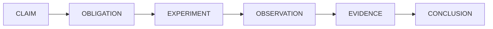

# CodeWitness

**Independent verification engine for AI-generated software.**

CodeWitness does not generate code. It answers one question:

> *"What evidence do we have that this code satisfies its requirements and behaves correctly?"*

It answers it by compiling the project, running its tests, analysing it, generating additional
adversarial tests, executing them, searching for counterexamples, and then reporting what was
observed — with the evidence attached. A language model's opinion is recorded as a suggestion and
never counted as proof.



---

## Quick start

---


```bash
# 1. Build (needs Java 25+ and Maven)
./build.sh

# 2. See what CodeWitness finds in a project that contains deliberate defects
./demo.sh
```

The demo verifies `fixtures/withdrawal-ledger`, a small Java project with four introduced defects
behind five requirements. At the time of writing it produces:

```text
Requirements
  ✗ R-001    Rolling withdrawal limit     FAILED
  ✗ R-002    Fees are applied to the rec… FAILED
  ✗ R-003    Negative amounts are reject… FAILED
  ✗ R-004    Multiple concurrent withdra… FAILED
  ? R-005    Rounding of computed totals  UNVERIFIED

Counterexamples
  CE-001  R-001  inputs: {t1=85800000, a1=700, t2=90000000, a2=700}  actual: 1400
```

R-001 fails because the ledger applies the limit per calendar day: two withdrawals of 700 an hour
apart, across midnight, total 1,400 in a rolling 24-hour window. R-005 has no way to be executed, so
it is `UNVERIFIED` — which is the honest answer, not a failure.

The launcher is `./codewitness` in the repository root. `./build.sh` builds the jar it needs but does
not install a `codewitness` command on `PATH`, so run it from the checkout (or set `CODEWITNESS_JAR`
and call it by path).

Every language is detected and verified the same way. The per-language quick starts, and what each adapter
needs installed, are in [`docs/languages.md`](docs/languages.md).

---

## What CodeWitness is not

- It is not a code generator.
- It is not an oracle: it never says "this code is correct". It says what was observed and what
  remains unknown.
- It never converts "the tests pass" into "the requirement holds" unless the tests it *executed*
  actually exercised that requirement.
- It never treats a language model's opinion as evidence.
- It does not modify source code. A failing requirement produces evidence and a reproduction
  command, not a patch.

---

## The five verdicts

Every requirement ends up in exactly one state:

| Status | Meaning |
| --- | --- |
| `VERIFIED` | Every planned obligation was discharged by an executed experiment, and nothing contradicted the requirement. |
| `PARTIALLY_VERIFIED` | Some obligations were discharged; significant cases remain unverified. |
| `FAILED` | An executed experiment (or a deterministic analyzer) reproduced a violation. The evidence contains the exact input. |
| `UNVERIFIED` | CodeWitness could not establish sufficient evidence either way. This is a legitimate and common result. |
| `BLOCKED` | Verification could not proceed because of an infrastructure or project problem: a failed build or a missing build tool. **A failed build is reported as `BLOCKED`, never as `FAILED`.** |

An overall run status is derived from the individual verdicts, and it is deliberately conservative: a
single counterexample makes the whole run `FAILED`; blocked verification never becomes a pass. If the
budget runs out before every requirement is discharged, the run as a whole is reported `BLOCKED` and
exits non-zero: the requirements it did reach keep their own verdicts, the ones it never reached stay
`UNVERIFIED`, and a truncated run never reports zero failures as success. A budget that stops the work
says so: `budget.exhausted` is set and `budget.exhaustedReason` names the limit that was reached
(`max_duration`, `max_generated_tests` or `max_llm_calls`), so a run that ran out of room cannot be read
as one that had nothing left to do.

A `BLOCKED` verdict outranks a counterexample, because a project that does not build cannot be verified
as a whole. That precedence does not discard what was observed: when an executed experiment did record a
counterexample for a requirement whose build failed, the verdict's reason names the counterexample and it
stays in the report.

---

## Command line

```bash
./codewitness verify <project>      # the full pipeline, producing report.html and report.json
./codewitness inspect <project>     # detection only: language, build system, modules, sources, tests
./codewitness test <project>        # compile and run the existing test suite only
./codewitness report <run-id>       # print a stored run, or list recent runs
./codewitness reproduce <run-id>    # print (or with --run, execute) the command that replays a counterexample
./codewitness clean <project>       # delete stored run data
./codewitness init <project>        # write starter codewitness.yaml and requirements.md
./codewitness issues [--project .]  # list, or mark resolved, faults CodeWitness recorded in itself
./codewitness mcp                  # serve the tools over the Model Context Protocol on stdio
./codewitness version
```

Useful `verify` flags: `--requirements <file>`, `--config <file>`, `--output <dir>`,
`--max-duration 10m`, `--max-generated-tests 100`, `--in-place`, `--fail-on-unverified`,
`--no-tests`, `--no-mutation`, `--no-generated-tests`, `--no-static-analysis`, `--no-security`,
`--llm`, `--json`, `--quiet`, `--sarif <file>`, `--baseline <report.json>`.

Exit codes are part of the interface:

| Code | Meaning |
| --- | --- |
| `0` | The run completed and no requirement is `FAILED` or `BLOCKED`. By default an `UNVERIFIED` requirement does not change this: exit `0` means "nothing failed", not "everything passed". |
| `1` | At least one requirement is `FAILED`, or `--fail-on-unverified` was given and some requirement is not `VERIFIED`. |
| `2` | Verification was `BLOCKED` (failed build, missing build tool, exhausted budget). `inspect` and `test` also use `2` when no adapter or build tool can be found, and `report`/`reproduce` when a stored run is unknown. `issues` uses `2` when `--resolve` names an id that was never recorded. |
| `3` | The command could not be used, or could not finish its job: a command-line or configuration error, an unhandled internal failure, a `--requirements` file that does not exist, a `clean` that could not delete, or a `reproduce --run` that could not start its command. Also used when a run completed but its result could not be stored — a verification whose evidence cannot be read back is not evidence, so this is a failure rather than a warning. The `./codewitness` launcher also exits `3` when no built jar is found. |

---

## Self-issue log

CodeWitness records faults it finds in **itself** — an unexpected exception, a phase or adapter that
crashed, a report artefact it could not write, a language it detected but cannot verify — in a durable
journal next to the project's run data:

```text
<project>/.codewitness/self-issues/
  SELF-ISSUES.md   # grouped digest: stable id, source frame, command, run and stack trace
  issues.jsonl     # one row per occurrence, machine-readable and append-only
  resolved.jsonl   # resolutions, with timestamps
```

This is not a list of findings about the project. A failing test, a surviving mutant, a compiler
error or a dependency advisory is the product working, and it is reported in the run, never here. A
self-issue never changes a requirement verdict or the exit code. Only the CLI's unhandled-exception
path and the engine's own catch blocks write to the journal.

Review it, or tell a future agent to fix an entry:

```bash
./codewitness issues --project .                       # open issues
./codewitness issues --project . --json                # the same for scripts
./codewitness issues --project . --all                 # include resolved issues
./codewitness issues --project . \
    --resolve CWI-1A2B3C4D --note "fixed by ..."       # keep the history, close the issue
```

The id is stable across runs: it is derived from the category, exception type and source frame. A
message is used only when there is no source frame to identify the fault, because messages often carry
a run directory or a temporary path that changes every run. Repeating a fault updates one entry instead
of creating a new one. A fault that recurs after its resolution is open again automatically. `verify`
prints a one-line pointer when a run records something new, and `SELF-ISSUES.md` contains a
ready-to-use request for a future agent.

The location defaults to the project being verified. It stays with the project even when `--output`
moves the run data, so a temporary output directory cannot take the journal with it. Set
`CODEWITNESS_SELF_ISSUES_DIR` to keep one central journal, or `CODEWITNESS_SELF_ISSUES=off` to disable
recording. The equivalent system properties are `codewitness.selfIssues.dir` and
`codewitness.selfIssues.enabled`.

---

## MCP server

`./codewitness mcp` serves the same engine over the Model Context Protocol on standard input and
standard output. It is a normal stdio MCP server: one JSON-RPC message per line, standard output
reserved for protocol frames, and progress/errors on standard error.

```bash
./codewitness mcp
```

Tools:

| Tool | What it does |
| --- | --- |
| `version` | Version, Java runtime and MCP protocol revision. |
| `inspect` | Detection only: language, build system, modules, sources, tests, capabilities. |
| `test` | Compile and run the existing test suite only. |
| `verify` | Full verification. Returns verdicts, counterexamples, report paths and an exit code. |
| `report` | Read a stored run, or list recent runs. |
| `issues` | List the self-issue journal, or mark entries resolved. |
| `reproduce` | Show the command(s) that replay a recorded counterexample. |

Verification exit codes stay verification results, not MCP errors: `0` = nothing failed, `1` = a
requirement failed, `2` = the run was blocked, `3` = the tool could not run. A full `verify` can take
minutes, so a client should allow a correspondingly long tool-call timeout.

For DSH, one entry in the MCP client configuration is enough; the server is the normal launcher with
the `mcp` argument:

```yaml
- insert:
    - id: codewitness-mcp
      name: "@deepseek-ai/dsh-mcp-client"
      config:
        serverName: codewitness
        transport: stdio
        command: /path/to/CodeWitness/codewitness/codewitness
        args: [mcp]
        cwd: /path/to/CodeWitness
        env:
          JAVA_HOME: /path/to/CodeWitness/.tools/jdk-25
          PATH: "/path/to/CodeWitness/.tools/jdk-25/bin:/path/to/CodeWitness/.tools/maven/bin:/usr/local/bin:/usr/bin:/bin:/usr/sbin:/sbin"
          HOME: /path/to/CodeWitness/.tools/selfcheck-home
          JAVA_TOOL_OPTIONS: "-Dmaven.repo.local=/path/to/CodeWitness/.m2/repository"
        toolCallTimeoutMs: 1800000
```

The stdio client scrubs ambient credentials, so `JAVA_HOME`, `PATH` (including Maven), `HOME` and the
Maven repository property must be declared explicitly. Its tools appear to the model as
`mcp__codewitness__verify`, `mcp__codewitness__issues`, and so on. The server itself is a local process
running with your permissions; it is not a security sandbox for untrusted projects.

---

## Requirements

Requirements are plain text with stable identifiers. Markdown:

```markdown
# R-001 Rolling withdrawal limit

A customer may withdraw at most 1,000 during any rolling 24-hour period.
A withdrawal that would exceed the limit must be rejected.
The system must behave correctly when multiple withdrawal requests occur concurrently.
```

or YAML, which additionally lets you declare structured properties, source paths and test classes:

```yaml
requirements:
  - id: R-001
    title: Rolling withdrawal limit
    description: A customer may withdraw at most 1,000 during any rolling 24-hour period.
    properties:
      - type: upper_bound
        value: 1000
      - type: concurrency
    paths:
      - src/main/java/com/example/account/WithdrawalLedger.java
    tests:
      - com.example.account.WithdrawalLedgerTest
```

The natural language text is authoritative. Anything structured that CodeWitness derives from it —
by heuristic or by language model — is labelled as an *interpretation* in every report.

Two declaration mistakes are reported rather than assumed away, because either one silently removes
evidence: a requirements document that names the same id twice (the repeated heading is verified twice,
but a report keyed by id can only show one verdict per id, so the ids are named on the console and in the
limitations), and a scenario whose `requirement` names an id the requirements document does not declare
(the planner matches scenarios by walking the requirements, so an orphan scenario was simply never
visited — a typo silently disabled the only executable evidence for that requirement).

---

## Versioning and what 1.0 means

A major version is a promise about what will not break. CodeWitness 1.0 makes it about these, and only these:

- **the command line**: the commands, their flags, and the exit codes in the table above;
- **the report documents**: `report.json` keys, the SARIF profile, and the `Status`/`Run status` vocabulary;
- **the configuration**: every key `codewitness.yaml` understands;
- **the adapter SPI**: `LanguageAdapter`, `VerificationTools.*` and `Capability`, which is what a new language
  is written against.

Adding to any of those is a minor release. Renaming or removing is a major one. Everything else — internal
structure, artefact layout under `.codewitness/runs/`, the wording of a limitation — may change in a minor
release, because those are implementation, and calling them an interface would freeze mistakes.

**What 1.0 is not.** It is not a claim that verification is complete. The tool's own self-check still reports one
requirement `UNVERIFIED` — the exit-code contract, because a scenario cannot yet assert anything about a
*process* — and that is the honest answer rather than a failure. Findings from heuristic rules are advisory and
never fail a requirement. The `local-process` sandbox is a resource boundary, not a security boundary, and every
report says so. The open work is in [`docs/backlog.md`](docs/backlog.md), with the reasoning.

---

## Backlog

What is known to be wrong or worth doing next lives in [`docs/backlog.md`](docs/backlog.md), together with the
release that closed each completed item. It is in the repository rather than in somebody's head because a backlog
that lives in a conversation expires with the conversation.

---

## Releasing

Release notes live in the repository: [`docs/release-notes/<version>.md`](docs/release-notes), backfilled to
0.1.5. A release's notes are the file whose name is its version, so the repository's account of its own history
travels with the code instead of living beside somebody's checkout.

A release is a tag whose version agrees in three places — the tag itself, the root `pom.xml` version every module
inherits, and the version the tool reports — with the shaded jar attached. Automation for that is landing as its
own change (`.github/workflows/release.yml`); until it does, a release is cut with those three checks by hand,
which is what every release so far has done.

---

## Building and testing

```bash
./build.sh                      # package everything
mvn test                        # unit and integration tests
mvn -Pe2e test                  # plus the end-to-end tests that verify the fixture projects
mvn -pl codewitness-core test   # one module
```

`mvn -Pe2e test` requires a Maven executable on `PATH` (`MAVEN_HOME` and `M2_HOME` are honoured),
plus Python 3, Cargo, Go, Node, the .NET SDK, CMake with CTest, PHP with Composer, Ruby with Bundler,
a Swift toolchain, Icarus Verilog with `vvp`, GHDL and Free Pascal
for the Python, Rust, Go, TypeScript, JavaScript, C#, C/C++, PHP, Ruby, Swift, Verilog, VHDL and Pascal
fixtures, and network access the
first time, because it builds real projects. The Kotlin fixture
needs no toolchain of its own beyond Maven: it is a Maven build with `kotlin-maven-plugin`, so the
compiler, the standard library and Surefire are resolved from a repository the way a dependency is. The C# fixture
needs no toolchain of its own beyond the SDK: its sandbox config sets `allow_network: false`, and it works because the
SDK's test host packages are already in the machine's NuGet cache on any machine that has run
`dotnet test` before. The C and C++ fixture needs CMake and CTest and nothing else — it fetches no
package — so it builds and tests without reaching for anything. The PHP fixture needs an interpreter
and Composer and nothing else installed: PHPUnit is a Composer dependency rather than a part of the
toolchain, so the first run resolves it from Packagist and the fixture allows network access for that
reason, exactly as a real project's `composer install` needs it. The Ruby fixture is the same story with
a different package manager: RSpec arrives from RubyGems as a bundle dependency, so the first run needs
network access for `bundle install` and nothing else is installed by hand. The Swift fixture is the
opposite case: XCTest ships with the toolchain and the package declares no dependencies, so the sandbox
config sets `allow_network: false` and the run compiles and tests offline with nothing installed by
hand. The Verilog fixture is the same case as the Swift one: `iverilog` and `vvp` ship together and the
tree declares no dependencies, so its sandbox config sets `allow_network: false` and the run compiles,
simulates, analyses and mutates offline with nothing installed by hand. The VHDL fixture is the same case
again on the toolchain side: GHDL is one executable that analyses, elaborates and simulates, and the tree
declares no dependencies, so its sandbox config sets `allow_network: false` and the run analyses,
elaborates, simulates, analyses and mutates offline with nothing installed by hand. The Pascal fixture is the same
case again: Free Pascal is a compiler and fpcunit ships inside the same distribution, so its sandbox
config sets `allow_network: false` and the run compiles, tests, analyses and mutates offline with
nothing installed by hand. An end-to-end test is skipped
rather than failed when its toolchain is absent.

---

---

The project applies its own strongest technique to itself: `selfcheck/codewitness.yaml` scopes PIT to the verdict
logic, and the suite kills 31 of 31 mutants. The measurement, and the gap the first run exposed, are in
[`docs/status.md`](docs/status.md#mutation-testing-of-codewitnesss-own-verdict-logic).

## Documentation

Everything that is reference rather than introduction lives in its own file, so this page stays something a person can
read in one sitting:

| Document | What is in it |
| --- | --- |
| [`docs/languages.md`](docs/languages.md) | the seventeen languages, what each adapter needs installed, and what it can and cannot verify |
| [`docs/scenarios.md`](docs/scenarios.md) | how a requirement is executed: the modes, process mode, inputs and invariants |
| [`docs/writing-scenarios.md`](docs/writing-scenarios.md) | the scenario reference, field by field |
| [`docs/configuration.md`](docs/configuration.md) | every `codewitness.yaml` key |
| [`docs/findings-in-ci.md`](docs/findings-in-ci.md) | SARIF, baselines and suppression: findings where reviews happen |
| [`docs/reports.md`](docs/reports.md) | the JSON and HTML reports, and what a run records for reproducibility |
| [`docs/security.md`](docs/security.md) | the execution model, its limits, and the hardened XML loader |
| [`docs/project-layout.md`](docs/project-layout.md) | the module map |
| [`docs/status.md`](docs/status.md) | the honest status of every feature, claimed and observed |
| [`docs/backlog.md`](docs/backlog.md) | what is known to be wrong or worth doing next |
| [`docs/release-notes/`](docs/release-notes) | what each release changed and why |
| [`ARCHITECTURE.md`](ARCHITECTURE.md) | the layered architecture, the evidence chain, and why the verdict rules are what they are |
| [`CONTRIBUTING.md`](CONTRIBUTING.md) | how to build, test, add a fixture, add a language adapter |
| [`docs/verification-model.md`](docs/verification-model.md) | requirements, obligations, evidence and verdicts in detail, with worked examples |
| [`docs/fixtures.md`](docs/fixtures.md) | the deliberately defective projects and what each proves |
| [`docs/demo.md`](docs/demo.md) | a walkthrough of a real run, with the observed output |

---

## Licence

Apache License 2.0 — see [`LICENSE`](LICENSE).

Copyright 2026 thread3d. You may use, modify and redistribute this work, including
commercially, provided you keep the copyright and licence notices and state significant changes;
the licence also grants an express patent licence and comes without warranty.

That choice was made for a tool that gets wired into build pipelines: the patent grant matters more
here than the brevity of MIT, and it is compatible with everything CodeWitness depends on (SnakeYAML,
Jackson, picocli, sqlite-jdbc and slf4j under Apache-2.0/MIT; JUnit under the EPL-2.0, test scope only).
