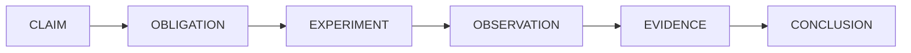

# CodeWitness

**Independent verification engine for AI-generated software.**

CodeWitness does not generate code. It answers one question:

> *"What evidence do we have that this code satisfies its requirements and behaves correctly?"*

It answers it by compiling the project, running its tests, analysing it, generating additional
adversarial tests, executing them, searching for counterexamples, and then reporting what was
observed — with the evidence attached. A language model's opinion is recorded as a suggestion and
never counted as proof.



---

## Quick start

```bash
# 1. Build (needs Java 25+ and Maven)
./build.sh

# 2. See what CodeWitness finds in a project that contains deliberate defects
./demo.sh
```

The demo verifies `fixtures/withdrawal-ledger`, a small Java project with four introduced defects
behind five requirements. At the time of writing it produces:

```text
Requirements
  ✗ R-001    Rolling withdrawal limit     FAILED
  ✗ R-002    Fees are applied to the rec… FAILED
  ✗ R-003    Negative amounts are reject… FAILED
  ✗ R-004    Multiple concurrent withdra… FAILED
  ? R-005    Rounding of computed totals  UNVERIFIED

Counterexamples
  CE-001  R-001  inputs: {t1=85800000, a1=700, t2=90000000, a2=700}  actual: 1400
```

R-001 fails because the ledger applies the limit per calendar day: two withdrawals of 700 an hour
apart, across midnight, total 1,400 in a rolling 24-hour window. R-005 has no way to be executed, so
it is `UNVERIFIED` — which is the honest answer, not a failure.

The launcher is `./codewitness` in the repository root. `./build.sh` builds the jar it needs but does
not install a `codewitness` command on `PATH`, so run it from the checkout (or set `CODEWITNESS_JAR`
and call it by path).

Verify a Java project:

```bash
./codewitness verify ./my-java-project --requirements requirements.md
```

or a Python project:

```bash
./codewitness verify ./my-python-project --requirements requirements.md
```

or a Rust project:

```bash
./codewitness verify ./my-rust-crate --requirements requirements.md
```

or a Go module:

```bash
./codewitness verify ./my-go-module --requirements requirements.md
```

or a TypeScript project:

```bash
./codewitness verify ./my-typescript-project --requirements requirements.md
```

or a JavaScript project:

```bash
./codewitness verify ./my-javascript-project --requirements requirements.md
```

or a C#/.NET project:

```bash
./codewitness verify ./my-dotnet-project --requirements requirements.md
```

The language is detected, and a project may be written in several. `LanguageAdapterRegistry.selectAll`
runs **every** adapter that claims part of the tree — a Java service with a TypeScript frontend is two
verifiable projects, and one of them being read is not a reason for the other to disappear. Phases that
belong to a language run once per language against that language's own description; a language whose build
fails blocks only the requirements written in it, and the run is `BLOCKED` only when that failure actually
stopped one from being verified.

JavaScript and TypeScript coexist in one tree. They own disjoint extensions — `js`/`mjs`/`cjs` against
`ts`/`tsx`/`mts`/`cts` — so the split is at the file level, and a TypeScript frontend next to plain
JavaScript tooling is verified in both rather than losing one.

The report says `polyglot` and lists every language it accounted for under `languages`, each entry marked
`verified` or not, so the verdicts cannot be read as if the whole tree were one language. A language the
tree contains that **no** adapter understands is an entry in that same list, marked not verified and naming
the file that gave it away — a language that appears nowhere in the report is indistinguishable from one
that is not there. Recognition comes from `LanguageDetector` implementations discovered like adapters are,
so naming a language CodeWitness cannot verify is a module and a provider file, not an edit to the engine.

`language.adapter: java`, `python`, `rust`, `go`, `typescript`, `javascript` or `csharp` *narrows* the run
to that one adapter instead of being merged with the automatic choice. It is not forced: the named adapter
is used when it exists and actually claims the project, and otherwise the run falls back to
auto-detection — an unknown id is silently ignored rather than reported.

Python support needs only an interpreter: it uses `pytest` when the project has it and the standard library `unittest` runner
otherwise, so a project with no third-party packages can still be verified. Rust support needs only
`cargo`: a dependency-free crate is built, tested, analysed and mutated by the toolchain it already
has, and generated scenarios become ordinary Cargo integration tests. Go support needs only the `go`
tool: a dependency-free module is built,
tested, analysed and mutated by the toolchain it already has, coverage comes from
`go test -coverprofile`, and generated scenarios become ordinary `_test.go` files in the package
under test. TypeScript support needs only Node 22.6 or later: a project with no `node_modules` is
syntax-checked, tested, analysed and mutated by the runtime it already has, and generated scenarios
become ordinary `node:test` modules. JavaScript support needs only Node 18.17 or later: there is no
compiler and no type check anywhere in the pipeline — the build is a syntax check with the runtime's
own parser — and a project with no `node_modules` is checked, tested, analysed and mutated by the
runtime it already has, with generated scenarios becoming ordinary `node:test` modules. C# support
needs only the .NET SDK: a solution is built with `dotnet build` and tested with `dotnet test`,
restore is left enabled but `-p:NuGetAudit=false` is passed on every command, because CodeWitness runs
its own advisory scan and NuGet's own audit would make each build depend on api.nuget.org, and
generated scenarios become xUnit cases in the tree's own test project.

---

## What CodeWitness is not

- It is not a code generator.
- It is not an oracle: it never says "this code is correct". It says what was observed and what
  remains unknown.
- It never converts "the tests pass" into "the requirement holds" unless the tests it *executed*
  actually exercised that requirement.
- It never treats a language model's opinion as evidence.
- It does not modify source code. A failing requirement produces evidence and a reproduction
  command, not a patch.

---

## The five verdicts

Every requirement ends up in exactly one state:

| Status | Meaning |
| --- | --- |
| `VERIFIED` | Every planned obligation was discharged by an executed experiment, and nothing contradicted the requirement. |
| `PARTIALLY_VERIFIED` | Some obligations were discharged; significant cases remain unverified. |
| `FAILED` | An executed experiment (or a deterministic analyzer) reproduced a violation. The evidence contains the exact input. |
| `UNVERIFIED` | CodeWitness could not establish sufficient evidence either way. This is a legitimate and common result. |
| `BLOCKED` | Verification could not proceed because of an infrastructure or project problem: a failed build or a missing build tool. **A failed build is reported as `BLOCKED`, never as `FAILED`.** |

An overall run status is derived from the individual verdicts, and it is deliberately conservative: a
single counterexample makes the whole run `FAILED`; blocked verification never becomes a pass. If the
budget runs out before every requirement is discharged, the run as a whole is reported `BLOCKED` and
exits non-zero: the requirements it did reach keep their own verdicts, the ones it never reached stay
`UNVERIFIED`, and a truncated run never reports zero failures as success.

---

## Command line

```bash
./codewitness verify <project>      # the full pipeline, producing report.html and report.json
./codewitness inspect <project>     # detection only: language, build system, modules, sources, tests
./codewitness test <project>        # compile and run the existing test suite only
./codewitness report <run-id>       # print a stored run, or list recent runs
./codewitness reproduce <run-id>    # print (or with --run, execute) the command that replays a counterexample
./codewitness clean <project>       # delete stored run data
./codewitness init <project>        # write starter codewitness.yaml and requirements.md
./codewitness version
```

Useful `verify` flags: `--requirements <file>`, `--config <file>`, `--output <dir>`,
`--max-duration 10m`, `--max-generated-tests 100`, `--in-place`, `--fail-on-unverified`,
`--no-tests`, `--no-mutation`, `--no-generated-tests`, `--no-static-analysis`, `--no-security`,
`--llm`, `--json`, `--quiet`.

Exit codes are part of the interface:

| Code | Meaning |
| --- | --- |
| `0` | The run completed and no requirement is `FAILED` or `BLOCKED`. By default an `UNVERIFIED` requirement does not change this: exit `0` means "nothing failed", not "everything passed". |
| `1` | At least one requirement is `FAILED`, or `--fail-on-unverified` was given and some requirement is not `VERIFIED`. |
| `2` | Verification was `BLOCKED` (failed build, missing build tool, exhausted budget). `inspect` and `test` also use `2` when no adapter or build tool can be found, and `report`/`reproduce` when a stored run is unknown. |
| `3` | The command could not be used, or failed before it could report: a command-line or configuration error, an unhandled internal failure, a `--requirements` file that does not exist, a `clean` that could not delete, or a `reproduce --run` that could not start its command. The `./codewitness` launcher also exits `3` when no built jar is found. |

---

## Requirements

Requirements are plain text with stable identifiers. Markdown:

```markdown
# R-001 Rolling withdrawal limit

A customer may withdraw at most 1,000 during any rolling 24-hour period.
A withdrawal that would exceed the limit must be rejected.
The system must behave correctly when multiple withdrawal requests occur concurrently.
```

or YAML, which additionally lets you declare structured properties, source paths and test classes:

```yaml
requirements:
  - id: R-001
    title: Rolling withdrawal limit
    description: A customer may withdraw at most 1,000 during any rolling 24-hour period.
    properties:
      - type: upper_bound
        value: 1000
      - type: concurrency
    paths:
      - src/main/java/com/example/account/WithdrawalLedger.java
    tests:
      - com.example.account.WithdrawalLedgerTest
```

The natural language text is authoritative. Anything structured that CodeWitness derives from it —
by heuristic or by language model — is labelled as an *interpretation* in every report.

---

## Scenarios: how a requirement gets executed

CodeWitness cannot invent your API, so you declare how a requirement can be executed. CodeWitness
then supplies the mechanical part: boundary enumeration, seeded random search, execution, and
counterexamples you can replay.

```yaml
scenarios:
  - id: SC-ROLLING
    requirement: R-001
    description: Two withdrawals across midnight, one hour apart
    mode: sequence            # single | sequence | concurrent
    setup: "com.example.account.WithdrawalLedger ledger = new com.example.account.WithdrawalLedger();"
    steps:
      - call: "ledger.withdraw(java.time.Instant.ofEpochMilli(${t1}), ${a1})"
        inputs:
          - name: t1
            type: long
            domain: long
            values: ["85800000"]                 # deterministic boundary case (23:50)
            range: {min: 0, max: 172800000}      # seeded random search
          - name: a1
            type: java.math.BigDecimal
            domain: decimal
            values: ["700"]
            range: {min: 100, max: 900, scale: 2}
      - call: "ledger.withdraw(java.time.Instant.ofEpochMilli(${t2}), ${a2})"
        inputs:
          - name: t2
            type: long
            domain: long
            values: ["90000000"]                 # 01:00 the next day
          - name: a2
            type: java.math.BigDecimal
            domain: decimal
            values: ["700"]
    observation: "ledger.totalWithinLast24Hours(java.time.Instant.ofEpochMilli(${t2}))"
    invariant: "observation.compareTo(new java.math.BigDecimal(\"1000\")) <= 0"
    cases: 300
    seed: 42
```

`${name}` is substituted with a generated variable of the declared `type`, so write `${a1}` and
not `new java.math.BigDecimal(${a1})`. The fragments are written in the project's own language: for a
Python project they are Python statements and expressions, and `${name}` becomes a Python variable:

```yaml
language:
  adapter: python

scenarios:
  - id: SC-ROLLING
    requirement: R-001
    mode: sequence
    setup: |
      from ledger import WithdrawalLedger
      ledger = WithdrawalLedger()
    steps:
      - call: "ledger.withdraw(${t1}, ${a1})"
        inputs:
          - {name: t1, type: int, domain: integer, values: ["85800000"]}
          - {name: a1, type: decimal.Decimal, domain: decimal, values: ["700"], range: {min: 100, max: 900, scale: 2}}
    observation: "ledger.total_within_last_24_hours(${t1})"
    invariant: "observation <= decimal.Decimal(\"1000\")"
```

The invariant is checked after every step. `mode: concurrent` releases eight threads simultaneously
against one shared subject and then checks the invariant. Every failing case reports its exact inputs
plus the seed and case index, which is what makes a counterexample reproducible. Python generated
tests are standard-library `unittest` cases, so they run with or without pytest.

For a Rust project the fragments are Rust statements, the generated test is a Cargo integration test
under `tests/`, and `${name}` becomes a Rust variable:

```yaml
language:
  adapter: rust

scenarios:
  - id: SC-ROLLING
    requirement: R-001
    mode: sequence
    setup: |
      let mut ledger = withdrawal_ledger::WithdrawalLedger::new();
    steps:
      - call: "ledger.withdraw(${t1}, ${a1});"
        inputs:
          - {name: t1, type: i64, domain: integer, values: ["85800000"]}
          - {name: a1, type: i64, domain: integer, values: ["70000"], range: {min: 10000, max: 90000}}
    observation: "ledger.total_within_last_24_hours(${t1})"
    invariant: "observation <= 100000"
```

Rust generated tests use only the standard library, so they compile on any stable toolchain; a value
recorded in a counterexample must implement `Debug`.

For a Go module the fragments are Go statements, the generated test is a `_test.go` file written into
the package under test (so it uses only the standard library and needs no import), and `${name}`
becomes a Go variable. Go rejects unused local variables, so every generated input is blanked with
`_ = name`; the standard packages a fragment might use (`fmt`, `math`, `os`, `regexp`, `sort`,
`strconv`, `strings`, `sync`, `time`, `errors`) are imported and blank-referenced so an unused one
never breaks the build:

```yaml
language:
  adapter: go

scenarios:
  - id: SC-ROLLING
    requirement: R-001
    mode: sequence
    setup: |
      l := New()
    steps:
      - call: "l.Withdraw(${t1}, ${a1})"
        inputs:
          - {name: t1, type: int64, domain: integer, values: ["85800000"]}
          - {name: a1, type: int64, domain: integer, values: ["70000"], range: {min: 10000, max: 90000}}
    observation: "l.TotalWithinLast24Hours(${t1})"
    invariant: "observation <= 100000"
```

Go generated tests use only the standard library and call the package's exported API from within the
same package; a scenario fragment is responsible for using whatever it declares.

For a TypeScript project the fragments are TypeScript statements, the generated test is a `node:test`
module written beside the project's own tests, and inputs are referenced as `#{name}` rather than
`${name}`: `${...}` is template-literal interpolation in TypeScript, so `#{...}` is used instead and
cannot collide with it. An `import` line in `setup` is hoisted to the top of the module, because an
import cannot appear inside a function:

```yaml
language:
  adapter: typescript

scenarios:
  - id: SC-ROLLING
    requirement: R-001
    mode: sequence
    setup: |
      import { WithdrawalLedger } from "../src/ledger.ts";
      const ledger = new WithdrawalLedger();
    steps:
      - call: "ledger.withdraw(#{t1}, #{a1});"
        inputs:
          - {name: t1, type: bigint, domain: integer, values: ["85800000"]}
          - {name: a1, type: bigint, domain: integer, values: ["70000"], range: {min: 10000, max: 90000}}
    observation: "ledger.totalWithinLast24Hours(#{t1})"
    invariant: "observation <= 100000n"
```

TypeScript generated tests use only Node's standard library, so they run on Node 22.6 or later
without a build step; `#{name}` becomes a TypeScript variable of the declared `type`.

For a JavaScript project the fragments are plain JavaScript, the generated test is a `node:test`
module written beside the project's own tests, and inputs are referenced as `#{name}` for the same
reason: `${...}` is template-literal interpolation in JavaScript, so `#{...}` is used instead and
cannot collide with it. The generated file uses the `.test.mjs` extension, so it is unambiguously an
ES module whatever the project's `package.json` declares, and it carries no type annotations:

```yaml
language:
  adapter: javascript

scenarios:
  - id: SC-ROLLING
    requirement: R-001
    mode: sequence
    setup: |
      import { WithdrawalLedger } from "../src/ledger.js";
      const ledger = new WithdrawalLedger();
    steps:
      - call: "ledger.withdraw(#{t1}, #{a1});"
        inputs:
          - {name: t1, type: bigint, domain: integer, values: ["85800000"]}
          - {name: a1, type: bigint, domain: integer, values: ["70000"], range: {min: 10000, max: 90000}}
    observation: "ledger.totalWithinLast24Hours(#{t1})"
    invariant: "observation <= 100000n"
```

JavaScript generated tests use only Node's standard library, so they run on Node 18.17 or later
without a build step; `#{name}` becomes a JavaScript variable, and `type` only selects `bigint`
wrapping.

For a C# project the fragments are C# statements, `${name}` becomes a C# variable, and the generated
test is an xUnit class written into the tree's own test project — a C# test must live in a project
that compiles against the code under test, so there is nowhere else for it to go. The class is
declared in the namespace that project's own tests already use and the production namespaces are
imported, so a scenario writes `new WithdrawalLedger()` without spelling out where the type lives:

```yaml
language:
  adapter: csharp

scenarios:
  - id: SC-ROLLING
    requirement: R-001
    mode: sequence
    setup: |
      var l = new WithdrawalLedger();
    steps:
      - call: "l.Withdraw(${t1}, ${a1})"
        inputs:
          - {name: t1, type: long, domain: integer, values: ["85800000"]}
          - {name: a1, type: long, domain: integer, values: ["70000"], range: {min: 10000, max: 90000}}
      - call: "l.Withdraw(${t2}, ${a2})"
        inputs:
          - {name: t2, type: long, domain: integer, values: ["90000000"]}
          - {name: a2, type: long, domain: integer, values: ["70000"]}
    observation: "l.TotalWithinLast24Hours(${t2})"
    invariant: "observation <= 100000"
```

The generated class is run with `dotnet test --filter FullyQualifiedName~<class>` and removed
afterwards unless `report.keep_generated_tests` is set, with a copy always kept in the run's artefact
store; a failing case reaches the engine as a `CODEWITNESS_COUNTEREXAMPLE|…` line carried in the TRX
failure message, so the counterexample carries data rather than a stack trace.

```bash
mvn -Dtest=Cw_SC_ROLLING_OB_001_Test -Dcodewitness.seed=42 -Dcodewitness.case=37 test
```

See [`docs/writing-scenarios.md`](docs/writing-scenarios.md) for the full reference.

---

## Configuration

`codewitness.yaml` at the project root; every value has a conservative default.

```yaml
project:
  name: payment-service

language:
  adapter: auto          # auto | java | python | rust | go | typescript | javascript | csharp

verification:
  timeout: 15m           # per build or test command
  max_duration: 15m      # whole run
  max_test_generation_iterations: 5
  max_generated_tests: 500
  max_mutation_time: 10m

mutation:      { enabled: true, tool: pitest }
property_testing: { enabled: true, max_scenarios: 50, concurrent: true }
static_analysis:  { enabled: true, analyzers: [javac, heuristics] }
security:
  enabled: true
  vulnerabilities:       # dependency advisories; off by default, and needs network access
    enabled: false
    source: osv          # osv
    endpoint: https://api.osv.dev
    timeout: 30s
    max_dependencies: 500
    fail_on: high        # critical | high | medium | low | none
tests:         { enabled: true }

llm:
  enabled: false         # advisory only, off by default
  provider: none         # none | openai-compatible
  api_key_env: CODEWITNESS_LLM_API_KEY
  max_calls: 0

report:  { html: true, json: true }
sandbox:
  mode: local-process    # local-process | docker
  allow_network: false
```

The language model is optional, disabled by default, and never decides anything. When it is enabled,
its output is stored as `LLM_ANALYSIS` evidence with `ADVISORY` confidence,
`generatedByLlm = true` and `executedIndependently = false`, and it is reported as an unexecuted
suggestion. Source code and project files are treated as untrusted data and fenced accordingly, so
an "ignore all previous instructions" comment inside a source file stays data.

---

## Reports

Every run produces both:

- `report.json` — the canonical machine-readable representation, with run id, environment, status,
  per-requirement verdicts, obligations, evidence, counterexamples, test/mutation/coverage/
  static-analysis summaries, phases, budget usage and limitations;
- `report.html` — a self-contained human report that starts with an executive summary and then shows
  the evidence, including an appendix listing every evidence record with the command that produced it.

Run data lives in `<project>/.codewitness/runs/<run-id>/`: the report files, the raw artifacts
(generated test sources, test and coverage reports) and an isolated copy of the project. Metadata is
also indexed in `<project>/.codewitness/codewitness.db` (SQLite).

---

## Reproducibility

A report is only useful if it can be reproduced, so every run records: the project identifier, the
source revision, the CodeWitness version, the runtime version (the Java version for a Java project,
the .NET SDK version for a C# one), the build tool and its version, the verification configuration
fingerprint, every tool version, the language model identifier if any, the requirements hash, the
isolation level, timestamps and every command that was executed. Evidence records carry their command
and inputs, and counterexamples carry a replayable command.

---

## Security

CodeWitness executes project code, so it treats the project as hostile:

- all execution goes through one sandbox abstraction. The child does not inherit the host
  environment: only an allow-list is forwarded (`PATH`, `JAVA_HOME`, `LANG`, `LC_ALL`, `TZ`, `TMPDIR`,
  `HOME`, `GRADLE_USER_HOME`, `JAVA_TOOL_OPTIONS`, `SDKMAN_DIR`), so credentials and tokens are
  dropped. `MAVEN_OPTS` is explicitly removed, but `JAVA_TOOL_OPTIONS` is forwarded and routinely
  carries proxy settings such as `-Dhttps.proxyHost`, so a proxy variable can still reach the build.
  There is also an isolated working directory, capped output and hard timeouts;
- the project is copied into the run workspace by default, so generated tests and build output never
  touch your working tree;
- `sandbox.mode: docker` runs everything in a container with no network and dropped capabilities;
- the local-process sandbox is a **resource-safety** boundary, not a security boundary, and every
  report says so instead of overstating it.

See [`docs/security.md`](docs/security.md).

---

## Project layout

```
codewitness/
├── codewitness-core/          language-independent verification core
│   ├── model/                 project, build, test, coverage, mutation, finding models
│   ├── evidence/              the evidence model and ledger
│   ├── requirements/          requirement parsing, properties, obligations
│   ├── result/                verdicts, counterexamples, report, budget, run record
│   ├── spi/                   LanguageAdapter, VerificationTools, registries, context
│   ├── engine/                the pipeline, verdict calculator, strategies
│   ├── exec/                  sandbox and process execution
│   ├── io/                    isolated workspace and artifact store
│   ├── config/                codewitness.yaml
│   └── llm/                   advisory provider abstraction and prompt fencing
├── codewitness-adapter-java/  Java 17+ projects (module targets 25), Maven and Gradle, JUnit 5, PIT, JaCoCo
├── codewitness-adapter-python/ Python 3 projects: syntax build, pytest/unittest, heuristics, security,
│                              coverage.py, AST mutation, dependency inventory; no third-party package required
├── codewitness-adapter-rust/   Rust projects: Cargo build and libtest, rustc diagnostics, heuristics,
│                               security, cargo-llvm-cov, built-in source mutation, dependency inventory;
│                               no third-party crate required
├── codewitness-adapter-go/     Go modules: go build and go test -json, go vet diagnostics, heuristics,
│                               security, go test -coverprofile coverage, built-in source mutation,
│                               module inventory; no third-party module required
├── codewitness-adapter-typescript/ TypeScript projects: Node syntax check and tsc, node:test with JUnit
│                               parsing, heuristics, security, V8 coverage from LCOV, built-in source
│                               mutation, dependency inventory; no third-party package required
├── codewitness-adapter-javascript/ JavaScript projects: Node syntax check only (no compiler, no type
│                               check), node:test with JUnit parsing, heuristics, security, V8
│                               coverage from LCOV, built-in source mutation, dependency inventory;
│                               no third-party package required
├── codewitness-adapter-csharp/  C#/.NET projects: dotnet build over the tree's solution, dotnet test
│                               with TRX parsing, Roslyn diagnostics, heuristics, security, coverlet
│                               cobertura coverage, bounded source mutation, NuGet inventory
├── codewitness-storage/       SQLite persistence
├── codewitness-report/        canonical JSON and human HTML reports
├── codewitness-cli/           command line interface
└── fixtures/                  deliberately defective projects used to test all of this
```

Language support lives entirely in the adapters: adding a language means adding a module that
implements `dev.codewitness.core.spi.LanguageAdapter` and registering its providers — not editing the
engine. Recognising a language CodeWitness has no adapter for is the same shape: a module implementing
`dev.codewitness.core.spi.LanguageDetector`, discovered the same way, and the detectors for the languages
nothing here implements live in `codewitness-language-detectors`. A few platform defaults do remain in core
— the `LanguageId` and `BuildSystemId` constants (`JAVA`, `PYTHON`, `RUST`, `GO`, `JAVASCRIPT`,
`TYPESCRIPT`, `CSHARP`, `POLYGLOT` and the rest), the typed `PackageCoordinate` an advisory lookup
needs, and the excluded-directory and build-wrapper names in `WorkspaceManager` — but they are
vocabulary and platform defaults, not language logic, and the engine never switches on a language.
Nothing in core names a language it cannot already verify.

---

## Building and testing

```bash
./build.sh                      # package everything
mvn test                        # unit and integration tests
mvn -Pe2e test                  # plus the end-to-end tests that verify the fixture projects
mvn -pl codewitness-core test   # one module
```

`mvn -Pe2e test` requires a Maven executable on `PATH` (`MAVEN_HOME` and `M2_HOME` are honoured),
plus Python 3, Cargo, Go, Node and the .NET SDK for the Python, Rust, Go, TypeScript, JavaScript and
C# fixtures, and network access the first time, because it builds real projects. The C# fixture is
the one that needs none: its sandbox config sets `allow_network: false`, and it works because the
SDK's test host packages are already in the machine's NuGet cache on any machine that has run
`dotnet test` before. An end-to-end test is skipped rather than failed when its toolchain is absent.

---

## Honest status of this MVP

Implemented and exercised end to end:

- detection of Java 17+ projects, including Java 25, using Maven or Gradle, with multi-module layouts;
- compilation and existing-test execution through the project's own build tool, with results parsed
  from raw Surefire/Failsafe/Gradle XML reports;
- static analysis: compiler diagnostics (`-Xlint:all`) plus an auditable table of deterministic
  heuristics, and a separate security rule set;
- coverage through JaCoCo (agent attached automatically when no report exists);
- mutation testing through PIT, including surviving-mutant reporting;
- requirement parsing (Markdown and YAML), stable ids, heuristic property extraction, obligation
  planning;
- generated adversarial tests from declared scenarios: boundary enumeration, seeded random search
  and concurrent execution;
- counterexample extraction from structured failure messages, with replayable reproduction commands;
- requirement → evidence mapping, conservative verdict computation;
- SQLite persistence, canonical JSON and self-contained HTML reports, console reporting;
- a CLI with `verify`, `inspect`, `test`, `report`, `reproduce`, `clean`, `init`, `version`.

The Python adapter is implemented and exercised end to end as well (`fixtures/python-withdrawal-ledger`):

- detection of Python 3 projects (`pyproject.toml`, `setup.py`, `setup.cfg`, `requirements.txt`,
  `Pipfile`, `tox.ini`, `pytest.ini`), flat and `src/` layouts, and a project virtual environment when
  one exists;
- a syntax build (`compile()` over every source file) whose failures are `BLOCKED`, never a defect;
- existing tests through pytest when the interpreter can import it, and through a standard-library
  `unittest` runner that writes the same JUnit XML when it cannot - so no third-party package is
  required;
- heuristic correctness rules and a separate security rule set for Python;
- coverage through `coverage.py`, reported as not measured when it is absent;
- mutation testing through the standard library `ast` module, with a bounded operator set, a mutant
  cap and a wall-clock budget;
- a dependency inventory from the project's manifests, resolved from `poetry.lock` or from requirements
  pinned with `==` when either exists, and from the declared names and version *ranges* otherwise; when
  nothing pins a version the report says the advisory scan cannot query these distributions rather than
  implying they are clean;
- generated adversarial tests from declared scenarios: the fragments are Python, the generated tests
  are `unittest` cases, and a counterexample carries the exact inputs plus a replayable command.

Python support is new, and the honest limits are:

- mutation uses a small, documented operator set (arithmetic, comparison boundaries, boolean
  operators and boolean constants) rather than a dedicated framework such as mutmut or cosmic-ray;
- coverage and pytest are used when present and reported as unavailable when not: CodeWitness never
  installs anything;
- the heuristic rule table is intentionally small and has a known false-positive profile, exactly
  like the Java one.

The Rust adapter is implemented and exercised end to end as well (`fixtures/rust-withdrawal-ledger`):

- detection of Cargo projects (`Cargo.toml`, `Cargo.lock`, `rust-toolchain.toml`) and the
  conventional `src/` and `tests/` layout, with a hyphenated package name normalised to the crate
  identifier Rust code uses;
- a build through `cargo build --all-targets` — the library, binaries, examples and tests — whose
  rustc diagnostics are parsed from rustc's own output, so a compile error is `BLOCKED` and never a
  code defect;
- existing tests through `cargo test`, parsed from libtest's line protocol because Cargo has no JUnit
  XML report, with the raw output stored as an artefact so the observation can be checked;
- heuristic correctness rules and a separate security rule set for Rust;
- coverage through `cargo-llvm-cov` when it is installed, and an honest "not measured" when it is not;
- mutation testing through a bounded, built-in source mutator (arithmetic, comparison boundaries,
  boolean operators and boolean constants) that flips one operator at a time and re-runs the suite;
- a dependency inventory from `Cargo.lock` when it exists — every crate the lock file resolves, including
  transitive ones, and so queryable — and from the declared crate names and version ranges otherwise; only
  a lock file carries the resolved version an advisory is a statement about, and the report says which of
  the two it read;
- generated adversarial tests from declared scenarios: the fragments are Rust, the generated tests
  are standard-library Cargo integration tests, and a counterexample carries the exact inputs plus a
  replayable `cargo test` command.

The honest limits of Rust support are:

- Cargo has no machine-readable test report, so tests are read from libtest's line protocol rather
  than from a report file; the protocol is stable, but it is a protocol rather than a document;
- mutation uses a deliberately small operator set rather than `cargo-mutants`, and only operators
  surrounded by whitespace are considered, so an unformatted expression may be skipped;
- coverage needs `cargo-llvm-cov` to be installed, and only its aggregate JSON totals are read;
  per-file coverage is not reported;
- a generated test calls the crate by name (`my_crate::Thing`) and any value recorded in a
  counterexample must implement `Debug`; the scenario documentation states both;
- the heuristic rule table is intentionally small and has a known false-positive profile.

The Go adapter is implemented and exercised end to end as well (`fixtures/go-withdrawal-ledger`):

- detection of Go modules (`go.mod`, `go.sum`, `go.work`), the module path and declared language
  version, and the package tree (Go has no separate test root: tests sit beside the code as
  `*_test.go`, and only those files are treated as tests);
- a build through `go build ./...` whose diagnostics are parsed from the toolchain's own
  `file:line:column: message` output, so a compile error is `BLOCKED` and never a code defect;
- existing tests through `go test -json`, read from Go's machine-readable event stream rather than
  from console output, with `-count=1` so a remembered cache hit is never mistaken for an experiment;
- static analysis runs `go vet ./...` and reads its diagnostics alongside the adapter's heuristic
  correctness rule table, and a separate security rule set for Go;
- coverage through the built-in `go test -coverprofile`, so statement coverage is available without
  installing anything; branch coverage is not part of the profile and is reported as an empty
  `0/0` rather than guessed;
- mutation testing through a bounded, built-in source mutator (arithmetic, comparison boundaries,
  boolean operators and boolean constants) that flips one operator at a time and re-runs the suite;
- a dependency inventory from `go.mod`, carrying the version each `require` directive selects, which is
  what makes the Go dependencies queryable at all; `go.sum` is deliberately not used, because it keeps
  every version ever downloaded rather than the one the build selects, and asking about those would report
  advisories against versions the build no longer uses;
- generated adversarial tests from declared scenarios: the fragments are Go, the generated
  `_test.go` files are placed in the package under test, and a counterexample carries the exact
  inputs plus a replayable `go test` command.

The honest limits of Go support are:

- `go build ./...` does not compile test files; a package whose tests do not compile is reported by
  the test phase as tests that did not execute, not by the build phase;
- mutation uses a deliberately small operator set rather than a dedicated framework, and only
  operators surrounded by whitespace are considered, so an unformatted expression may be skipped;
- the coverage profile carries statements only: branch coverage is reported as an empty `0/0`, not
  as a measured percentage;
- a generated test is written into the package under test and may call both exported and unexported
  identifiers, but it uses only the fixed standard-library import set listed above, and a fragment
  that declares a local variable must use it (Go rejects an unused variable);
- the heuristic rule table is intentionally small and has a known false-positive profile.

The TypeScript adapter is implemented and exercised end to end as well
(`fixtures/typescript-withdrawal-ledger`):

- detection of Node/TypeScript projects (`package.json`, `tsconfig.json` and their lock files) and the
  conventional `src/` plus `tests/` layout, with the pinned package manager (npm, pnpm, yarn or bun)
  recorded rather than assumed;
- a build with the project's own `tsc --noEmit` when a compiler is installed and a `tsconfig.json`
  exists, and otherwise a syntax check using the runtime's own type stripper — the same parser that will
  execute the files — with the difference stated in the report because the syntax check does not check
  types;
- existing tests through Node's built-in runner (`node --test`), read from the JUnit report the runner
  writes rather than from console output, with the raw report stored as an artefact;
- heuristic correctness rules and a separate security rule set for TypeScript (`CW-TS-SEC-001..007`,
  `CW-TS-REL-001..004`, `CW-TS-TYPE-001..002`, `CW-TS-BUG-001..002`, `CW-TS-NUM-001..002`,
  `CW-TS-DATE-001` and `CW-TS-TEST-001`);
- coverage through V8 (`node --test --experimental-test-coverage`), read from its LCOV export;
- mutation testing through a bounded, built-in source mutator (arithmetic, comparison boundaries,
  equality, boolean operators and boolean constants) that flips one operator at a time and re-runs the
  suite, excluding mutants the runtime cannot parse;
- a dependency inventory from `package-lock.json` when it exists — every package the install would ship,
  including transitive ones — and from the declared names and version ranges otherwise;
- generated adversarial tests from declared scenarios: the fragments are TypeScript, the generated tests
  are `node:test` modules, and a counterexample carries the exact inputs plus a replayable `node --test`
  command.

The honest limits of TypeScript support are:

- TypeScript is executed by Node's type stripper, so only erasable syntax is supported: `enum`,
  `namespace` with a runtime value and parameter properties cannot be run (and `.tsx` cannot be checked
  or executed) without a compiler; the adapter reports that rather than pretending otherwise;
- tests run through Node's built-in runner, so a project whose tests are written for Jest or Vitest is
  detected and reported, but those runners are not installed or invoked;
- mutation uses a deliberately small operator set rather than Stryker, and only operators surrounded by
  whitespace are considered, so an unformatted expression may be skipped;
- coverage is V8 coverage, so only the files the tests actually loaded appear in the report: a source
  file no test imports is not counted as 0%, it is absent, and the report says so;
- scenarios reference inputs as `#{name}` rather than `${name}` because `${...}` is template-literal
  interpolation in TypeScript;
- a generated test is written beside the project's own tests and its `setup` import is relative to that
  directory, which is why the convention is stated in the documentation;
- the heuristic rule table is intentionally small and has a known false-positive profile.

The JavaScript adapter is implemented and exercised end to end as well
(`fixtures/javascript-withdrawal-ledger`):

- detection of Node/JavaScript projects (adapter id `javascript`, language id `javascript`, build
  system `node`): a `package.json` beside JavaScript sources, or an unambiguous Node test file such as
  `*.test.js` or `*.spec.mjs`, with the conventional `src/` plus `tests/` layout. It deliberately
  refuses a project that has a `tsconfig.json` or `tsconfig.base.json` or any
  `.ts`/`.tsx`/`.mts`/`.cts` source, leaving it to the TypeScript adapter. `.jsx` is not a source or
  test extension here either, because Node cannot execute JSX without a transform, so a project whose
  sources or tests are all JSX is left unclaimed rather than run without its transform;
- a build that is a syntax check only: `node --check` over every source and test file through a
  generated helper script. JavaScript has no compiler and no type check anywhere in the pipeline, and
  the build message says so;
- existing tests through Node's built-in runner (`node --test --test-reporter=junit`), read from the
  JUnit report the runner writes rather than from console output, with the raw report stored as an
  artefact; Node 18.17 or later is required for that reporter;
- heuristic correctness rules and a separate security rule set for JavaScript (`CW-JS-SEC-001..007`,
  `CW-JS-REL-001..004`, `CW-JS-BUG-001..002`, `CW-JS-NUM-001..002`, `CW-JS-DATE-001` and
  `CW-JS-TEST-001`). The TypeScript-only escape-hatch rules — `CW-TS-TYPE-001` for `any`,
  `CW-TS-TYPE-002` for a non-null assertion, and `CW-TS-REL-002` for `@ts-ignore`, `@ts-nocheck` and
  `@ts-expect-error` — have no JavaScript equivalent and are deliberately absent;
- coverage through V8 (`node --test --experimental-test-coverage --test-reporter=lcov`), read from
  its LCOV export;
- mutation testing through a bounded, built-in source mutator (provider id `javascript-text-mutation`,
  tool id `javascript-text`; arithmetic, comparison boundaries, equality, boolean operators and
  boolean constants) that flips one operator at a time and re-runs the suite, excluding mutants the
  runtime cannot parse;
- a dependency inventory from `package-lock.json` when it exists — every package the install would ship,
  including transitive ones — and from the declared names and version ranges otherwise;
- generated adversarial tests from declared scenarios: the fragments are plain JavaScript, the
  generated tests are ordinary `node:test` modules written with the `.test.mjs` extension, a failing
  case throws the same `CODEWITNESS_COUNTEREXAMPLE|…` protocol line, and a counterexample carries the
  exact inputs plus a replayable `node --test` command.

The honest limits of JavaScript support are:

- JavaScript has no compiler and no type check, here or anywhere else in the pipeline: the build
  verifies syntax with the runtime's own parser and nothing more. CodeWitness never claims a type
  check happened;
- generated scenario tests are always written as `.test.mjs`, so they are always ES modules whatever
  the project's `package.json` `"type"` says. In a CommonJS project a scenario fragment's `import`
  must therefore use the form Node's ESM/CJS interop supports: a named import works when the CommonJS
  module exposes its exports statically (`exports.Foo = …` or `module.exports = { Foo }`), and
  otherwise the default-import form is needed. The build check and the project's own tests still
  follow the project's module type — `node --check` and `node --test` both honour `package.json`
  `"type"`;
- tests run through Node's built-in runner, so a project whose tests are written for Jest or Vitest is
  detected and reported, but those runners are not installed or invoked;
- `.jsx` needs a transform the runtime does not perform, so it is not a source or test extension for
  this adapter: a `.jsx` test is never collected as if it had run, and a project whose sources or
  tests are all JSX is left unclaimed rather than reported as passing;
- mutation uses a deliberately small operator set rather than Stryker, and only operators surrounded
  by whitespace are considered, so an unformatted expression may be skipped;
- coverage is V8 coverage, so only the files the tests actually loaded appear in the report: a source
  file no test imports is not counted as 0%, it is absent, and the report says so;
- scenarios reference inputs as `#{name}` rather than `${name}` because `${...}` is template-literal
  interpolation in JavaScript, and generated fragments carry no type annotations: `type` only selects
  `bigint` wrapping;
- a generated test is written beside the project's own tests and its `setup` import is relative to
  that directory, which is why the convention is stated in the documentation;
- the heuristic rule table is intentionally small and has a known false-positive profile.

The C#/.NET adapter is implemented and exercised end to end as well
(`fixtures/csharp-withdrawal-ledger`):

- detection of .NET trees in the three ways one announces itself — a solution file, one or more
  project files, or C# sources with no project file at all — with the conventional `src/` and `tests/`
  split; a test project is identified by what it references (`Microsoft.NET.Test.Sdk` or
  `Microsoft.Testing.Platform`) or by an `IsTestProject` declaration, rather than by its name;
- a build through `dotnet build` over the tree's single solution, or over each project when there is
  no single solution, whose Roslyn/MSBuild diagnostics are parsed from the canonical
  `file(line,col): error CS####: message [project]` line shape, so a compile error is `BLOCKED` and
  never a code defect. Restore is left enabled, but `-p:NuGetAudit=false` is passed on every command,
  because CodeWitness runs its own advisory scan and NuGet's own audit would make each build depend
  on api.nuget.org;
- existing tests through one `dotnet test` per test project with `--logger trx`, read from the TRX
  report rather than from console output — a report that starts with a UTF-8 BOM — with classes taken
  from `TestDefinitions`, anything that is not `Passed` or `Failed` recorded as skipped, and a
  failure's `<Message>` carried into the counterexample verbatim;
- static analysis runs over a C# rule table (`csharp-heuristics`, ids `CW-CS-SEC-*`,
  `CW-CS-CORRECT-*`, `CW-CS-REL-*` and `CW-CS-TEST-001`) alongside the Roslyn diagnostics the build
  phase already produced, with one shared `CSharpSourceScan` handling comments, verbatim strings
  (`@"..."`), raw strings (`"""..."""`) and interpolated strings, so the mutation lexis and the
  analyzer can never disagree about where a literal ends. A separate security rule set is filtered
  out of the same table;
- coverage from coverlet's cobertura report, collected with
  `dotnet test --collect:"XPlat Code Coverage"`; a project without `coverlet.collector` comes back
  "not measured", naming the collector instead of reporting zero;
- mutation testing through the shared `CommandMutationTester` and a C# `CSharpLexis`, with a bounded
  operator set (arithmetic, comparison boundaries, boolean operators and boolean constants) that
  flips one operator at a time and re-runs each mutant with `dotnet test --no-restore`;
- a dependency inventory read from `packages.lock.json` when it is present — the resolved graph,
  transitives included — and otherwise from `PackageReference` versions and central `PackageVersion`
  entries, in the `NuGet` ecosystem; a version behind an MSBuild property is reported unresolved
  rather than guessed;
- generated adversarial tests from declared scenarios: the fragments are C#, the generated test is an
  xUnit class written into the tree's own test project — its namespace taken from that project's own
  tests, the production namespaces imported — it is run with
  `dotnet test --filter FullyQualifiedName~<class>`, and it is removed afterwards unless
  `report.keep_generated_tests` is set. A failing case reaches the engine as a
  `CODEWITNESS_COUNTEREXAMPLE|…` line carried in the TRX failure message, so a counterexample carries
  the exact inputs plus a replayable `dotnet test` command.

The honest limits of C#/.NET support are:

- coverage needs `coverlet.collector` in the test project: without it the phase reports the project
  as not measured and names the collector rather than reporting zero;
- restore is left enabled, so a tree whose packages this machine has never restored needs network
  access or a populated NuGet cache before it can build;
- a version that stands behind an MSBuild property is reported unresolved rather than guessed, so the
  advisory scan cannot query it; and a project that references neither test host and declares no
  `IsTestProject` is not treated as a test project, so its tests are not run;
- mutation uses a deliberately small operator set rather than a dedicated framework, and only
  operators surrounded by whitespace are considered, so an unformatted expression may be skipped;
- a tree that holds `.cs` sources but no project file at all is claimed with a warning: the sources can
  be analysed, but there is no project for the SDK to build, so nothing can be compiled, tested or
  mutated.

Implemented but limited, and reported as such:

- **Dependency advisories** are checked only when you turn the scan on. It covers every ecosystem the
  adapters can inventory at a resolved version: Maven (from `dependency:list`), npm and PyPI and
  crates.io (from `package-lock.json`, `poetry.lock` and `Cargo.lock`, or from requirements pinned with
  `==`), Go (from the versions `go.mod` selects) and NuGet (from `packages.lock.json`, or from
  `PackageReference` versions and central `PackageVersion` entries when there is no lock file). A
  dependency an inventory reports without a resolved version cannot be asked about, so the report says
  the scan could not query it rather than implying it is clean. When the scan is on, CodeWitness asks
  OSV which of the resolved dependencies are
  affected and records the answer, the service it asked and when; when it is off, the report says the
  dependencies were *not checked* rather than reporting zero vulnerabilities. An advisory at `fail_on`
  severity or above **fails** the requirements whose own module resolves the vulnerable artifact — the
  attribution is deliberately narrow, so a requirement in `module-a` is not refuted by a dependency that
  only `module-b` pulls in, and each module's dependencies are keyed by their language so a same-named
  module in another language cannot be charged with them. An advisory whose severity the source did not
  state refutes nothing, and an empty result is not a claim that a dependency is unaffected.
- **Gradle** support (detection, commands, report parsing) is implemented and unit tested, but the
  end-to-end demonstration in this repository was exercised with Maven only; no Gradle
  distribution was available in the environment it was built in.
- **Mutation testing** needs the project to give PIT a test-framework plugin (the exact snippet is
  printed when it is missing). CodeWitness does not modify the project to add it.
- **Heuristic analysis** is a small, explicitly documented rule table with a known false-positive
  profile; a clean run is weak evidence. Its rules carry real severities — `CW-SEC-001` is `CRITICAL`
  and `CW-SEC-002`, `CW-SEC-004` and `CW-NUM-001/002` are `HIGH` — but a rule match is not a
  demonstration: findings from the heuristic tables are recorded as advisory evidence with a note,
  and only a finding from a deterministic tool (a compiler, a linter, `go vet`, Roslyn) may refute a
  requirement. One rule in particular, `CW-CONC-001`, fires on any class that reads a mutable private
  field in a condition and writes it in the same file without synchronisation, even when the object is
  never shared. It is advisory: it never changes a verdict.
- **Language model support** is an advisory provider abstraction with one HTTP implementation. It is
  off by default, and no automatic conversion of suggestions into executable tests is implemented.
- **Concurrency** verification depends on the declared scenario; CodeWitness does not infer
  invariants, and a passing concurrent test is evidence, not proof.
- A step that throws is a failure by default, because an unexpected exception is a failure. To say
  "rejecting by throwing is correct", wrap the call in a `try`/`catch` inside the step fragment; see
  [`docs/writing-scenarios.md`](docs/writing-scenarios.md).

Not implemented (deliberately out of MVP scope): formal verification, symbolic execution,
distributed or cloud execution, IDE or VCS integration, autonomous repair.

Where CodeWitness cannot verify something, it says `UNVERIFIED` and explains why. That is a feature.

---

## Licence

Apache License 2.0 — see [`LICENSE`](LICENSE).

Copyright 2026 thread3d. You may use, modify and redistribute this work, including
commercially, provided you keep the copyright and licence notices and state significant changes;
the licence also grants an express patent licence and comes without warranty.

That choice was made for a tool that gets wired into build pipelines: the patent grant matters more
here than the brevity of MIT, and it is compatible with everything CodeWitness depends on (SnakeYAML,
Jackson, picocli, sqlite-jdbc and slf4j under Apache-2.0/MIT; JUnit under the EPL-2.0, test scope only).

## Documentation

- [`ARCHITECTURE.md`](ARCHITECTURE.md) — the layered architecture, the evidence chain and why the
  verdict rules are what they are.
- [`CONTRIBUTING.md`](CONTRIBUTING.md) — how to build, test, add a fixture, add a language adapter.
- [`docs/verification-model.md`](docs/verification-model.md) — requirements, obligations, evidence
  and verdicts in detail, including worked examples.
- [`docs/writing-scenarios.md`](docs/writing-scenarios.md) — the scenario reference.
- [`docs/security.md`](docs/security.md) — the execution model and its limits.
- [`docs/fixtures.md`](docs/fixtures.md) — the deliberately defective projects and what each proves.
- [`docs/demo.md`](docs/demo.md) — a walkthrough of a real run, with the observed output.
