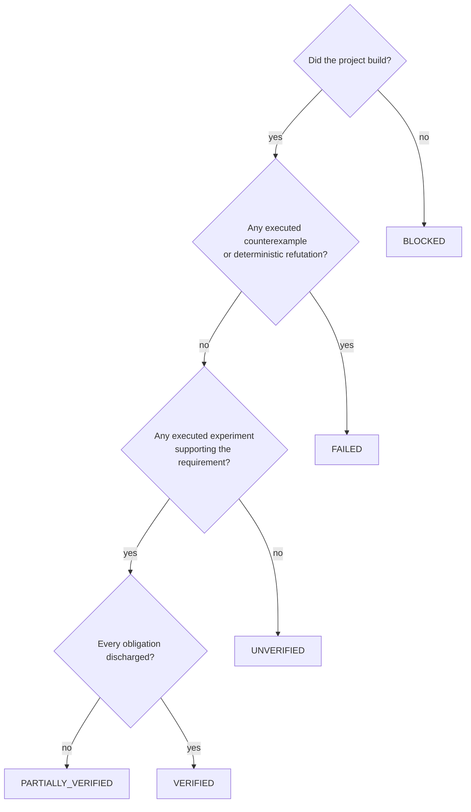

# The verification model

This is the part of CodeWitness worth arguing about. Everything else is plumbing.

## Requirements

A requirement is a natural language statement with a stable identifier:

```markdown
# R-001 Rolling withdrawal limit

A customer may withdraw at most 1,000 during any rolling 24-hour period.
A withdrawal that would exceed the limit must be rejected.
The system must behave correctly when multiple withdrawal requests occur concurrently.
```

The identifier must be stable across runs, because evidence from one run is compared with evidence
from another. CodeWitness takes the id from the heading (`R-001`), and assigns positional ids
(`R-001`, `R-002`, …) when a document has none — recording that it did so.

The **text is authoritative**. CodeWitness may derive structure from it:

```yaml
id: R-001
description: A customer may withdraw at most 1,000 during any rolling 24-hour period.
properties:
  - type: upper_bound
    value: 1000
  - type: rejection
  - type: concurrency
```

That structure is an *interpretation*, and the report says so, next to the original sentence. If the
interpretation is wrong, the original text is still what a human reads.

## Obligations

An obligation is a concrete experiment that would demonstrate something about the requirement. It is
the step that most verification tools skip, and skipping it is how "we ran the tests" becomes "the
requirement holds".

Obligations come from three sources, in decreasing order of strength:

1. **A scenario you declared.** Executable by construction, attributed to you, and the only kind that
   can lead to `VERIFIED`.
2. **A property derived from the text.** For `upper_bound value=1000` the planner records that values
   at, just below and just above 1,000 must behave as the text says. Used by the generators when no
   scenario exists.
3. **A suggestion from a language model.** Advisory. It cannot discharge anything by itself, and it
   is never executed without becoming a real test first.

If none of the three produces anything executable, CodeWitness records a single `MANUAL` obligation
saying so:

> No executable verification was declared for this requirement. CodeWitness cannot attempt it, so it
> must remain UNVERIFIED.

That sentence is the point of the whole exercise.

**Scenarios suppress text-derived obligations.** When a requirement declares a scenario, the planner
does not add the property-derived ones. Otherwise every declared experiment would be accompanied by
permanently unexecuted obligations, and a requirement that had in fact been demonstrated would be
reported as merely partial — a lie in the pessimistic direction. The interpreted properties are still
shown in the report; they are simply not counted as obligations.

## Evidence

Evidence is the atom. Every record contains:

| Field | Why it exists |
| --- | --- |
| `id`, `runId` | So a report can cite it and a reader can find it again. |
| `type` | `COMPILER`, `TEST`, `GENERATED_TEST`, `STATIC_ANALYSIS`, `MUTATION_TEST`, `COVERAGE`, `SECURITY_SCAN`, `COUNTEREXAMPLE`, `LLM_ANALYSIS`, … |
| `status` | `SUPPORTS`, `REFUTES` or `INCONCLUSIVE`. |
| `confidence` | How much weight it carries. |
| `source` | Which tool or strategy produced it. |
| `command`, `inputs`, `output`, `result` | Reproducibility: what was run, with what, and what came back. |
| `artifacts` | Copies of raw reports and generated sources in the run directory. |
| `requirements`, `obligations` | What the observation is about. |
| `generatedByLlm`, `executedIndependently` | Provenance: a model's suggestion is not a result. |
| `reproductionCommand` | How to watch it happen again. |

### Confidence

| Level | Meaning | May decide a verdict? |
| --- | --- | --- |
| `DETERMINISTIC` | A tool executed and produced a fact: a compiler exit code, a test that failed, an analyzer run. | Yes |
| `HIGH` | Deterministic observation with light inference — a mapped test passing. | Can refute, cannot on its own verify |
| `MEDIUM` | Partial coverage, heuristic analysis. | No |
| `LOW` | A single heuristic pattern match. | No |
| `ADVISORY` | A language model's opinion, or a human's. | Never |

The rule that matters: `generatedByLlm && !executedIndependently` is never proof, no matter what
confidence is attached to it.

A mapped test class supports a requirement only when a case in it actually ran. A class the runner
never reached — excluded by a tag, filtered out, not discovered — reports nothing, and its silence is
recorded as `INCONCLUSIVE` with the obligations left `UNVERIFIED`, never as a pass: "no failure was
reported" and "a test passed" are different observations, and only the second one supports anything.

## Counterexamples

A counterexample is the most valuable thing the tool can produce, so it is a first-class record:

- the **exact inputs**, in order, in a machine-readable map;
- **expected** versus **observed**;
- the **invariant** that was violated;
- the **experiment** that observed it (test, analyzer or search) and the evidence id;
- the **seed and case index** when the search was randomised;
- a **reproduction command** and the path of the generated test source.

A failing generated test reports a single structured line, which is what makes this possible:

```
CODEWITNESS_COUNTEREXAMPLE|case=37|seed=42|inputs={t1=85800000, a1=700, t2=90000000, a2=700}|expected=…|actual=1400|invariant=…
```

A counterexample is only recorded when the failure was **observed by execution**. A suggestion from a
model that has not been run is a `SUGGESTION`, and the two are never conflated.

The model is language-independent. The examples in this document use Java because that was the first
adapter, but a Python generated test raises the same line from its standard-library `unittest` case, a
Rust generated test raises it from a Cargo integration test, a Go generated test records it from a
`_test.go` file in the package under test, a TypeScript or JavaScript generated test throws it from a
`node:test` module, a Kotlin generated test throws it as an `AssertionError` inside a JUnit 5 test, a
C# generated test throws it as an `XunitException` inside an xUnit fact — which is
what carries the line into the TRX failure message the engine reads — a PHP generated test carries it in
the failure message of a PHPUnit `TestCase` method, which is what puts it into the JUnit `<failure>` text
the PHP report parser reads, a Ruby generated test raises it as an
`RSpec::Expectations::ExpectationNotMetError`, which is what puts it into `exception.message` in RSpec's
JSON report, where the Ruby report parser reads it, a Swift generated test fails an XCTest case with
`XCTFail`, which is what puts the line into the compiler-style error line XCTest prints to the console
for that case, where the Swift report parser reads it, a Pascal generated program prints the same line
with `WriteLn` and calls `Halt(1)`, which is what makes it exit non-zero for the report parser to read as
the failing case, a Verilog generated testbench prints the same
line to the simulator's output and then calls `$fatal`, which is what makes the simulation exit non-zero
for the report parser to read as the failing case — the counterexample's inputs are the signal values
the testbench drove onto the design's ports rather than call arguments — a VHDL generated testbench
prints the same line with a `report`, sets a flag and then runs a single `assert … severity failure` at
the end, which is what makes the simulation exit non-zero for the report parser to read as the failing
case, and its counterexample's inputs are likewise the signal values its testbench drove onto the
design's ports — and a C and C++ generated test
is
one self-contained program that prints the line to standard output and exits non-zero, which CTest
records as `Failed` with the program's output beside it in `system-out`, so the CTest report parser
joins the two before the engine reads the line. In every case the engine parses it identically.
What changes between languages is only how the experiment is run and how a replay command
is built; what a counterexample is, and how it affects a verdict, does not.

## Verdicts

`VerdictCalculator` is the only place that assigns a status, and it does so from evidence:



A project that never built is `BLOCKED`, not `FAILED`: a build that does not compile has not been shown
to be defective. An experiment that never ran is `UNVERIFIED`, not a pass, and its reason is stated.

Overall run status: any `FAILED` makes the run `FAILED`; an all-`VERIFIED` claim set makes it
`VERIFIED`; all-`BLOCKED` makes it `BLOCKED`; nothing verified at all makes it `UNVERIFIED`;
otherwise `PARTIALLY_VERIFIED`. There is deliberately **no single percentage**: a number like
"93% correct" hides exactly the information the report exists to convey.

## Worked examples

### 1. A real defect, found by a generated experiment

Requirement R-001 says the limit applies to a rolling 24-hour window. The implementation compares
against the calendar day. Nothing in the project's own tests crosses midnight, so they all pass.

The declared scenario draws two instants and two amounts, runs the two withdrawals, and after each
step checks:

```java
var observation = ledger.totalWithinLast24Hours(Instant.ofEpochMilli(t2));
if (!(observation.compareTo(new BigDecimal("1000")) <= 0)) { /* counterexample */ }
```

The boundary case `t1 = 23:50`, `a1 = 700`, `t2 = 01:00`, `a2 = 700` produces 1,400 within 24 hours:

```
R-001  FAILED
  CE-001  inputs: {t1=85800000, a1=700, t2=90000000, a2=700}
          expected: total within 24 hours <= 1000
          actual:   1400
          reproduce: mvn -Dtest=Cw_SC_ROLLING_OB_001_Test test
  EV-012 GENERATED_TEST  REFUTES  DETERMINISTIC
```

The conclusion follows from an observation, not from an opinion about the code.

### 2. A failed build

The project does not compile. Every requirement is `BLOCKED`:

```
R-001  BLOCKED
  The project could not be built, so no verification could be attempted.
  A failed build is not evidence that the code is incorrect.
  Reason: build failed with exit code 1
```

The run exits with code `2`, not `1`. Reporting a compile error as "the code is wrong" is the single
most misleading thing a tool like this can do, so it is structurally impossible here.

### 3. Insufficient evidence

The requirement says "money arithmetic must be exact to the cent". No scenario was declared, so
CodeWitness cannot execute anything about it:

```
R-005  UNVERIFIED
  CodeWitness found no way to execute this requirement: every planned obligation is still
  unverified. The requirement must not be treated as passing.
```

This is a *successful* result. The tool was asked a question it cannot answer, and it said so.

### 4. A passing experiment that is still not proof

A concurrency scenario runs 120 cases, eight threads released simultaneously, and the invariant holds
every time:

```
R-004  VERIFIED
  Every planned obligation was discharged by executed experiments.
  unknownAspects: none
  limitations:
    - Test strength: 3 mutant(s) in the code covered by R-004 survived the test suite …
```

`VERIFIED` here means "the experiments we ran did not falsify it", which is exactly what a test can
ever mean. The report says so, and it also says that the test suite cannot tell some mutated
behaviours apart from the original — so a reader knows how much the pass is worth.

### 5. A language model's suggestion counts for nothing

With `llm.enabled: true`, CodeWitness asks a model for adversarial test ideas and stores them:

```
EV-021  LLM_ANALYSIS  INCONCLUSIVE  ADVISORY
        adversarial test suggestions for R-001 (SUGGESTION — not executed, not evidence)
        generatedByLlm: true, executedIndependently: false
```

No verdict changes. If one of those ideas is worth pursuing, someone turns it into a scenario, and
then it becomes an experiment like any other.

## What would make CodeWitness lie

For completeness, the ways this model could be wrong — and why each is guarded:

- **A scenario whose invariant is wrong.** Then execution produces a counterexample for a
  non-defect, or misses a real one. The scenario is attributed to the user in every report, and the
  generated source is kept in the run directory so it can be reviewed.
- **A mapping mistake.** A test mentioning `R-001` is attributed to R-001. The mapping is a fact about
  the source tree, printed in the evidence, and checkable by opening the file. Anything unmapped is
  reported as unmapped rather than guessed.
- **A heuristic false positive.** Heuristic findings are `MEDIUM`/`LOW` confidence and never verify
  anything; a `HIGH` finding in a file a requirement covers does produce a counterexample, and the
  rule id, file and line are in the report so the reader can judge it.
- **A tool that silently did nothing.** Every phase records whether it ran and what it produced; a
  tool that could not run leaves its requirements unverified and says so in the limitations.
- **Optimism.** This is the failure mode the whole design is arranged against, so it is worth saying
  plainly: CodeWitness is tuned to under-claim. It will report `UNVERIFIED` for things a human would
  happily sign off, because it has no way to show them.
